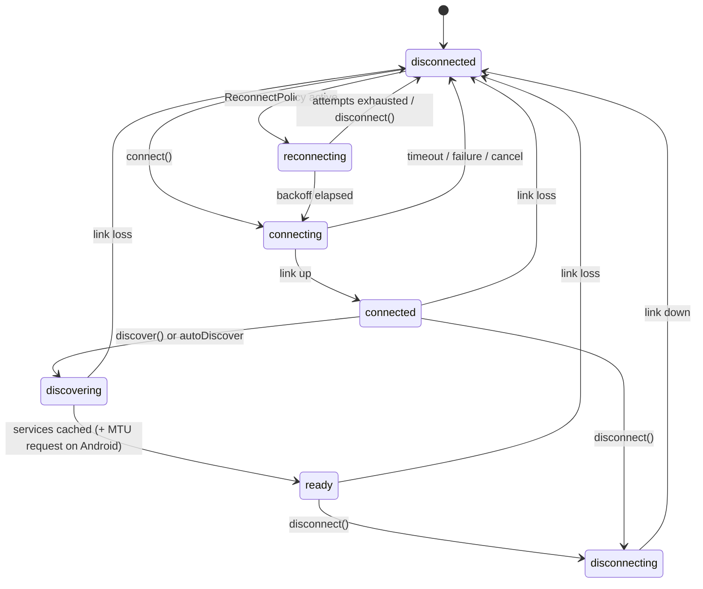

# Expo BLE (`expo-ble-kit`) — Architecture & Implementation Plan

> **Status:** Draft v0.14 · **Date:** 2026-10-02 · **Scope:** proposition #3, an Expo-first Bluetooth Low Energy module · **Changes:** Appendix D
>
> **Package name:** `expo-ble-kit` (D0a, decided 2026-10-02) · native module `ExpoBleKit` · Android package `expo.modules.blekit`.
>
> **Platform baseline:** Expo SDK 57 stable (RN 0.86) · SDK 58 in beta (RN 0.88 RC, Expo Modules 2.0 beta, iOS 27 scene life cycle).
>
> **Repo state (2026-10-02):** P0-03 scaffold on Expo SDK 57 stable. Stable releases only, on every branch (ADR-011); the repo moves to SDK 58 once it is released as stable.

---

## 0. How to use this document (agents: read this first)

- **Read order:** §0 → §3 Decisions → §4 Architecture → §5 Public API → your phase in §7 → Appendix B (rules). Read §4.14 and §10 before touching background or lifecycle code.
- **Normative language:** MUST, MUST NOT, SHOULD, MAY (RFC 2119 meaning).
- **Tasks:** IDs are `P<phase>-<nn>`. Each task lists dependencies and acceptance criteria. Do not start a task whose dependencies are not done.
- **Gates:** `[GATE Dx]` marks a human decision. Stop and ask. Never decide a gate silently.
- **Verify flags:** `⚠️ VERIFY` marks platform facts that must be confirmed against official Apple / Android / Expo docs before implementation. Put the source link in the PR and update this file.
- **Source of truth:** this file. If code has to diverge from it, update this file in the same PR.
- **Definition of Done (every task):** code + tests (at least L1/L2, see §8) + types + docs + example app still builds on iOS and Android + changeset + CI green.
- **Suggested `AGENTS.md` entry for the repo:**

  ```md
  Before any change, read docs/ARCHITECTURE_AND_PLAN.md (§0, §3, Appendix B).
  Only work on tasks from §7 whose dependencies are done. Stop at any [GATE].
  Never weaken a rule from Appendix B to make a test pass.
  ```

---

## 1. Context and goals

### 1.1 Why this library

- There is no first-party Expo BLE module, and the community side is fragmenting instead of consolidating:
  - `react-native-ble-plx`: last release 3.5.1 (2026-02-18). Forks exist to keep it working on RN 0.86 / SDK 57. No peripheral role, bonding, beacons or Bluetooth Classic. Values are base64 strings.
  - Newer Nitro-based libraries (`react-native-ble-nitro`, `munim-bluetooth`) are young. `expo-ble` (Expo Modules, singleton API) releases rarely.
- About 16% of React Native developers use Bluetooth (State of React Native 2025, platform APIs).
- Timing is good: New Architecture only since SDK 55, Expo Modules got much faster across SDK 56–58 with 2.0 in beta, `ArrayBuffer` is first-class, and SDK 58's lifecycle changes force a clean design for background handling.

### 1.2 Goals

| ID | Goal |
|---|---|
| G1 | Expo-first: Expo Modules API + config plugin. Works in dev builds and in bare RN apps with `expo` installed |
| G2 | Complete central role: scan, connect, discover, read, write (with/without response), notify/indicate, descriptors, MTU, RSSI, multiple devices |
| G3 | Peripheral role: advertising + GATT server |
| G4 | Reliable by design: serialized per-connection operation queue, timeouts everywhere, typed errors, reconnection policies, Android GATT hygiene |
| G5 | Binary-first API: `Uint8Array` end to end, never base64 |
| G6 | Background: iOS state restoration, Android foreground service + PendingIntent scans, background events through `expo-task-manager` |
| G7 | Privacy-first onboarding: AccessorySetupKit (iOS 18+) and CompanionDeviceManager (Android) |
| G8 | Testable: public fake adapter for app tests, emulator CI with a virtual peripheral, hardware-in-the-loop suite |
| G9 | Agent-friendly: strict types, typed errors, recipes, co-located agent skill |

### 1.3 Non-goals for 1.0

- Bluetooth Classic (RFCOMM/SPP): Android-only, and iOS requires MFi. Candidate for a separate package later.
- iBeacon ranging (requires CoreLocation on iOS). Raw advertisement access, including Eddystone frames, **is** in scope.
- BLE Mesh, LE Audio / Auracast, vendor DFU/OTA protocols. We ship primitives (`writeStream`, L2CAP) that others can build these on.
- Expo Go (impossible with custom native code) and the Legacy Architecture.
- Apple platforms other than iOS/iPadOS (tvOS, macOS, visionOS, watchOS). The podspec declares iOS only.

### 1.4 Success criteria for 1.0

- Feature coverage ≥ ble-plx core + peripheral role + background restoration.
- Soak suite (§8.5) passes on the device matrix (§8.2) with zero crashes.
- Example apps: Explorer, Heart Rate, Phone-as-Peripheral, Throughput, Background.
- Migration guide and `plx-compat` layer for ble-plx users.

---

## 2. Prior art

| Project | Stack | Latest on npm (checked 2026-10-02) | Notes |
|---|---|---|---|
| `react-native-ble-plx` | classic native module | 3.5.1 (2026-02-18) | Most used. No peripheral, bonding, beacons, Classic. Base64 values. Forks patch RN 0.86 issues |
| `react-native-ble-manager` | native module | 12.5.3 (2026-09-21) | Actively released, not Expo-first |
| `react-native-ble-nitro` | Nitro Modules | 1.15.1 (2026-07-10) | Central role, config plugin |
| `munim-bluetooth` | Nitro Modules | 0.8.1 (2026-09-19) | Central + peripheral, Android Classic, L2CAP, Multipeer. Pre-1.0 |
| `expo-ble` (Daniel Reiling) | Expo Modules | 0.5.0 (2026-01-24) | Singleton API, config plugin, sparse releases. Owns the `expo-ble` name |
| `sfourdrinier/react-native-ble-plx` → "Unified BLE Manager 4.x" | ble-plx fork | — | Targets Expo SDK 57 / RN 0.86 |

**Positioning:** the boring, complete, Expo-native default. Reliability, background support, testability and docs over novelty.

**[GATE D0b] Build vs join — decided 2026-10-02: build** (ADR-012). The maintainer chose to build `expo-ble-kit` rather than join an existing effort.

---

## 3. Key decisions (ADR summaries)

| ID | Decision | Status |
|---|---|---|
| ADR-001 | Bind through the **Expo Modules API** (not Nitro, not raw TurboModules) | Accepted |
| ADR-002 | **Minimum Expo SDK 57, Expo Modules 1.0 DSL**, New Architecture only, iOS ≥ 16.4, **Android `minSdk` 26** (Android 8.0). Move to Expo Modules 2.0, one member at a time, once SDK 58 is stable and documented | Accepted 2026-10-02 (D1, after P0-04; `minSdk` 26 via Q5) |
| ADR-003 | Binary values are `Uint8Array` (JS) / `Data` (Swift) / `ByteArray` (Kotlin). No base64 anywhere in the core API | Accepted |
| ADR-004 | Object model: `BleManager` singleton + native-backed SharedObjects (`Peripheral`, `GattServer`, `L2CAPChannel`) | Accepted |
| ADR-005 | Three layers: native core (no Expo/React imports) → thin binding → TypeScript API | Accepted |
| ADR-006 | Exactly one in-flight GATT operation per connection on **both** platforms (FIFO queue + timeouts) | Accepted |
| ADR-007 | One JS event per native event by default; opt-in native batching for notifications and scan results | Accepted |
| ADR-008 | Background events go through an `expo-task-manager` consumer, backed by a native event buffer | Proposed → spike P0-05 |
| ADR-009 | License: MIT, personal ownership (github.com/sbaiahmed1), no CLA | Accepted 2026-10-02 (D2) |
| ADR-010 | Four-layer test pyramid, including a public fake adapter and a Bumble virtual peripheral | Accepted |
| ADR-011 | **Stable releases only.** Every branch, spikes included, builds against the latest stable Expo SDK (57 today) and stable packages. No beta, alpha, RC, canary or `next`-tagged versions, and no experimental or undocumented features of a stable SDK, unless the maintainer explicitly asks. The repo moves to SDK 58 when it is stable | Accepted 2026-10-02, tightened the same day |
| ADR-012 | **Build** `expo-ble-kit` as a new library instead of joining an existing effort (gate D0b) | Accepted 2026-10-02 |

**ADR-001 rationale.** Expo Modules give us everything in one package: app-lifecycle subscribers (needed to create `CBCentralManager` at launch for state restoration), config plugins, SharedObjects with events, and TaskManager interop. Performance is no longer a reason to look elsewhere: on iOS, Expo Modules 2.0 synchronous calls are 2.5–5.6× faster than the 1.0 API, and Expo's Android microbenchmarks show 2.0 faster than a TurboModule in all twelve cases. Nitro was considered and rejected for v1 because we would have to rebuild the lifecycle and plugin integration ourselves. Re-evaluate only if P2 benchmarks show the JS boundary, not the radio, is the bottleneck.

**ADR-002 / [GATE D1] rationale (decided 2026-10-02).** Expo Modules 2.0 (annotated Swift/Kotlin classes: `@ExpoModule`, `@JS`, `@Record`, `@SharedObject`, `@Event`) is beta in SDK 58 and experimental in SDK 57, so ADR-011 rules it out for now. The P0-04 spike (`docs/spikes/P0-04-binding.md`) measured the stable 1.0 DSL on a real Galaxy A52: binary data is a real `Uint8Array` in arguments, return values and event payloads (no base64), events arrive complete and in order at 10k/s, and an async call costs 0.1–0.45 ms, far below a BLE operation. So the library is built on the 1.0 DSL with SDK 57 as the minimum. Because the binding is thin (ADR-005) and both APIs can coexist in one module, moving to 2.0 later only touches the binding layer; Expo's `expo-migrate-module` agent skill can help. SDK 57 apps built with Xcode 27 need `expo-build-properties` `ios.enableSceneSupport` to launch on iOS 27 (see P0-03).

**ADR-002 Android `minSdk` 26 rationale (decided 2026-10-02).** The Android core is built on API 26+ calls: `connectGatt(…, Handler)`, PendingIntent scans, `AdvertisingSet` and `ScanResult.isConnectable()`. Supporting 24–25 would mean fallback paths and a test device for a negligible share of devices. Expo's default is 24, so the config plugin raises the app's `minSdkVersion` to 26 (§4.15), and the library declares `minSdkVersion 26` as a backstop: an app below 26 fails at manifest merge with a clear error instead of crashing at runtime.

**ADR-005 rationale.** A core with no Expo/React dependencies is unit-testable with fakes (XCTest / JVM), reusable from native or brownfield code, and survives binding API churn (1.0 → 2.0) untouched.

---

## 4. Architecture

### 4.1 Layers

```
┌──────────────────────────────────────────────────────────────────────┐
│ App (React)                                                           │
├──────────────────────────────────────────────────────────────────────┤
│ TS API  (src/)   BleManager · Peripheral · GattServer · hooks ·       │
│                  BleError · uuid · testing/ (FakeBleAdapter)          │
├──────────────────────────────────────────────────────────────────────┤
│ Binding (Expo Modules)   module · SharedObjects · events ·            │
│                          lifecycle subscribers · TaskManager consumer │
├───────────────────────────────────┬──────────────────────────────────┤
│ iOS core (Swift, no Expo/RN)      │ Android core (Kotlin, no Expo/RN) │
│ CentralEngine · ScanController ·  │ CentralEngine · ScanController ·  │
│ PeripheralSession · GattQueue ·   │ PeripheralSession · GattQueue ·   │
│ GattServer · Advertiser ·         │ GattServer · Advertiser ·         │
│ Restoration · AccessorySetup      │ BondManager · ConnectionService · │
│                                   │ BackgroundScans · Companion       │
├───────────────────────────────────┼──────────────────────────────────┤
│ CoreBluetooth · AccessorySetupKit │ android.bluetooth(.le) · CDM      │
└───────────────────────────────────┴──────────────────────────────────┘
```

Layer rules:

- The core MUST NOT import `ExpoModulesCore`, React, or any JS-runtime type. It is plain Swift/Kotlin and unit-testable without an app.
- The binding MUST NOT contain BLE logic. It only marshals values, manages object lifetime, converts errors and forwards events.
- The TS layer MUST NOT re-implement queueing or timeouts. It validates input, normalizes UUIDs, applies defaults and shapes the API.

### 4.2 Repository layout

```
expo-ble-kit/
├── AGENTS.md                         # points agents to docs/ARCHITECTURE_AND_PLAN.md
├── docs/
│   ├── ARCHITECTURE_AND_PLAN.md      # this file
│   ├── spikes/                       # P0 spike reports (one file per spike)
│   └── guides/                       # getting-started, permissions, bare-setup, background, migration-from-plx
├── package.json                      # `exports` map: `.`, `./testing`, `./app.plugin.js`, `./package.json` (§4.6)
├── app.plugin.js                     # re-exports plugin/build
├── expo-module.config.json · tsconfig.json
├── src/
│   ├── index.ts                      # public exports only (§5)
│   ├── BleManager.ts  Peripheral.ts  GattServer.ts  Advertiser.ts  L2CAPChannel.ts
│   ├── hooks/                        # useBleState, useBlePermissions, useScan, usePeripheral, useCharacteristicValue
│   ├── errors.ts  uuid.ts  constants.ts  types.ts  permissions.ts  background.ts
│   ├── internal/port.ts              # NativeBleKitPort interface (real module + fake implement it)
│   ├── internal/native.ts            # requireNativeModule('ExpoBleKit')
│   ├── testing/                      # public entry `expo-ble-kit/testing`: FakeBleAdapter, VirtualPeripheral
│   └── compat/plx/                   # P6: ble-plx compatibility layer
├── plugin/src/                       # config plugin: index.ts, ios.ts, android.ts, schema.ts
├── ios/
│   ├── Core/                         # CentralEngine, ScanController, PeripheralSession, GattQueue,
│   │                                 # GattServer, Advertiser, L2CAP, Restoration, AccessorySetup,
│   │                                 # Errors, UUIDs, Logging, CBAbstractions
│   ├── Binding/                      # ExpoBleKitModule, PeripheralObject, GattServerObject,
│   │                                 # AppLifecycleSubscriber, TaskConsumer
│   └── Tests/                        # XCTest with fake CB implementations. Excluded from the pod's
│                                     # source_files; run via a podspec test_spec or a SwiftPM
│                                     # package over Core/ (chosen in P1-01)
├── android/src/main/java/expo/modules/blekit/
│   ├── core/                         # CentralEngine, ScanController, PeripheralSession, GattQueue,
│   │                                 # GattServer, Advertiser, L2cap, BondManager, ConnectionService,
│   │                                 # BackgroundScans, Companion, Errors, Uuids, Log, BtAbstractions
│   └── binding/                      # ExpoBleKitModule, PeripheralObject, GattServerObject,
│                                     # LifecycleListener, TaskConsumer, ScanResultReceiver
├── android/src/test/                 # JVM unit tests with fakes
├── example/                          # Expo app: Explorer, HeartRate, PhoneAsPeripheral, Throughput, Background.
│                                     # Uses CNG: example/ios and example/android are gitignored and
│                                     # generated by `expo prebuild`, so every build exercises the plugin
├── test-peripherals/
│   ├── profile.json                  # the test GATT profile (§8.3), single source for all test peripherals
│   ├── bumble/                       # Python virtual peripheral for the Android emulator (netsim)
│   └── zephyr/                       # nRF52840 firmware implementing the same profile
├── e2e/maestro/                      # E2E flows for the example app
└── skills/                           # co-located agent skill (P6) ⚠️ VERIFY Expo convention
```

### 4.3 iOS core

| Component | Responsibility |
|---|---|
| `CentralEngine` | Owns one `CBCentralManager` on a private serial queue `expo.blekit.central`. Publishes adapter state. Owns `ScanController` and `[UUID: PeripheralSession]`. Created **lazily** (creating it can trigger the permission prompt), except when restoration is enabled **and** `CBManager.authorization == .allowedAlways` |
| `ScanController` | `scanForPeripherals(withServices:options:)`, advertisement parsing into `ScanResult`, name/manufacturer filtering in the core (CoreBluetooth only filters by service). CoreBluetooth runs one scan at a time (a new call replaces the previous one), so the controller multiplexes JS scan sessions (§5.3) |
| `PeripheralSession` | Wraps `CBPeripheral` and its delegate. Connection state machine (§4.8), `GattQueue`, discovery cache, subscription registry, write-without-response flow control (`canSendWriteWithoutResponse`, `peripheralIsReady(toSendWriteWithoutResponse:)`), `maximumWriteValueLength(for:)` |
| `GattQueue` | Generic serial operation queue (§4.9) |
| `Advertiser`, `GattServer` | One `CBPeripheralManager` on queue `expo.blekit.peripheral`. Service publication, read/write requests, `updateValue` with `peripheralManagerIsReady(toUpdateSubscribers:)` flow control |
| `Restoration` | `willRestoreState` for both managers. Rehydrates sessions and re-arms subscriptions natively. Buffers events until the binding attaches |
| `AccessorySetup` (iOS 18+) | `ASAccessorySession` lifecycle, picker presentation, mapping authorized accessories to peripherals. Opt-in only (see §10) |
| `CBAbstractions` | Protocols over CoreBluetooth types (`CentralManaging`, `PeripheralLike`, `PeripheralManaging`) so XCTest can inject fakes |

iOS platform rules:

- Creating a CoreBluetooth manager without `NSBluetoothAlwaysUsageDescription` in Info.plist crashes the app. Check for the key before creating any manager and reject with `MISCONFIGURED` instead.
- There is no MTU API. Report `mtu = maximumWriteValueLength(for: .withoutResponse) + 3`.
- Bonding is implicit: it is triggered when an encrypted attribute is accessed. There is no `createBond` on iOS.
- A pending `connect` never times out on its own. Our connect timeout MUST call `cancelPeripheralConnection`.
- On iOS 17+, use the auto-reconnect connect option and the `isReconnecting` disconnect callback ⚠️ VERIFY.
- Background scanning requires service UUID filters, and duplicates are coalesced. Background advertising drops the local name and moves service UUIDs to the overflow area.
- Apps the user force-quit are not relaunched for state restoration. Document this.

### 4.4 Android core

`minSdk` is 26 (ADR-002), so the API 26+ calls below need no fallbacks. Anything newer than API 26 is feature-detected at runtime.

| Component | Responsibility |
|---|---|
| `CentralEngine` | `BluetoothManager` / `BluetoothAdapter`. Adapter state via `ACTION_STATE_CHANGED`. One `HandlerThread` named `blekit-gatt`, plus a coroutine dispatcher built from its `Handler` |
| `ScanController` | `BluetoothLeScanner` with `ScanFilter` / `ScanSettings`. Multiplexes JS scan sessions (§5.3). Scan-start throttle guard (about 5 starts per 30 s per app ⚠️ VERIFY): sliding window, delay restarts, emit `SCAN_THROTTLED` warning. Unfiltered scans pause when the screen is off (Android 8.1+), so docs recommend filters. Android 7+ silently downgrades a scan running longer than about 30 minutes to opportunistic ⚠️ VERIFY, so long-running scans restart before that limit (each restart counts against the throttle window) |
| `PeripheralSession` | `connectGatt(context, autoConnect, callback, TRANSPORT_LE, phyMask, handler)` (API 26+) so every callback lands on `blekit-gatt`. State machine, `GattQueue`, API 33+ overloads (`writeCharacteristic(c, value, writeType)` returning a status, `onCharacteristicChanged(gatt, c, value)`) with legacy fallbacks, CCCD handling, `requestMtu` (≤ 517), `close()` discipline, bounded retry for status 133 |
| `BondManager` | `createBond()`, `ACTION_BOND_STATE_CHANGED` receiver, bond state per device. Never auto-confirms pairing |
| `Advertiser` | `BluetoothLeAdvertiser` and `AdvertisingSet` (extended advertising when `isLeExtendedAdvertisingSupported`) |
| `GattServer` | `BluetoothGattServer`, request handling, `notifyCharacteristicChanged` gated by `onNotificationSent` |
| `ConnectionService` | Foreground service of type `connectedDevice` (Android 14+ also needs `FOREGROUND_SERVICE_CONNECTED_DEVICE`). Runs while at least one session has `keepAliveInBackground`. Android 12+ refuses foreground-service starts from the background (exemptions exist, e.g. apps with a CompanionDeviceManager association ⚠️ VERIFY), so the service starts when a `keepAliveInBackground` connect is issued while the app is in the foreground. It then stays up through link loss and reconnects until the last such session ends, and never needs a restart from the background. If a start is refused, emit a `warning` and continue without keep-alive |
| `BackgroundScans` | `startScan(filters, settings, PendingIntent)` (API 26+) → `ScanResultReceiver` → TaskManager. Works even when the process is dead |
| `Companion` | `CompanionDeviceManager` association (system picker) and device presence observation ⚠️ VERIFY API levels (31 / 33 / 36 differ) |
| `BtAbstractions` | Interfaces over adapter, scanner, GATT client and GATT server for JVM unit tests |

### 4.5 Binding layer

- Module `ExpoBleKit`: manager functions plus module-level events `stateChange`, `scanResults`, `restoration`, `bondStateChange`, `warning`, `log`.
- SharedObjects:
  - `PeripheralObject`, with events `connectionStateChange`, `notification` / `notificationBatch`, `mtuChange`, `servicesChanged`.
  - `GattServerObject`, with events `readRequest`, `writeRequest`, `subscriptionChange`.
  - `L2CAPChannelObject`, with events `data`, `close`.
- Identity: the binding keeps an `id → weak SharedObject` map, so one native peripheral always maps to the same JS object.
- Errors: core errors become coded exceptions carrying `code` (§4.11) plus `nativeDomain`, `nativeCode`, `gattStatus`.
- Lifecycle: an iOS app-delegate subscriber (declared in `expo-module.config.json`) creates engines early when restoration is enabled. An Android application lifecycle listener wires receivers and the service. Under SDK 58's scene life cycle, Expo forwards app-delegate events to subscribers; the background relaunch path is confirmed in spike P0-05.
- TaskManager consumer for headless background delivery on both platforms ⚠️ VERIFY that third-party consumers are supported on the target SDK (the interfaces live in `expo-modules-core`).

### 4.6 TypeScript layer

- The public surface is exactly §5, exported from `src/index.ts`. Everything else is internal.
- An internal port interface, `NativeBleKitPort`, is implemented by the real native module and by `FakeBleAdapter`. Tests inject the fake through the public `expo-ble-kit/testing` entry.
- `src/internal/native.ts` resolves the native module lazily, on first use, with `requireOptionalNativeModule`. It also exposes an internal setter that `installFakeBle` uses. So importing `expo-ble-kit` in Jest, where no native module exists, doesn't throw.
- `package.json` declares an `exports` map (`.`, `./testing`, `./app.plugin.js`, `./package.json`) so that `expo-ble-kit/testing` resolves in Metro, Jest and TypeScript.
- Web: until D3 is decided, the web build exports the same API with `state === 'unsupported'`, and every call rejects with `NOT_SUPPORTED`.
- The TS layer owns UUID normalization, option defaults, the `BleError` class, hooks (built on `useSyncExternalStore`) and `AbortSignal` wiring. Input validation failures reject with `INVALID_ARGUMENT`.

### 4.7 Threading model

| Concern | iOS | Android | Rule |
|---|---|---|---|
| BLE callbacks and core state | Serial queues `expo.blekit.central` / `expo.blekit.peripheral` | `HandlerThread` `blekit-gatt` (+ `blekit-server`) | All core state is confined to these threads |
| Calls from JS | Hop onto the BLE queue | Hop onto the BLE thread | Never touch CoreBluetooth / `BluetoothGatt` objects anywhere else |
| Synchronous reads from JS (`BleManager.state`, `Peripheral.state` / `name` / `mtu` / `services`) | Immutable snapshot | Immutable snapshot | The BLE thread publishes a new snapshot atomically (lock or atomic reference) after every change. Getters read the latest snapshot and never block on the BLE queue |
| Promise settlement, events | From the BLE queue | From the BLE thread | Allowed; Expo marshals them to JS |
| Main thread | Never used | Never used (except where Android requires it to start a foreground service) | Nothing blocks the UI |

### 4.8 State machines

**Adapter state (JS):** `unknown | resetting | unsupported | unauthorized | poweredOff | poweredOn`.
iOS maps `CBManagerState` one to one. Android: `STATE_OFF` → `poweredOff`, `STATE_TURNING_ON` / `STATE_TURNING_OFF` → `resetting`, `STATE_ON` → `poweredOn`, missing runtime permission → `unauthorized`, no adapter or no LE → `unsupported`.

**Connection (per `PeripheralSession`):**



The JS-visible `ConnectionState` maps the native states as follows:

| Native | JS |
|---|---|
| `connecting`, `connected`, `discovering` | `connecting` |
| `ready` | `connected` |
| `disconnecting` | `disconnecting` |
| `disconnected` | `disconnected` |
| `reconnecting` (including iOS system auto-reconnect, `isReconnecting == true`) | `reconnecting` |

`ready` means the link is up and post-connect setup is done: discovery (when `autoDiscover`), the Android MTU request and subscription restore. With `autoDiscover: false`, `ready` follows link-up directly. JS sees `connected` and `connect()` resolves at the same moment, so an op issued from a `connected` listener never races the discovery cache, including after a reconnect.

Invariants:

- Entering `disconnected` rejects every queued and in-flight op with `DISCONNECTED`, marks subscriptions inactive and, on Android, calls `gatt.close()` exactly once.
- `reconnecting` is only reachable when a `ReconnectPolicy` is set. Calling `disconnect()` from JS cancels it.
- With `restoreSubscriptionsOnReconnect`, CCCDs are re-enabled natively before `connect()` resolves or the reconnected event fires.

### 4.9 GATT operation queue

- One FIFO per `PeripheralSession`, exactly one op in flight.
- Op kinds: discover (services, characteristics, descriptors), read, write with response, write without response, descriptor read/write (including CCCD), set notify/indicate, read RSSI, request MTU, connection priority, PHY, bond.
- **Timeouts:** default 10 s per op, configurable globally and per call. On Android, two consecutive timeouts force a disconnect + `close()` (configurable).
- **Cancellation:** `AbortSignal` removes queued ops. An in-flight op can't be aborted at the radio, so its result is discarded and its promise rejects with `OPERATION_CANCELLED`.
- **Write without response** (no acknowledgement from the peer): on iOS, wait for `canSendWriteWithoutResponse`. On Android 33+, honor the status returned by `writeCharacteristic` (busy → retry after the next write callback or a short delay). Older Android: pace on `onCharacteristicWrite` ⚠️ VERIFY legacy semantics.
- **Long values:** writes with response larger than MTU − 3 rely on the platform's long-write support, up to the 512-byte ATT maximum ⚠️ VERIFY on both platforms. Larger payloads use `writeStream()` (chunked, flow-controlled, progress callback, abortable).
- **Ordering:** for a given peripheral, completion order equals submission order. There is no ordering across peripherals.

### 4.10 Events and batching

- Default: one JS event per native event.
- Notifications: `subscribeBatched(..., { intervalMs, maxItems })` coalesces natively into `{ values: Uint8Array[]; timestamps: number[]; dropped: number }`. Each timestamp is captured natively when the event arrives, so timing survives batching.
- **Timestamps** (`ScanResult.timestamp`, notification timestamps, `LogEntry.timestamp`) are milliseconds since the Unix epoch, comparable with `Date.now()` on both platforms. They are computed as the engine-start wall-clock time plus monotonic elapsed time, so they never go backwards within a process.
- Scan results: `reportIntervalMs` batches results and de-duplicates per device within each window.
- Overflow: a bounded buffer per subscription (default 4096 items). Policy is drop-oldest, with a `dropped` count and a `warning` event. A radio can't be back-pressured, so JS must keep up or batch.

### 4.11 Error model

```ts
export class BleError extends Error {
  code: BleErrorCode;
  retryable: boolean;
  platform: 'ios' | 'android' | 'web';
  peripheralId?: string;
  serviceUUID?: string;
  characteristicUUID?: string;
  nativeDomain?: string;  // e.g. CBErrorDomain, CBATTErrorDomain, android.bluetooth
  nativeCode?: number;
  gattStatus?: number;    // Android GATT/HCI status when relevant
}
```

| `BleErrorCode` | When | Retryable |
|---|---|---|
| `BLUETOOTH_UNSUPPORTED` | No BLE hardware | No |
| `BLUETOOTH_UNAUTHORIZED` | Bluetooth permission denied or restricted | No |
| `BLUETOOTH_POWERED_OFF` | Adapter is off | After user action |
| `BLUETOOTH_RESETTING` | Stack is resetting | Yes |
| `PERMISSION_DENIED` | A specific runtime permission is missing (Android) | No |
| `MISCONFIGURED` | A required Info.plist key, manifest permission, component or background mode is not declared. The message names the missing entry and links the setup guide | No |
| `INVALID_ARGUMENT` | Input rejected by validation: malformed UUID, out-of-range MTU or chunk size, conflicting options | No |
| `SCAN_FAILED` | Scanner error (Android scan failure codes) | Depends |
| `SCAN_THROTTLED` | Android scan-start limit reached | Yes, later |
| `PERIPHERAL_NOT_FOUND` | Unknown id, or not retrievable (iOS only; Android can't detect unknown addresses, see §4.12) | No |
| `CONNECTION_FAILED` | Link could not be established (includes Android 133) | Yes |
| `CONNECTION_TIMEOUT` | Our connect timeout fired | Yes |
| `DISCONNECTED` | Link lost, or disconnected while an op was pending | Depends |
| `OPERATION_TIMEOUT` | Per-op timeout fired | Yes |
| `OPERATION_CANCELLED` | `AbortSignal` or `disconnect()` | No |
| `SERVICE_NOT_FOUND`, `CHARACTERISTIC_NOT_FOUND`, `DESCRIPTOR_NOT_FOUND` | Not in the discovery cache | No |
| `NOT_SUPPORTED` | The property or platform doesn't support this op | No |
| `READ_NOT_PERMITTED`, `WRITE_NOT_PERMITTED` | ATT permission errors | No |
| `INSUFFICIENT_AUTHENTICATION`, `INSUFFICIENT_ENCRYPTION`, `INSUFFICIENT_AUTHORIZATION` | ATT security errors | After bonding |
| `INVALID_ATTRIBUTE_LENGTH`, `INVALID_OFFSET` | ATT value errors | No |
| `CONGESTED` | Android connection congested | Yes, with backoff |
| `GATT_ERROR` | Any other ATT/GATT status (see `gattStatus`) | Maybe |
| `BOND_FAILED` | Bonding failed or was rejected | Maybe |
| `ADVERTISING_FAILED` | Advertiser error (reason included) | Depends |
| `L2CAP_FAILED` | Channel open or I/O error | Maybe |
| `INTERNAL` | A bug. Include `getDiagnostics()` output in reports | No |

Mapping: Android statuses in Appendix A. iOS maps `CBError` / `CBATTError` codes to the closest code ⚠️ VERIFY the full list.

### 4.12 Identifiers and UUIDs

- `Peripheral.id` is opaque. iOS: `CBPeripheral.identifier`, a per-app UUID, not a MAC address. Android: the device address, which may be a random private address. IDs MUST NOT be compared across platforms.
- Reconnect by id: iOS `retrievePeripherals(withIdentifiers:)`, Android `BluetoothAdapter.getRemoteDevice(address)`.
- Android caveats:
  - `getRemoteDevice(address)` never fails and assumes a public address, so unknown ids can't be detected up front.
  - The core remembers the address type of every device seen in a scan during the current process. When it knows the type, it uses `getRemoteLeDevice(address, addressType)` (API 33+) ⚠️ VERIFY.
  - Connecting by address to a random-static device not scanned in this process may fail with `CONNECTION_FAILED` or `CONNECTION_TIMEOUT`. Docs recommend a short `scanFor` before reconnecting by a stored id.
- UUID inputs may be 16-bit (`'180d'` or `0x180d`), 32-bit or 128-bit. Outputs are always lowercase 128-bit (`0000180d-0000-1000-8000-00805f9b34fb`). Compare normalized values only. Ship constants for common Bluetooth SIG services and characteristics.

### 4.13 Permissions

| Platform / API level | Needed for | Declarations / runtime permissions | Notes |
|---|---|---|---|
| iOS | Any CoreBluetooth use | `NSBluetoothAlwaysUsageDescription` | Prompt appears when the first manager is created, hence lazy creation |
| iOS | Central role in background | `UIBackgroundModes: bluetooth-central` | Opt-in via plugin |
| iOS | Peripheral role in background | `UIBackgroundModes: bluetooth-peripheral` | Opt-in via plugin |
| iOS 18+ | AccessorySetupKit | `NSAccessorySetupKitSupports` (+ Bluetooth services / names / company identifiers keys) | Opt-in. May change CoreBluetooth discovery behavior app-wide ⚠️ VERIFY |
| Android ≤ 11 (API ≤ 30) | Scan | `ACCESS_FINE_LOCATION`, plus `BLUETOOTH` / `BLUETOOTH_ADMIN` with `maxSdkVersion="30"` | Location services often must be on to get results |
| Android 10–11 (API 29–30) | Scan while the app is in the background (PendingIntent scans, scans under the foreground service) | `ACCESS_BACKGROUND_LOCATION` with `maxSdkVersion="30"`, requested at runtime after fine location | Opt-in via plugin (`android.backgroundLocation`). Google Play requires a background-location declaration ⚠️ VERIFY which background scan paths need it |
| Android 12+ (API 31+) | Scan | `BLUETOOTH_SCAN` (optionally `usesPermissionFlags="neverForLocation"`) | `neverForLocation` filters some beacon advertisements from results |
| Android 12+ | Connect, GATT, bond | `BLUETOOTH_CONNECT` | |
| Android 12+ | Advertise | `BLUETOOTH_ADVERTISE` | Opt-in via plugin |
| Android 13+ | Foreground service notification | `POST_NOTIFICATIONS` | Only if the foreground service is enabled |
| Android 14+ | Foreground service | `FOREGROUND_SERVICE`, `FOREGROUND_SERVICE_CONNECTED_DEVICE`, service type `connectedDevice` | Opt-in via plugin |
| Android | CompanionDeviceManager | Feature/permission declarations per API level ⚠️ VERIFY | Opt-in via plugin |

Runtime API: `getPermissionsAsync()` and `requestPermissionsAsync({ scan, connect, advertise, backgroundScan })`. On iOS, "request" means creating the manager (prompts once); the status comes from `CBManager.authorization`. `backgroundScan` only differs from `scan` on Android 10–11. Elsewhere it mirrors `scan`; iOS background scanning needs the background mode, not a permission.

### 4.14 Background and lifecycle

**iOS**

1. The plugin adds `UIBackgroundModes` (`bluetooth-central` and/or `bluetooth-peripheral`) only when configured.
2. With `ios.restoreIdentifier` set, the system may relaunch the app for BLE events. The app-delegate subscriber creates engines at launch, but only if Bluetooth is already authorized → `willRestoreState` → sessions rehydrated, subscriptions re-armed natively, events buffered.
3. Delivery: buffered events flush to JS through the `restoration` event once the runtime is ready, or to the registered TaskManager task when the app runs headless.
4. Pending connects persist in the background. Use them for "connect when in range" via `connect({ timeoutMs: null })` (the explicit exception to Appendix B rule 4).
5. **Spike P0-05:** confirm exactly what runs on a background relaunch under SDK 58's scene life cycle, where no scene connects: is the subscriber called, does the JS runtime start, does the TaskManager path work?

**Android**

1. Long-lived background connections: `ConnectionService` (foreground service type `connectedDevice`), started and stopped automatically based on sessions with `keepAliveInBackground`. It must be started while the app is in the foreground (§4.4). Notification content comes from plugin defaults or JS.
2. Background discovery without a foreground service: PendingIntent scans → receiver → TaskManager task (headless JS).
3. Companion presence (CompanionDeviceManager) → service → TaskManager task.
4. Document OEM battery management (Doze, app standby, vendor-specific killers) and cover it in the device matrix.

**JS side:** `BleManager.registerBackgroundTask(taskName, options)` plus `TaskManager.defineTask(taskName, ...)` at module scope. TaskManager requires module-scope definitions because no components are mounted when the app is launched in the background.

### 4.15 Config plugin

```ts
export type ExpoBleKitPluginProps = {
  /** iOS NSBluetoothAlwaysUsageDescription. `false` skips it (only for apps that set it elsewhere). */
  bluetoothAlwaysPermission?: string | false;
  ios?: {
    backgroundModes?: Array<'central' | 'peripheral'>;
    /** Enables CoreBluetooth state preservation/restoration. */
    restoreIdentifier?: string;
    /** iOS 18+ AccessorySetupKit. Opt-in; see §10 before enabling. */
    accessorySetupKit?: { services?: string[]; names?: string[]; companyIdentifiers?: string[] };
  };
  android?: {
    neverForLocation?: boolean;        // default true
    requireBleHardware?: boolean;      // <uses-feature android:required>, default false
    advertise?: boolean;               // adds BLUETOOTH_ADVERTISE
    foregroundService?: boolean;       // declares ConnectionService + FGS permissions
    backgroundScanReceiver?: boolean;  // declares ScanResultReceiver
    backgroundLocation?: boolean;      // ACCESS_BACKGROUND_LOCATION (maxSdkVersion 30), see §4.13
    companionDevice?: boolean;         // CompanionDeviceManager declarations
  };
};
```

Plugin rules:

- Idempotent, never duplicates entries, everything beyond the base permissions is opt-in, one snapshot test per option.
- Android `minSdk` (ADR-002): the plugin sets `android.minSdkVersion=26` in `gradle.properties` when it is absent or lower. It never lowers a higher value. Expo's autolinking reads this property into its version catalog (checked on SDK 57). Snapshot tests run with `expo-build-properties` before and after this plugin. If another plugin later writes a lower value, the library's own `minSdkVersion 26` fails the manifest merge with a clear error.
- Legacy permissions use `maxSdkVersion`, but the plugin never adds `maxSdkVersion` to a permission that is already declared without it. Otherwise an app that also uses location for other reasons (e.g. through `expo-location`) loses it on Android 12+. Snapshot tests run with `expo-location` listed both before and after this plugin, and the result must be identical in both orders ⚠️ VERIFY mod ordering.

**Bare React Native apps (G1).** The config plugin never runs in bare apps. The library's own `AndroidManifest.xml` therefore declares **no** permissions and **no** components:

- A library-declared `maxSdkVersion` would merge into the app's own location permission (see the rule above).
- A declared `connectedDevice` foreground service would make every app justify an unused service type in Play Console ⚠️ VERIFY.

Bare apps follow `docs/guides/bare-setup.md`, which lists exactly the entries the plugin writes, including `minSdkVersion 26`; a test keeps the guide and the plugin in sync. At runtime the core checks declarations before first use, so a missing entry rejects with `MISCONFIGURED` instead of crashing or failing silently:

- Android: the requested permissions from `PackageManager`, plus the service and receiver components.
- iOS: the Info.plist keys and `UIBackgroundModes`.

### 4.16 Logging and diagnostics

- Levels: `none | error | warn | info | debug | verbose`. Native logs go to `os.Logger` (subsystem `expo.blekit`) and Logcat (tag `BleKit`). An optional JS log handler is available through `BleManager.setLogHandler`.
- Every GATT op gets an id. Debug logs include op id, peripheral, op kind, duration and status.
- `BleManager.getDiagnostics()` returns adapter state, permissions, sessions and their queue depths, active subscriptions and a ring buffer of the last 100 errors.

---

## 5. Public API (v1 specification)

This section is the contract. Changing it requires updating `src/types.ts`, docs and tests in the same PR (Appendix B, rule 8).

### 5.1 Common types

```ts
export type UUID = string; // inputs: 16/32/128-bit, outputs: lowercase 128-bit
export type BleState = 'unknown' | 'resetting' | 'unsupported' | 'unauthorized' | 'poweredOff' | 'poweredOn';
export type PermissionStatus = 'granted' | 'denied' | 'undetermined';
/** See §4.8 for how native states map onto these. `connected` means ready for GATT ops. */
export type ConnectionState = 'disconnected' | 'connecting' | 'connected' | 'disconnecting' | 'reconnecting';
export type Phy = 'le1m' | 'le2m' | 'leCoded';
export type LogLevel = 'none' | 'error' | 'warn' | 'info' | 'debug' | 'verbose';

/** Removes a JS listener. Synchronous, no I/O, never fails. */
export interface Subscription { remove(): void }
export interface OpOptions { timeoutMs?: number; signal?: AbortSignal }
export interface BlePermissions {
  scan: PermissionStatus;
  connect: PermissionStatus;
  advertise: PermissionStatus;
  /** Android 10–11: ACCESS_BACKGROUND_LOCATION. Elsewhere mirrors `scan`. */
  backgroundScan: PermissionStatus;
  canAskAgain: boolean;
}
export interface BlePermissionRequest { scan?: boolean; connect?: boolean; advertise?: boolean; backgroundScan?: boolean }
```

### 5.2 Manager (module singleton)

```ts
export interface BleManagerApi {
  readonly state: BleState;
  addStateListener(listener: (state: BleState) => void): Subscription;

  getPermissionsAsync(): Promise<BlePermissions>;
  requestPermissionsAsync(request?: BlePermissionRequest): Promise<BlePermissions>;

  /** Sessions may overlap; the core multiplexes them (§5.3). */
  startScan(options: ScanOptions, onResults: (results: ScanResult[]) => void, onError?: (error: BleError) => void): ScanSession;
  /** Scans until the first match or the timeout. Resolves null on timeout. */
  scanFor(options: ScanOptions & { timeoutMs: number; match?: (r: ScanResult) => boolean; signal?: AbortSignal }): Promise<ScanResult | null>;

  /**
   * No I/O. Returns the cached native-backed object for this id (same object for the same id).
   * Never touches CoreBluetooth and never creates a manager (no permission prompt). The native
   * peripheral is resolved on the first async call, which rejects with PERIPHERAL_NOT_FOUND
   * when iOS can't retrieve the id.
   */
  getPeripheral(id: string): Peripheral;
  /** iOS: retrievePeripherals(withIdentifiers:), drops unknown ids. Android: getRemoteDevice(address), never drops ids (§4.12). */
  getKnownPeripherals(ids: string[]): Promise<Peripheral[]>;
  /** Peripherals connected at the OS level, possibly by another app. */
  getSystemConnectedPeripherals(services: UUID[]): Promise<Peripheral[]>;

  // Peripheral role (P4)
  openGattServer(services: ServiceDefinition[]): Promise<GattServer>;
  startAdvertising(data: AdvertisingData, options?: AdvertisingOptions): Promise<Advertisement>;

  // Background (P3)
  registerBackgroundTask(taskName: string, options: BackgroundTaskOptions): Promise<void>;
  unregisterBackgroundTask(taskName: string): Promise<void>;

  // Onboarding (P5)
  readonly ios: { showAccessoryPicker(items: AccessoryPickerItem[]): Promise<Peripheral | null> };
  readonly android: {
    associateCompanionDevice(filter: CompanionDeviceFilter): Promise<Peripheral | null>;
    isLocationServicesEnabled(): Promise<boolean>; // matters on API <= 30
  };

  setLogLevel(level: LogLevel): void;
  setLogHandler(handler: ((entry: LogEntry) => void) | null): void;
  getDiagnostics(): Promise<Diagnostics>;
}

export declare const BleManager: BleManagerApi;
```

### 5.3 Scanning

```ts
export interface ScanOptions {
  /** Strongly recommended. Required for background scanning on iOS. */
  services?: UUID[];
  allowDuplicates?: boolean;      // default false
  /** Batch window for onResults in ms. 0 = deliver immediately (default). */
  reportIntervalMs?: number;
  namePrefix?: string;
  manufacturerData?: Array<{ companyId: number; data?: Uint8Array; mask?: Uint8Array }>;
  android?: {
    scanMode?: 'opportunistic' | 'lowPower' | 'balanced' | 'lowLatency'; // default 'balanced'
    callbackType?: 'allMatches' | 'firstMatch' | 'matchLost';
    matchMode?: 'aggressive' | 'sticky';
    legacy?: boolean;             // default true
    phy?: 'le1m' | 'leCoded' | 'all';
    reportDelayMs?: number;       // hardware batching
  };
  ios?: { solicitedServices?: UUID[] };
}

export interface ScanResult {
  id: string;
  name: string | null;
  rssi: number;
  txPowerLevel: number | null;
  isConnectable: boolean | null;
  serviceUUIDs: UUID[];
  serviceData: Record<UUID, Uint8Array>;
  manufacturerData: Record<number, Uint8Array>; // key = Bluetooth SIG company id
  /** Raw advertising + scan response bytes. Android only; null on iOS. */
  rawAdvertisement: Uint8Array | null;
  timestamp: number;
}

export interface ScanSession { readonly active: boolean; stop(): void }
```

**Overlapping scan sessions** (e.g. two components using `useScan`) are multiplexed in the core:

- One platform scan runs at a time, using the union of all active sessions' filters. Any unfiltered session makes the platform scan unfiltered.
- Results are filtered per session before delivery, so each session only sees its own matches.
- Settings that can't be merged use the most demanding active value: `allowDuplicates` is true if any session asks for it, and `android.scanMode` takes the highest duty cycle.
- Starting or stopping a session restarts the platform scan with the new union. On Android, restarts are debounced because they count against the throttle window.
- Stopping one session never stops another.

### 5.4 Peripheral (central role)

```ts
export interface ConnectOptions extends Omit<OpOptions, 'timeoutMs'> {
  /**
   * Default 15000. `null` = no timeout: the connect stays pending until the device appears
   * ("connect when in range": iOS pending connect, Android autoConnect). It is still cancelled by
   * disconnect() or `signal`. This is the only exception to Appendix B rule 4.
   */
  timeoutMs?: number | null;
  autoDiscover?: boolean;                    // default true
  reconnect?: ReconnectPolicy | false;       // default false
  restoreSubscriptionsOnReconnect?: boolean; // default true when reconnect is set
  keepAliveInBackground?: boolean;           // Android: foreground service (P3). iOS: needs the background mode
  android?: { autoConnect?: boolean; requestMtu?: number | false; phy?: Phy[] }; // requestMtu default 517 (see Q3)
  ios?: { enableAutoReconnect?: boolean; notifyOnDisconnection?: boolean };
}

export interface ReconnectPolicy {
  maxAttempts?: number;    // default Infinity
  initialDelayMs?: number; // default 1000
  maxDelayMs?: number;     // default 30000
  backoff?: 'exponential' | 'fixed';
}

export interface WriteOptions extends OpOptions { withResponse?: boolean } // default true
export interface StreamOptions extends OpOptions {
  /** Default false. true = every chunk waits for the ATT acknowledgement (slower; for peripherals that require it, e.g. some DFU protocols). */
  withResponse?: boolean;
  /** Default: the maximum value length for the chosen write type (MTU − 3 on Android, maximumWriteValueLength on iOS). */
  chunkSize?: number;
  onProgress?: (sent: number, total: number) => void;
}
export interface SubscribeOptions extends OpOptions { mode?: 'auto' | 'notify' | 'indicate' } // default 'auto'
export interface BatchOptions extends SubscribeOptions { intervalMs: number; maxItems?: number }
export interface NotificationBatch { values: Uint8Array[]; timestamps: number[]; dropped: number }

/**
 * A GATT subscription. Several subscriptions to the same characteristic share one CCCD:
 * - the first enables it, removing the last disables it;
 * - batched and unbatched subscribers can share a characteristic (batching is per subscriber);
 * - a later subscriber that asks for an explicit `mode` different from the active one rejects
 *   with INVALID_ARGUMENT.
 */
export interface CharacteristicSubscription extends Subscription {
  readonly active: boolean;
  /** Stops delivery immediately. If this was the last subscriber, disables the CCCD and rejects with a coded error if that write fails. */
  unsubscribe(options?: OpOptions): Promise<void>;
  /** Fire-and-forget unsubscribe(). CCCD failures go to the `warning` event and the log. */
  remove(): void;
}

export type CharacteristicProperty =
  | 'broadcast' | 'read' | 'writeWithoutResponse' | 'write' | 'notify' | 'indicate'
  | 'authenticatedSignedWrites' | 'extendedProperties';

export interface Service { uuid: UUID; isPrimary: boolean; characteristics: Characteristic[] }
export interface Characteristic { uuid: UUID; serviceUUID: UUID; properties: CharacteristicProperty[]; descriptors: Descriptor[] }
export interface Descriptor { uuid: UUID; characteristicUUID: UUID }

export interface Peripheral {
  readonly id: string;
  readonly name: string | null;
  readonly state: ConnectionState;
  /** ATT MTU. On iOS derived from maximumWriteValueLength(.withoutResponse) + 3. */
  readonly mtu: number;
  /** Discovery cache; empty before discovery. */
  readonly services: Service[];

  connect(options?: ConnectOptions): Promise<void>;
  disconnect(): Promise<void>;
  discover(services?: UUID[], options?: OpOptions): Promise<Service[]>;

  read(service: UUID, characteristic: UUID, options?: OpOptions): Promise<Uint8Array>;
  write(service: UUID, characteristic: UUID, value: Uint8Array, options?: WriteOptions): Promise<void>;
  /** Chunked, flow-controlled write for payloads larger than one packet (without response by default). */
  writeStream(service: UUID, characteristic: UUID, data: Uint8Array, options?: StreamOptions): Promise<void>;
  readDescriptor(service: UUID, characteristic: UUID, descriptor: UUID, options?: OpOptions): Promise<Uint8Array>;
  writeDescriptor(service: UUID, characteristic: UUID, descriptor: UUID, value: Uint8Array, options?: OpOptions): Promise<void>;

  subscribe(service: UUID, characteristic: UUID,
    onValue: (value: Uint8Array, timestamp: number) => void, options?: SubscribeOptions): Promise<CharacteristicSubscription>;
  subscribeBatched(service: UUID, characteristic: UUID,
    onBatch: (batch: NotificationBatch) => void, options: BatchOptions): Promise<CharacteristicSubscription>;

  readRssi(options?: OpOptions): Promise<number>;
  /** Android: negotiates. iOS: resolves the current MTU (not negotiable). */
  requestMtu(mtu: number, options?: OpOptions): Promise<number>;

  addConnectionStateListener(listener: (state: ConnectionState, error?: BleError) => void): Subscription;
  addServicesChangedListener(listener: () => void): Subscription;

  /** Android-only. Elsewhere these reject with NOT_SUPPORTED (bondState is 'none'). */
  readonly android: {
    readonly bondState: 'none' | 'bonding' | 'bonded';
    createBond(options?: OpOptions): Promise<void>;
    requestConnectionPriority(priority: 'balanced' | 'high' | 'lowPower'): Promise<void>;
    setPreferredPhy(tx: Phy[], rx: Phy[], codedOption?: 's2' | 's8'): Promise<{ tx: Phy; rx: Phy }>;
    /** Hidden API through reflection. Unstable and opt-in; may stop working on new Android versions. */
    refreshGattCache(): Promise<boolean>;
  };

  /** P5. iOS: channel security is set by the publishing side. */
  openL2CAPChannel(psm: number, options?: OpOptions & {
    android?: { secure?: boolean }; // default true: createL2capChannel; false: createInsecureL2capChannel
  }): Promise<L2CAPChannel>;
}

export interface L2CAPChannel {
  readonly psm: number;
  /** Resolves when the OS accepted the bytes (backpressure). */
  write(data: Uint8Array): Promise<void>;
  addDataListener(listener: (data: Uint8Array) => void): Subscription;
  close(): Promise<void>;
}
```

### 5.5 Peripheral role (P4)

```ts
export type AttributePermission = 'readable' | 'writeable' | 'readEncryptionRequired' | 'writeEncryptionRequired';

export interface ServiceDefinition { uuid: UUID; primary?: boolean; characteristics: CharacteristicDefinition[] }
export interface CharacteristicDefinition {
  uuid: UUID;
  properties: CharacteristicProperty[];
  permissions: AttributePermission[];
  /** Static value. On iOS this makes the characteristic read-only and cached by the OS. */
  value?: Uint8Array;
  descriptors?: Array<{ uuid: UUID; value: Uint8Array }>;
}

export interface ReadRequest { centralId: string; characteristic: UUID; offset: number }
export interface WriteRequest { centralId: string; characteristic: UUID; offset: number; value: Uint8Array; withResponse: boolean }

export interface GattServer {
  /**
   * Must answer before the platform deadline, otherwise the core answers with an ATT error.
   * Long reads: the handler is called once per read sequence, with offset 0. The core caches the
   * returned value and answers the continuation requests (offset > 0) from that cache. A central
   * therefore never sees a value stitched together from two different handler results. A request
   * that starts at a non-zero offset with no cached value is passed to the handler with that offset.
   * ⚠️ VERIFY how each platform sequences blob reads.
   */
  onReadRequest(handler: (request: ReadRequest) => Uint8Array | Promise<Uint8Array>): Subscription;
  onWriteRequest(handler: (request: WriteRequest) => void | Promise<void>): Subscription;
  /** Flow-controlled. Resolves once queued for every target central. */
  notify(characteristic: UUID, value: Uint8Array, options?: { centrals?: string[] }): Promise<void>;
  addSubscriptionListener(listener: (e: { centralId: string; characteristic: UUID; subscribed: boolean }) => void): Subscription;
  close(): Promise<void>;
}

export interface AdvertisingData {
  localName?: string;
  serviceUUIDs?: UUID[];
  /** Android only. Ignored with a warning on iOS. */
  manufacturerData?: { companyId: number; data: Uint8Array };
  /** Android only. Ignored with a warning on iOS. */
  serviceData?: Record<UUID, Uint8Array>;
  includeTxPower?: boolean;
}
export interface AdvertisingOptions {
  connectable?: boolean; // default true
  android?: {
    mode?: 'lowPower' | 'balanced' | 'lowLatency';
    txPower?: 'ultraLow' | 'low' | 'medium' | 'high';
    extended?: boolean;
    timeoutMs?: number;
  };
}
export interface Advertisement { stop(): Promise<void> }
```

### 5.6 Background and onboarding

```ts
export type BleBackgroundEvent =
  | { type: 'restored'; peripheralIds: string[] }
  | { type: 'scanResults'; results: ScanResult[] }
  | { type: 'connectionStateChange'; peripheralId: string; state: ConnectionState }
  | { type: 'notification'; peripheralId: string; service: UUID; characteristic: UUID; value: Uint8Array; timestamp: number }
  | { type: 'devicePresence'; peripheralId: string; present: boolean };

export interface BackgroundTaskOptions {
  events: Array<BleBackgroundEvent['type']>;
  /** Android: filters for PendingIntent background scans. */
  scan?: Pick<ScanOptions, 'services' | 'manufacturerData' | 'namePrefix'>;
}

/** iOS 18+. productImage is a bundled asset. ⚠️ VERIFY picker item requirements. */
export interface AccessoryPickerItem { name: string; productImage: string; services?: UUID[]; namePrefix?: string; companyId?: number }
export interface CompanionDeviceFilter { services?: UUID[]; namePattern?: string; singleDevice?: boolean }
```

### 5.7 Hooks, utilities, errors

```ts
export function useBleState(): BleState;
export function useBlePermissions(): [BlePermissions | null, (req?: BlePermissionRequest) => Promise<BlePermissions>];
export function useScan(options: ScanOptions & { enabled?: boolean; maxResults?: number }): {
  results: ScanResult[]; isScanning: boolean; error: BleError | null; start(): void; stop(): void; clear(): void;
};
export function usePeripheral(id: string | null): { peripheral: Peripheral | null; state: ConnectionState; error: BleError | null };
export function useCharacteristicValue(peripheral: Peripheral | null, service: UUID, characteristic: UUID,
  options?: { mode?: 'subscribe' | 'read'; batchMs?: number }): { value: Uint8Array | null; error: BleError | null };

export function normalizeUUID(input: string | number): UUID;
export function uuid16(short: number): UUID;
export declare const GattServices: Readonly<Record<'HeartRate' | 'Battery' | 'DeviceInformation' | 'GenericAccess', UUID>>;
export declare const GattCharacteristics: Readonly<Record<'HeartRateMeasurement' | 'BatteryLevel' | 'ManufacturerName' | 'DeviceName', UUID>>;
export { BleError, BleErrorCode }; // §4.11

export interface LogEntry { level: LogLevel; message: string; timestamp: number; peripheralId?: string; opId?: number }
export interface Diagnostics {
  state: BleState;
  permissions: BlePermissions;
  sessions: Array<{ id: string; state: ConnectionState; queueDepth: number; subscriptions: number }>;
  recentErrors: BleError[]; // ring buffer, last 100
}
```

### 5.8 Testing entry (`expo-ble-kit/testing`)

```ts
export function installFakeBle(options?: { state?: BleState; permissions?: Partial<BlePermissions> }): FakeBle;

export interface VirtualPeripheralConfig {
  id?: string;   // generated when omitted
  name?: string;
  rssi?: number; // default -60
  services: Array<{
    uuid: UUID;
    characteristics: Array<{ uuid: UUID; properties: CharacteristicProperty[]; value?: Uint8Array }>;
  }>;
}

export interface FakeBle {
  addPeripheral(config: VirtualPeripheralConfig): VirtualPeripheral;
  setState(state: BleState): void;
  /** Make the next matching op fail with this code. */
  injectError(match: { op: string; peripheralId?: string; characteristic?: UUID }, code: BleErrorCode): void;
  reset(): void;
}

export interface VirtualPeripheral {
  readonly id: string;
  advertise(on: boolean): void;
  setValue(service: UUID, characteristic: UUID, value: Uint8Array): void;
  notify(service: UUID, characteristic: UUID, value: Uint8Array): void;
  disconnect(reason?: 'peer' | 'linkLoss'): void;
  readonly writes: ReadonlyArray<{ characteristic: UUID; value: Uint8Array; withResponse: boolean }>;
}
```

### 5.9 Usage examples

```ts
import { BleManager, GattServices, GattCharacteristics } from 'expo-ble-kit';

await BleManager.requestPermissionsAsync({ scan: true, connect: true });

const found = await BleManager.scanFor({ services: [GattServices.HeartRate], timeoutMs: 10_000 });
if (found) {
  const hrm = BleManager.getPeripheral(found.id);
  await hrm.connect({ timeoutMs: 10_000, reconnect: { maxAttempts: 5 } });

  const sub = await hrm.subscribe(GattServices.HeartRate, GattCharacteristics.HeartRateMeasurement, (v) => {
    const bpm = v[0] & 0x01 ? v[1] | (v[2] << 8) : v[1]; // flags bit 0 = 16-bit value
    console.log('bpm', bpm);
  });
  // later: sub.remove(); await hrm.disconnect();
}
```

```ts
// App-level unit test with the fake adapter (Jest)
import { installFakeBle } from 'expo-ble-kit/testing';
import { GattServices, GattCharacteristics } from 'expo-ble-kit';

const ble = installFakeBle({ state: 'poweredOn' });
const hrm = ble.addPeripheral({
  name: 'HRM',
  services: [{ uuid: GattServices.HeartRate, characteristics: [{ uuid: GattCharacteristics.HeartRateMeasurement, properties: ['notify'] }] }],
});
hrm.advertise(true);
// ...render the screen under test, then:
hrm.notify(GattServices.HeartRate, GattCharacteristics.HeartRateMeasurement, Uint8Array.of(0x00, 72));
```

---

## 6. Platform capability matrix

| Capability | iOS | Android | Web (optional, P6) |
|---|---|---|---|
| Scan with service filters | ✅ | ✅ | Picker only (`requestDevice`) |
| Scan in background | ✅ service filter required, no duplicates | ✅ via foreground service or PendingIntent | ❌ |
| Raw advertisement bytes | ❌ (parsed fields only) | ✅ | ❌ |
| Connect / GATT client | ✅ | ✅ | ✅ Chromium browsers |
| MTU negotiation | ❌ automatic | ✅ up to 517 | ❌ |
| Write-without-response flow control | ✅ | ✅ (API 33+ status codes, legacy pacing below) | Partial |
| Connection priority / PHY | ❌ | ✅ | ❌ |
| Explicit bonding | ❌ implicit | ✅ | ❌ |
| Advertise local name + service UUIDs | ✅ | ✅ | ❌ |
| Advertise manufacturer / service data | ❌ | ✅ | ❌ |
| GATT server | ✅ | ✅ | ❌ |
| L2CAP connection-oriented channels | ✅ | ✅ (API 29+) | ❌ |
| State restoration after relaunch | ✅ (not after user force-quit) | n/a: foreground service / PendingIntent / CDM instead | ❌ |
| System accessory picker | ✅ AccessorySetupKit (iOS 18+) | ✅ CompanionDeviceManager | ✅ `requestDevice` |
| Bluetooth Classic, iBeacon ranging | Out of scope | Out of scope | Out of scope |

---

## 7. Implementation plan

### 7.1 Phase overview

Estimates assume one developer with native iOS/Android experience, assisted by coding agents.

| Phase | Goal | Estimate | Exit criteria |
|---|---|---|---|
| P0 | Foundations, gates, risky spikes | 2 weeks | D0a, D0b, D1, D2 decided. Spike reports merged in `docs/spikes/` |
| P1 | Central-role MVP | 4 weeks | `0.1.0` on the `next` tag. Explorer works against Bumble and nRF52840 on iOS and Android |
| P2 | Robustness | 3 weeks | Soak suite green on the device matrix. `0.2.0` |
| P3 | Background | 3–4 weeks | Background scenarios S-B1…S-B6 pass. `0.3.0` |
| P4 | Peripheral role | 3 weeks | Two-phone suite green in all four iOS/Android combinations. `0.4.0` |
| P5 | Advanced features | 3–4 weeks | Feature tests green. `0.5.0` |
| P6 | Ecosystem and 1.0 | 2–3 weeks | §1.4 success criteria met. `1.0.0` |
| **Total** | | **≈ 20–23 weeks** | Usable MVP after ≈ 6 weeks |

Parallelism: P0-06/P0-07 can run alongside P0-03/P0-04. With two people, P4 can start after P2 in parallel with P3. P6-01 can start any time after P1.

### 7.2 P0 — Foundations and spikes

- [ ] **P0-01 Name and npm scope** `[GATE D0a]` — deps: none.
  **Decided 2026-10-02: `expo-ble-kit`** (unscoped; free on npm that day). Remaining: reserve it on npm (needs the owner's npm login).
  **Accept:** name recorded in this file's header ✅; name reserved on npm.
- [x] **P0-02 Build vs join** `[GATE D0b]` — deps: none.
  Contact the maintainers of the two most active Expo-compatible projects (§2). Assess their code against Appendix B.
  **Accept:** decision and rationale recorded in §3.
  **Decided 2026-10-02: build** (ADR-012). The maintainer decided without the maintainer conversations.
- [ ] **P0-03 Scaffold** — deps: P0-01.
  Scaffold on the latest stable SDK, 57 today (ADR-011): iOS + Android, no native view, example app, strict TypeScript, ESLint/Prettier, SwiftLint, ktlint, changesets, CI skeleton (lint, typecheck, unit tests, example builds on both platforms).
  - Findings from 2026-10-02: the module template pins stale root devDependencies (RN 0.82.1, `jest-expo` / `babel-preset-expo` 55.x) even in its SDK 58 version; only `expo` moves. The module sources are identical in the SDK 57 and 58 templates, so a later SDK bump only changes dependency versions. jest-expo 57+ also needs `@react-native/jest-preset` as a peer.
  - Yarn 4 is pinned in the repo (`.yarnrc.yml` + `.yarn/releases`, `nodeLinker: node-modules`). Its default one-day age gate rejects packages published less than 24 hours ago; use version ranges rather than disabling the gate.
  - **iOS 27:** an SDK 57 app built with Xcode 27 crashes at launch on iOS 27 (`_UIApplicationEvaluateRuntimeIssueForNoSceneLifecycleAdoption`: apps linked against the iOS 27 SDK must adopt the UIScene life cycle). **Resolved** in the example (not the library) with `expo-build-properties` → `ios.enableSceneSupport: true` (needs Expo ≥ 57.0.23; moves RN startup to Expo's scene delegate and adds the scene manifest). Remove it when `main` moves to SDK 58, which adopts scenes by default. Verified on the iOS 27 and 26.5 simulators. The getting-started docs (P1-16) must tell SDK 57 users on Xcode 27 to do the same.
  - Run `git init`. Move this file to `docs/`, add the root `AGENTS.md` from §0, and replace the template `example/AGENTS.md` (it prescribes Expo Router, which the example doesn't use).
  - Align the root devDependencies with the example's SDK: `expo`, `react-native`, `react`, `@types/react`, `jest-expo`, `babel-preset-expo`, `typescript`.
  - Set the package version to `0.0.0`. The podspec reads version, summary, author and homepage from `package.json`, declares iOS only (§1.3) and excludes `Tests/` (§4.2).
  - `android/build.gradle` sets `minSdkVersion 26` explicitly (ADR-002), and the example app builds with `android.minSdkVersion=26`.
  - Add the `exports` map and `app.plugin.js` (§4.2, §4.6). The example uses CNG (§4.2).
  **Accept:** CI green on the empty module; example app launches on both platforms; `npx expo install --check` is clean in `example/`; root and example resolve the same `react-native` version.
- [x] **P0-04 Binding spike** `[GATE D1]` — deps: P0-03.
  Stable only (ADR-011): SDK 57 and the 1.0 DSL, on both platforms. Expo Modules 2.0 is beta on SDK 58 and experimental on SDK 57, so it is out of scope until SDK 58 is stable. Implement an async `readValue` returning bytes, a `notification` event with a `Uint8Array` payload, and a `PeripheralObject` SharedObject. Measure 10k async calls, a 10k events/s burst, and binary round-trip correctness (no base64).
  **Accept:** `docs/spikes/P0-04-binding.md` with numbers and a recommendation; a human decides D1.
  **Status 2026-10-02:** report written with real-device numbers from a Galaxy A52 (Android 14): binary data is a real `Uint8Array` everywhere (arguments, return values, module and shared-object events), no events lost or reordered, async calls 0.1–0.45 ms, 10k events/s sustained. **D1 decided 2026-10-02: 1.0 DSL, minimum SDK 57** (ADR-002). The iOS real-device run was not done before deciding; it can follow when signing is set up.
- [ ] **P0-05 iOS background relaunch spike** — deps: P0-03.
  Minimal restoration prototype (`restoreIdentifier`, `bluetooth-central` mode) against a physical peripheral (nRF52840 or a second phone acting as peripheral). Simulate system termination (not a user force-quit) ⚠️ VERIFY Apple's recommended method. Answer: does the app-delegate subscriber run under SDK 58's scene life cycle? Does the JS runtime start without a scene? Can a TaskManager consumer deliver events headlessly?
  **Accept:** `docs/spikes/P0-05-ios-background.md` with findings and the chosen delivery strategy; ADR-008 updated.
- [ ] **P0-06 Android emulator BLE spike** — deps: P0-03, P0-07.
  Start the emulator with netsim enabled (emulator 37.1 starts `netsimd` by itself and writes `$TMPDIR/netsim.ini`, so no extra flag was needed in P0-07 ⚠️ VERIFY on CI runners), attach the Bumble virtual peripheral over the `android-netsim` transport, and run a test that scans, connects and reads. Add a CI job marked allowed-to-fail.
  **Accept:** green locally; the CI job runs and uploads logcat, `dumpsys bluetooth_manager` and the Bumble log.
  **Status 2026-10-02 — green locally, CI pending the first push:**
  - `e2e/android-netsim/run.sh` starts the Bumble peripheral on the emulator's netsim radio, runs the library's instrumented tests (`:expo-ble-kit:connectedDebugAndroidTest`) and collects logcat, `dumpsys bluetooth_manager`, the Bumble log and the JUnit reports.
  - `android/src/androidTest/.../l3/NetsimPeripheralTest.kt` scans by the TEST service UUID (checks name and manufacturer data), connects, requests the MTU, discovers, and reads `STATIC_READ` and the 512-byte `LONG_READ`. It uses raw Android APIs (no library core yet) and reads UUIDs and expected values from `profile.json`, which the build copies into the test APK.
  - Passed on the Android 15 (API 35) emulator image, emulator 37.1. Requesting MTU 247 still produced an ATT Exchange MTU request of 517 on the wire (see Q3).
  - `.github/workflows/nightly.yml` runs the same script on an API 35 emulator via `reactivecircus/android-emulator-runner`, `continue-on-error: true`, and uploads the artifacts. Not run yet: the GitHub repo doesn't exist.
- [x] **P0-07 Test peripheral profile** — deps: none.
  Define `test-peripherals/profile.json` (§8.3) and implement it with Bumble. The Zephyr firmware for nRF52840 can follow during P1.
  **Accept:** the Bumble peripheral is discoverable from a real phone (Bumble over a USB Bluetooth dongle) or from the emulator.
  **Done 2026-10-02:** `test-peripherals/profile.json` (UUID base `0c6c0000-b347-4cfa-9827-1c5a13658519`) and `test-peripherals/bumble/` (Bumble 0.0.219, run with `uv run blekit-peripheral`). Discovered as `BleKit-Test` from the Android emulator (Android 15 / API 35 image, emulator 37.1) over netsim. 26 hardware-free pytest tests (in-memory radio) cover every characteristic and command, and run in CI. Bumble's GATT server lacks prepared writes and service removal, so the peripheral adds both itself (see `test-peripherals/README.md`).
- [x] **P0-08 License and governance** `[GATE D2]` — deps: none.
  License, CODEOWNERS, CONTRIBUTING, SECURITY, issue templates (with a field for `getDiagnostics()` output). D2 decided 2026-10-02: MIT, personal ownership, no CLA (ADR-009).
  **Accept:** files merged.
  **Done 2026-10-02:** `LICENSE` (the template's copyright line named 650 Industries / Expo; now Ahmed Sbai, also in `example/LICENSE`), `.github/CODEOWNERS`, `CONTRIBUTING.md`, `SECURITY.md` (GitHub private vulnerability reporting, which must be enabled in the repository settings after creation), issue forms (bug report with `getDiagnostics()` and debug-log fields, feature request), a PR template carrying the §0 Definition of Done, and a short `README.md`.

### 7.3 P1 — Central-role MVP

- [x] **P1-01 Core abstractions and fakes** — deps: P0-04.
  CoreBluetooth / Android Bluetooth interfaces (§4.3, §4.4) plus fake implementations. Set up the native unit-test harnesses: iOS core tests outside the pod's sources (podspec `test_spec` or a SwiftPM package over `ios/Core`, pick one), and JVM tests under `android/src/test`. Both run in CI.
  **Accept:** at least one unit test per platform runs against the fakes, in CI.
  **Done 2026-10-02:**
  - iOS: `ios/Core/CBAbstractions.swift` (`CentralManaging`, `PeripheralLike`, `ServiceLike`, `CharacteristicLike`, `DescriptorLike`), real adapters in `CBAdapters.swift`, `Scheduling` (+ `QueueScheduler`). Fakes and a virtual-time `TestScheduler` in `ios/Tests/Fakes`. Harness: the SwiftPM package `ios/Package.swift`, run with `swift test --package-path ios` (macOS host, no simulator); it also enforces the no-Expo rule at compile time.
  - Android: `core/BtAbstractions.kt` (`BluetoothAdapterPort`, `LeScannerPort`, `RemoteDevicePort`, `GattClientPort` with plain data types, since `android.bluetooth` classes can't be created in JVM tests), real adapters in `AndroidBtAdapters.kt`, `SerialExecutor` (+ `HandlerExecutor`). Fakes and a virtual-time `ManualExecutor` in `android/src/test`. JVM tests check the mirrored constants against android.jar and fail on Expo or React imports in `core/`.
  - The template module moved to `ios/Binding` and `android/.../binding` (§4.2).
  - Scope note: the peripheral-role abstractions (`PeripheralManaging`, GATT server, advertiser) are added with P4-01, which first needs them.
  - 7 iOS and 8 Android tests pass locally; both example apps still build. CI jobs added (`ios-core-tests`, Android unit tests in `example-android`); not run yet.
- [x] **P1-02 GattQueue (iOS + Android)** — deps: P1-01.
  **Accept:** unit tests for ordering, per-op timeout, `AbortSignal` cancellation, reject-all on disconnect, and a randomized test proving no op starts while another is in flight.
  **Done 2026-10-02:** `ios/Core/GattQueue.swift` and `android/.../core/GattQueue.kt`, same semantics and the same tests on both platforms (7 each). Decisions recorded here:
  - Completions are matched to the in-flight operation by a caller-supplied predicate (kind and target); late callbacks after a timeout are ignored.
  - Cancelling the running operation answers the caller at once with `OPERATION_CANCELLED`, but the queue stays busy until the radio answers or the timeout fires (rule 2).
  - The queue counts consecutive timeouts and reports each one; the session (P1-05) applies the Android two-timeout disconnect.
  - The next operation always starts on a later turn, never re-entrantly from inside a completion.
  - The randomized test (25 seeds × 2,000 random actions) was checked against a deliberately broken queue on both platforms and fails on it.
  - `CoreError` with the full §4.11 code list was added here; the platform mapping tables remain P1-10.
- [ ] **P1-03 Adapter state and permissions** — deps: P1-01, P1-14 (the example needs the Info.plist key and manifest permissions before any manager can be created).
  Lazy iOS manager creation, Android 12+ and legacy permission paths, `getPermissionsAsync` / `requestPermissionsAsync`, `stateChange`, declaration checks (`MISCONFIGURED`, §4.15).
  **Accept:** state transitions verified by toggling Bluetooth on devices; permission flows verified on Android 11, 12 and 14, and on iOS; removing `NSBluetoothAlwaysUsageDescription` or a manifest permission yields `MISCONFIGURED`, not a crash.
- [ ] **P1-04 Scanning** — deps: P1-03.
  Filters, options, advertisement parsing, session multiplexing (§5.3), Android throttle guard and long-scan restart, `reportIntervalMs` batching, address-type memory (§4.12).
  **Accept:**
  - The test peripheral is found with and without filters, and parsed fields match `profile.json`.
  - 10 start/stop cycles within 20 s on Android produce a `SCAN_THROTTLED` warning instead of a silent failure.
  - Two concurrent sessions with different filters each receive only their own matches, and stopping one leaves the other running.
- [ ] **P1-05 Connect and disconnect** — deps: P1-02, P1-04.
  Timeouts, iOS cancel-on-timeout, Android `close()` on every path, bounded status-133 retry (max 3 attempts with backoff).
  **Accept:**
  - 100 connect/disconnect cycles without leaks (Android GATT client count stable in diagnostics).
  - Connecting to an absent device fails with `CONNECTION_TIMEOUT` within timeout + 1 s.
  - `connect({ timeoutMs: null })` stays pending until the device appears, and `disconnect()` or `signal` cancels it.
  - `connect()` resolves at the same moment the state listener sees `connected`.
- [ ] **P1-06 Discovery and cache** — deps: P1-05.
  **Accept:** full profile discovered; filtered discovery works; cache cleared on disconnect.
- [ ] **P1-07 Read, write, descriptors** — deps: P1-06.
  With and without response (basic pacing only; full flow control is P2-02). Long values up to 512 bytes.
  **Accept:** every profile characteristic read/written as its properties allow; 512-byte read and write succeed on both platforms ⚠️ VERIFY long-write behavior.
- [ ] **P1-08 Notify and indicate** — deps: P1-06.
  CCCD handling, `subscribe`, CCCD sharing across subscribers, `unsubscribe()` / `remove()`, cleanup on disconnect.
  **Accept:**
  - 20 Hz stream for 5 minutes with zero sequence gaps, and indications acknowledged.
  - No CCCD is left enabled after the last subscriber is removed (checked on the peripheral side).
  - With two subscribers on one characteristic, removing one keeps the other receiving.
  - `unsubscribe()` rejects with a coded error when the CCCD write fails.
- [ ] **P1-09 MTU and RSSI** — deps: P1-06.
  Android `requestMtu` after discovery (default per Q3; note the Android 14+ behavior in Q3), iOS-derived MTU, `readRssi`.
  **Accept:** `mtu` reflects the negotiated value; `mtuChange` fires on Android; the value requested vs. negotiated is recorded on API 33 and API 34+ devices for Q3.
- [ ] **P1-10 Error model** — deps: P1-02.
  `BleError`, codes, iOS and Android mapping tables (Appendix A).
  **Accept:** every native failure path maps to a code; unit tests cover the mapping tables.
- [ ] **P1-11 UUID utilities and constants** — deps: none.
  **Accept:** normalization tests for 16/32/128-bit inputs, numbers and mixed casing.
- [ ] **P1-13 Port and fake adapter** — deps: P1-10, P1-11.
  Define `NativeBleKitPort` (`src/internal/port.ts`) from §5; the native binding tasks implement it as they land. Add the lazy native-module resolution (§4.6), `FakeBleAdapter`, and the public `expo-ble-kit/testing` entry as specified in §5.8. Done before P1-12 so the TS API and hooks are built test-first against the fake.
  **Accept:** the `testing` entry resolves through the `exports` map in Jest and TypeScript; importing `expo-ble-kit` in Jest without a native module doesn't throw; the fake follows the same ordering and error semantics as the native core (shared contract test cases with P1-02).
- [ ] **P1-12 TS API and hooks** — deps: P1-03 … P1-10, P1-13.
  `BleManager`, `Peripheral`, `useBleState`, `useBlePermissions`, `useScan`, `usePeripheral`, `useCharacteristicValue`.
  **Accept:** exported types match §5 exactly; hooks tested with the fake adapter.
- [ ] **P1-14 Config plugin v1** — deps: P0-03.
  Base iOS/Android declarations from §4.13 and §4.15 (no background or peripheral-role options yet), the `minSdkVersion` raise, and `docs/guides/bare-setup.md`.
  **Accept:** snapshot tests, including the `expo-location` and `expo-build-properties` ordering cases (§4.15); an app left on Expo's default `minSdk` builds after adding the plugin; running `npx expo prebuild --clean` twice gives identical native projects; a test checks that the bare-setup guide lists exactly what the plugin writes.
- [ ] **P1-15 Explorer and Heart Rate examples** — deps: P1-12.
  Explorer: scan list → device → services → read / write / subscribe, with hex and UTF-8 views. Heart Rate: scan for `0x180D`, connect with a reconnect policy, live BPM.
  **Accept:** both work against Bumble (emulator) and the nRF52840 on iOS and Android devices; Maestro flows `explorer-basic.yaml` and `heart-rate.yaml` pass; example screens have Jest tests using the fake adapter.
- [ ] **P1-16 Docs v1** — deps: P1-12.
  Getting started (requirements: Expo SDK 57+, iOS 16.4+, Android 8.0 / API 26+; SDK 57 apps built with Xcode 27 need `ios.enableSceneSupport`), permissions, bare setup, API reference (TypeDoc), troubleshooting (Android 133, location services on API ≤ 30, reconnecting by id on Android (§4.12), no Bluetooth in the iOS Simulator).
  **Accept:** docs build; every public symbol is documented. Publish `0.1.0` on `next`.

### 7.4 P2 — Robustness

- [ ] **P2-01 Reconnection policies** — deps: P1-05, P1-08.
  Exponential/fixed backoff, iOS 17+ auto-reconnect, Android direct-then-`autoConnect` strategy, subscription restore, the `reconnecting` state.
  **Accept:** power-cycling the peripheral 20 times reconnects every time and notifications resume; the state listener sees `reconnecting` → `connected`; a read issued from the `connected` listener succeeds (no `CHARACTERISTIC_NOT_FOUND`).
- [ ] **P2-02 Write-without-response flow control** — deps: P1-07.
  **Accept:** 1 MB sent through repeated writes arrives complete (peripheral byte counter) on every matrix device.
- [ ] **P2-03 `writeStream()`** — deps: P2-02.
  Chunking, progress, abort.
  **Accept:** 1 MB completes; abort stops within one chunk; throughput is logged.
- [ ] **P2-04 Native notification batching** — deps: P1-08.
  Batching and the overflow policy from §4.10.
  **Accept:** 100 Hz × 20 B for 60 minutes with `intervalMs: 16` gives ≤ ~63 JS events/s and `dropped == 0`.
- [ ] **P2-05 Multiple devices** — deps: P1-05.
  **Accept:** 5+ concurrent connections (several Bumble devices or boards) with independent queues; one device dropping doesn't affect the others.
- [ ] **P2-06 Android GATT hygiene** — deps: P1-05.
  `close()` audit, service-changed handling (API 31+ callback), opt-in cache refresh.
  **Accept:** 500-cycle soak with a stable GATT client count; a service change on the peripheral invalidates the cache and emits `servicesChanged`.
- [ ] **P2-07 Logging and diagnostics** — deps: P1-10.
  **Accept:** debug logs show op id, duration and status; `getDiagnostics()` snapshot test.
- [ ] **P2-08 Throughput example and benchmarks** — deps: P2-03, P2-04.
  Minimal native reference apps (Swift and Kotlin) using the same profile.
  **Accept:** `docs/benchmarks.md`; `writeStream` and notify throughput ≥ 80% of the native reference.
- [ ] **P2-09 OEM pass and soak** — deps: P2-01 … P2-08.
  **Accept:** soak suite (§8.5) green on the matrix. Publish `0.2.0`.

### 7.5 P3 — Background

- [ ] **P3-01 iOS restoration** — deps: P0-05, P2-01.
  Background modes, central restoration, authorization-aware early creation.
  **Accept:** S-B2 passes.
- [ ] **P3-02 Event buffer and delivery** — deps: P3-01.
  Native buffer, `restoration` event, TaskManager consumer on iOS.
  **Accept:** S-B1 and S-B2 deliver events to JS in the foreground and to the task when headless, per the P0-05 strategy.
- [ ] **P3-03 Android foreground service** — deps: P2-01.
  `ConnectionService` (`connectedDevice`), notification config, `keepAliveInBackground`, foreground-only start (§4.4).
  **Accept:** S-B3 passes on Pixel, Samsung and Xiaomi; a link loss and reconnect while the app is backgrounded keeps the service running without a restart; a refused start produces a `warning`, not a crash.
- [ ] **P3-04 Android background scans** — deps: P1-04.
  PendingIntent scans, `ScanResultReceiver`, TaskManager headless delivery, `ACCESS_BACKGROUND_LOCATION` handling on API 29–30 (§4.13).
  **Accept:** S-B4 passes, including on an API 29 or 30 device with background location granted; without it, `registerBackgroundTask` rejects with `PERMISSION_DENIED` naming the missing permission.
- [ ] **P3-05 Plugin options and background guide** — deps: P3-01, P3-03, P3-04.
  Options `ios.backgroundModes: ['central']`, `ios.restoreIdentifier`, `android.foregroundService`, `android.backgroundScanReceiver`, `android.backgroundLocation`, and the matching bare-setup entries. The guide includes App Store review notes for background modes and the Google Play background-location declaration.
  **Accept:** snapshot tests; guide reviewed by a human.
- [ ] **P3-06 Background example and scenario suite** — deps: P3-02 … P3-05.
  The Background example screen hosts scenarios S-B1 … S-B6.
  **Accept:** S-B1 … S-B6 recorded per device in `docs/qa/background.md`. Publish `0.3.0`.

### 7.6 P4 — Peripheral role

- [ ] **P4-01 GATT server** — deps: P2-07.
  Definitions, static and dynamic values, read/write requests with deadlines, long reads served from a per-sequence cache (§5.5), long writes, subscriptions.
  **Accept:** nRF Connect acting as a central can read, write and subscribe against the example app; a 512-byte dynamic value read at MTU 23 returns one consistent snapshot even when the handler's value changes mid-read.
- [ ] **P4-02 Server notifications with flow control** — deps: P4-01.
  **Accept:** 100 Hz notifications from phone B to phone A for 10 minutes with zero sequence gaps.
- [ ] **P4-03 Advertiser** — deps: P4-01.
  Legacy advertising, Android extended advertising, iOS limitations surfaced as warnings. Plugin options `android.advertise` and `ios.backgroundModes: ['peripheral']`, plus the matching bare-setup entries.
  **Accept:** advertisements show the expected fields on both platforms; iOS warns on unsupported fields; plugin snapshot tests for both options.
- [ ] **P4-04 iOS peripheral restoration** — deps: P3-01, P4-01.
  **Accept:** services and advertising survive the system-relaunch scenario.
- [ ] **P4-05 Phone-as-peripheral example and two-phone suite** — deps: P4-01 … P4-03.
  **Accept:** suite green for iOS→iOS, iOS→Android, Android→iOS and Android→Android. Publish `0.4.0`.

### 7.7 P5 — Advanced features

- [ ] **P5-01 Bonding** — deps: P1-07.
  Android bonding API and events; iOS docs for implicit pairing via an encrypted characteristic.
  **Accept:** bonding through the `SECURE` characteristic works on both platforms, and `INSUFFICIENT_ENCRYPTION` / `INSUFFICIENT_AUTHENTICATION` surface correctly before bonding.
- [ ] **P5-02 Connection priority and PHY (Android)** — deps: P1-05.
  **Accept:** 2M PHY negotiated with the nRF52840; throughput difference recorded.
- [ ] **P5-03 L2CAP channels** — deps: P1-05, P4-01.
  Client channels and server publishing.
  **Accept:** 1 MB echo over L2CAP in both directions on both platforms.
- [ ] **P5-04 AccessorySetupKit (iOS 18+)** — deps: P1-12.
  Plugin keys, picker, mapping to `Peripheral`.
  **Accept:** a separate example configuration with ASK enabled; the effect on generic scanning documented ⚠️ VERIFY (see §10).
- [ ] **P5-05 CompanionDeviceManager** — deps: P3-04.
  Association and presence events delivered through TaskManager. Plugin option `android.companionDevice`, plus the matching bare-setup entries.
  **Accept:** S-B5 passes on an API 33+ device; plugin snapshot test. Publish `0.5.0`.

### 7.8 P6 — Ecosystem and 1.0

- [ ] **P6-01 `plx-compat` layer** — deps: P1-12.
  A subset of the ble-plx API (manager, device, monitor/read/write with base64) plus a migration guide.
  **Accept:** a sample ble-plx app runs after changing imports only; remaining gaps are listed in the guide.
- [ ] **P6-02 Web Bluetooth (central subset)** `[GATE D3]` — deps: P1-12.
  **Accept:** the basic Explorer flow works in desktop Chrome.
- [ ] **P6-03 Co-located agent skill and recipes** — deps: P2-09.
  Recipes: heart rate, streaming/OTA-style transfer, background reconnect. ⚠️ VERIFY Expo's convention by inspecting how `expo-sqlite` ships its skill and how `npx @expo/agent-cli skills:sync` discovers skills.
  **Accept:** the skill is installed in the example app via skills sync; an agent can implement the heart-rate recipe from the skill alone.
- [ ] **P6-04 (optional) EAS Observe integration** — deps: P2-07.
  Report BLE errors and connection metrics through `Observe.registerIntegration` ⚠️ VERIFY API.
  **Accept:** errors visible in an Observe dashboard for the example app.
- [ ] **P6-05 1.0 release** — deps: everything above except optional tasks.
  Docs site, compatibility table, release-candidate soak.
  **Accept:** §1.4 success criteria met. Publish `1.0.0`.

---

## 8. Testing and QA

### 8.1 Test layers

| Layer | What | Where it runs | Blocking? |
|---|---|---|---|
| L1 | TypeScript unit tests (Jest) with `FakeBleAdapter`: API shaping, UUIDs, errors, hooks, batching | Every PR | Yes |
| L2 | Native unit tests (XCTest, JVM) against fake CoreBluetooth / Android abstractions: queue, state machines, mapping tables | Every PR | Yes |
| L3 | Android emulator (netsim virtual radio) + Bumble virtual peripheral running the test profile | Nightly | Allowed to fail until stable |
| L4 | Hardware-in-the-loop: real phones + nRF52840 test firmware + second phone for peripheral tests, driven by Maestro | Weekly and before every release | Yes for releases |

The iOS Simulator has no Bluetooth, so iOS behavior is only verified on devices (L4). Bumble attached to the emulator's netsim radio has been used for CI elsewhere, but it is known to be fragile on hosted runners: treat L4 as the source of truth.

### 8.2 Device matrix

| Platform | Versions | Devices | Why |
|---|---|---|---|
| iOS | 16.x (floor), 26, 27 | One older iPhone on iOS 16, one current iPhone | SDK floor, current OS, newest SDK target |
| Android | API 26–30 | Any, including one device on API 26 or 27 | `minSdk` floor (ADR-002), legacy permissions, location services requirement |
| Android | API 31–33 | Pixel, Samsung | New permission model, API 33 GATT overloads |
| Android | API 34–36 | Pixel, Samsung, Xiaomi/Redmi, OnePlus/Oppo | Foreground service types, aggressive OEM battery policies |

Test peripherals: nRF52840 DK or dongle (Zephyr firmware), Bumble (emulator or USB dongle), and a second phone for peripheral-role tests.

### 8.3 Test GATT profile (`test-peripherals/profile.json`)

All custom UUIDs derive from one random 128-bit base generated in P0-07. Every streamed frame carries a uint32 little-endian sequence number so tests can detect loss.

| Characteristic | Properties | Behavior |
|---|---|---|
| `STATIC_READ` | read | Fixed 20-byte value |
| `LONG_READ` | read | 512-byte deterministic pattern |
| `ECHO_WRITE` | write | Stores the written value |
| `ECHO_READ` | read | Returns the last value written to `ECHO_WRITE` |
| `SINK_NO_RSP` | writeWithoutResponse | Counts received bytes |
| `SINK_COUNTER` | read, notify | Total bytes received by `SINK_NO_RSP` (uint32 LE) |
| `STREAM` | notify | Sequence number + payload at the rate/size set through `CONTROL`. Has a 0x2901 user-description descriptor |
| `INDICATE` | indicate | Sends sequence numbers on `CONTROL` `SEND_INDICATIONS` |
| `SECURE` | read (encryption required) | Triggers pairing |
| `L2CAP_PSM` | read | PSM of an L2CAP echo server (P5) |
| `CONTROL` | write | Commands: set stream rate/size, disconnect after N ms, toggle a secondary service (service-changed tests), reset counters, send N indications |

The standard Heart Rate service (`0x180D` / `0x2A37`) is also exposed for demos. A `SECONDARY` service appears and disappears on `CONTROL` toggles.

`test-peripherals/profile.json` holds the exact UUIDs, values, advertising data, command opcodes and error codes; `test-peripherals/README.md` summarizes them.

### 8.4 Background scenarios

| ID | Scenario | Expected |
|---|---|---|
| S-B1 | iOS app suspended while a 1 Hz notification stream continues | Events delivered (in background or on resume) with no gaps |
| S-B2 | iOS app terminated by the system, peripheral then sends a notification | App relaunched in background; `restored` + notification delivered |
| S-B3 | Android screen off for 60 minutes with the foreground service and a 10 Hz stream | Connection kept, zero sequence gaps |
| S-B4 | Android app process killed, then the peripheral starts advertising | PendingIntent scan wakes the app; the task receives `scanResults` |
| S-B5 | Android companion device comes into range | `devicePresence` delivered to the task |
| S-B6 | User force-quits the iOS app | Documented no-relaunch behavior; clean state on next manual launch |

### 8.5 Soak and performance targets

- 60 minutes of notifications at 100 Hz × 20 B (batched): 0 crashes, 0 sequence gaps, memory growth under 10%.
- 500 connect/disconnect cycles: ≥ 99% success against a stable peripheral, no GATT client leak, no zombie sessions.
- Bluetooth toggled off and on 50 times during active ops: every pending promise settles with a coded error, no crash.
- A filtered scan left running for 45 minutes with the screen on keeps delivering results on Android (long-scan restart, §4.4).
- `writeStream` and notification throughput ≥ 80% of the native reference apps on the same device pair.

### 8.6 CI pipeline

| Trigger | Jobs |
|---|---|
| Every PR | Lint, typecheck, L1, L2, plugin snapshots, example app builds (iOS + Android) |
| Nightly | L3 (emulator + netsim + Bumble). Upload logcat, `dumpsys bluetooth_manager` and the Bumble log |
| Weekly and before release | L4 on a self-hosted runner with phones and the nRF52840: Maestro flows + soak subset |

---

## 9. Release and versioning

- SemVer. One `0.x` minor per phase; pre-releases on the `next` dist-tag.
- Changesets generate the changelog.
- Support the latest two Expo SDKs. CI builds the example app against both.
- The README carries a compatibility table: package version ↔ Expo SDK ↔ React Native.
- Deprecate for at least one minor version before removing anything. Never change the meaning of an existing error code.

---

## 10. Risks and mitigations

| Risk | Impact | Likelihood | Mitigation |
|---|---|---|---|
| Moving from the 1.0 DSL to Expo Modules 2.0 after SDK 58 is stable, or 1.0 falling behind | Binding rework | Medium | Thin binding (ADR-005), 1.0/2.0 coexistence in one module, migrate member by member |
| SDK 57 apps built with Xcode 27 crash on iOS 27 without the UIScene life cycle (confirmed 2026-10-02) | Users' apps (and our example) fail to launch | Mitigated | The example enables `expo-build-properties` `ios.enableSceneSupport`; docs tell SDK 57 users to do the same; P0-05 must test background relaunch with scene support on, since it changes the app life cycle the binding hooks into |
| iOS background relaunch behaves differently under the scene life cycle | Background features fail on iOS | Medium | Spike P0-05 first; native-first buffering; TaskManager delivery |
| Android OEM quirks (status 133, scan throttling, battery killers) | Flaky connections, bad reviews for users' apps | High | Bounded retries, throttle guard, OEM matrix, troubleshooting docs |
| Emulator + Bumble flaky on hosted CI | False alarms | Medium–High | L3 allowed to fail; L4 is the source of truth |
| AccessorySetupKit changes CoreBluetooth discovery app-wide when declared | Generic scanning breaks for apps that enable it | Medium | Opt-in only, separate example config, document clearly ⚠️ VERIFY (open question on Apple's developer forums) |
| TaskManager consumer interfaces are internal and change between SDKs | Background delivery breaks on an SDK bump | Medium | Isolate behind one adapter class; contract tests per supported SDK |
| Scope creep (Classic, beacons, DFU) | 1.0 slips | High | Non-goals in §1.3; separate packages later |
| Maintainer bus factor (the fate of earlier BLE libraries) | Library goes stale | Medium | Co-maintainers, company backing, tests and docs that let others contribute safely |
| Hidden Android APIs (`refresh()`) | Breaks on new Android versions | Low–Medium | Opt-in, documented as unstable, feature-detected |
| App Store review of background modes | Rejections for users' apps | Low | Background modes opt-in only; guide with justification wording |
| Google Play policy declarations (background location on API 29–30, foreground service types) | Rejections or extra review for users' apps | Medium | Both opt-in only; nothing declared in the library manifest (§4.15); guide covers the Play Console forms |

---

## 11. Open questions and decision gates

| ID | Question | Decide by |
|---|---|---|
| D0a | ~~Package name and npm scope~~ **Decided 2026-10-02: `expo-ble-kit`** (unscoped). Reserving it on npm is still open (P0-01) | Done |
| D0b | ~~Build a new library or join an existing effort~~ **Decided 2026-10-02: build** (ADR-012) | Done |
| D1 | ~~Binding API: Expo Modules 2.0 with min SDK 58, or 1.0 DSL with SDK 57+~~ **Decided 2026-10-02: 1.0 DSL, minimum SDK 57** (ADR-002) | Done |
| D2 | ~~License and ownership~~ **Decided 2026-10-02: MIT, personal ownership, no CLA** (ADR-009) | Done |
| D3 | Web Bluetooth support in 1.0 or later | Before P6 |
| Q1 | Persist the background event buffer to disk? Size cap and privacy implications | P3 |
| Q2 | Native batching on by default for high-rate characteristics? | After P2-04 data |
| Q3 | Default Android MTU request after connect: 517, 247, or none. Measured 2026-10-02 (P0-06, Android 15 / API 35 emulator): `requestMtu(247)` sent an ATT Exchange MTU request with `client_rx_mtu = 517`, so the value is ignored on API 35. ⚠️ VERIFY on API 34 and below 34 before deciding; if it holds from 34 up, the option only matters below API 34 | Validate on the matrix in P2 (data from P1-09) |
| Q4 | Peripheral ids change on iOS after reinstall: document only, or offer an app-level re-identification helper? | P1 |
| Q5 | ~~Android `minSdk`: 26, or the Expo default (24) with fallbacks~~ **Decided 2026-10-02: 26.** See ADR-002 | Done |

---

## 12. Glossary

| Term | Meaning |
|---|---|
| ATT / GATT | Attribute protocol / Generic Attribute Profile: services, characteristics, descriptors |
| CCCD | Client Characteristic Configuration Descriptor (0x2902); enables notifications/indications |
| MTU | ATT maximum transmission unit; usable payload per packet is MTU − 3 |
| PHY | Physical layer mode: 1M, 2M, Coded (long range) |
| L2CAP CoC / PSM | Connection-oriented channels over L2CAP / the channel identifier |
| HCI | Host Controller Interface; how a Bluetooth host talks to a controller (used by Bumble and netsim) |
| FGS | Android foreground service |
| CDM | Android CompanionDeviceManager |
| ASK | Apple AccessorySetupKit |
| netsim | Android emulator's virtual Bluetooth radio |
| Bumble | Google's Python Bluetooth stack, used here to emulate test peripherals |
| HIL | Hardware-in-the-loop testing |

---

## Appendix A — Android status mapping (subset) ⚠️ VERIFY against AOSP / Android docs

Operation callbacks (`onCharacteristicRead`, `onCharacteristicWrite`, `onDescriptorWrite`, …):

| Status | Meaning | `BleErrorCode` | Retry |
|---|---|---|---|
| 0 | Success | — | — |
| 2 (0x02) | Read not permitted | `READ_NOT_PERMITTED` | No |
| 3 (0x03) | Write not permitted | `WRITE_NOT_PERMITTED` | No |
| 5 (0x05) | Insufficient authentication | `INSUFFICIENT_AUTHENTICATION` | After bonding |
| 6 (0x06) | Request not supported | `NOT_SUPPORTED` | No |
| 7 (0x07) | Invalid offset | `INVALID_OFFSET` | No |
| 8 (0x08) | Insufficient authorization | `INSUFFICIENT_AUTHORIZATION` | After bonding |
| 13 (0x0D) | Invalid attribute length | `INVALID_ATTRIBUTE_LENGTH` | No |
| 15 (0x0F) | Insufficient encryption | `INSUFFICIENT_ENCRYPTION` | After bonding |
| 143 (0x8F) | Connection congested | `CONGESTED` | Yes, with backoff |
| 257 (0x101) | Generic failure | `GATT_ERROR` | Maybe |

Connection state changes (`onConnectionStateChange` status, HCI disconnect reasons):

| Status | Meaning | `BleErrorCode` | Retry |
|---|---|---|---|
| 8 (0x08) | Supervision timeout (link loss) | `DISCONNECTED` | Per reconnect policy |
| 19 (0x13) | Remote device terminated | `DISCONNECTED` | Per reconnect policy |
| 22 (0x16) | Local host terminated | `DISCONNECTED` | No (we asked for it) |
| 62 (0x3E) | Failed to establish | `CONNECTION_FAILED` | Yes |
| 133 (0x85) | Generic `GATT_ERROR` | `CONNECTION_FAILED` | Yes: `close()`, delay, new `connectGatt`, max 3 |

---

## Appendix B — Engineering rules (non-negotiable, agents included)

1. CoreBluetooth objects are only touched on the engine's serial queue. `BluetoothGatt` / `BluetoothGattServer` are only touched on their handler threads. Synchronous getters read published snapshots and never block on those threads (§4.7).
2. Never issue a GATT operation while another is in flight on the same connection. Everything goes through `GattQueue`.
3. On Android, every `BluetoothGatt` is `close()`d exactly once when its session ends, including failed connects. Every new code path that creates one gets a test.
4. Every async operation has a timeout. No unbounded waits. The only exception is an explicit `connect({ timeoutMs: null })`, which stays cancellable through `disconnect()` and `signal`.
5. Every pending promise settles on disconnect (reject with `DISCONNECTED`).
6. Binary data is `Uint8Array` / `Data` / `ByteArray` end to end. Base64 only exists inside `compat/plx`.
7. Core code never imports Expo or React. Binding code contains no BLE logic.
8. Public API changes update §5, `src/types.ts`, docs and tests in the same PR.
9. Platform-specific options live under `ios` / `android` namespaces. Cross-platform options behave identically, or the difference is documented in §6.
10. The config plugin never adds a permission or background mode unless it's base functionality or explicitly enabled.
11. No hidden or reflection-based APIs except where §4 explicitly allows them, and then only behind an opt-in flag.
12. `⚠️ VERIFY` items are confirmed in official docs before implementation; the PR links the source.
13. Stop and ask a human at any `[GATE]`.
14. The example app builds and runs on both platforms after every PR.
15. Never weaken a rule, a timeout or a test to make CI pass. Open an issue instead.

---

## Appendix C — References

- Expo SDK 56 changelog (Expo UI, inline modules, type generation, iOS 16.4 floor): https://expo.dev/changelog/sdk-56
- Expo SDK 57 changelog (RN 0.86, release cadence): https://expo.dev/changelog/sdk-57
- Expo SDK 58 beta changelog (iOS 27 scene life cycle, Expo Modules 2.0 beta, Android widgets, App Intents): https://expo.dev/changelog/sdk-58-beta
- An early look at Expo Modules 2.0: https://expo.dev/blog/an-early-look-at-expo-modules-2-0
- Expo TaskManager (SDK 58): https://docs.expo.dev/versions/v58.0.0/sdk/task-manager/
- AccessorySetupKit, discovering and configuring accessories: https://developer.apple.com/documentation/accessorysetupkit/discovering-and-configuring-accessories
- `NSAccessorySetupKitSupports`: https://developer.apple.com/documentation/bundleresources/information-property-list/nsaccessorysetupkitsupports
- Apple forums: does declaring ASK restrict CoreBluetooth discovery app-wide? https://developer.apple.com/forums/thread/847667
- Bumble: https://github.com/google/bumble
- Zephyr docs, Bumble bridge to the Android emulator's netsim: https://docs.zephyrproject.org/latest/connectivity/bluetooth/bluetooth-tools.html
- Prior CI use of Bumble + emulator netsim: https://github.com/codenameone/bluetoothle-codenameone/pull/16
- State of React Native 2025, platform APIs: https://results.stateofreactnative.com/en-US/platform-apis/
- Prior art: https://github.com/dotintent/react-native-ble-plx · https://github.com/sfourdrinier/react-native-ble-plx · https://github.com/zykeco/react-native-ble-nitro · https://github.com/Daniel-Reiling/expo-ble · npm `munim-bluetooth`

---

## Appendix D — Revision history

| Version | Date | Changes |
|---|---|---|
| v0.1 | 2026-10-02 | Initial draft |
| v0.2 | 2026-10-02 | Review fixes. **Tasks:** broke the P1-12 ↔ P1-13 cycle (fake adapter now comes before the TS API); P1-03 depends on P1-14; P0-03 now covers `create-expo-module@next` (SDK 58), git init, dependency alignment, podspec, `exports` and CNG; owners added for the Heart Rate example (P1-15), the Background example (P3-06) and the peripheral/companion plugin options (P4-03, P5-05). **API:** `connect({ timeoutMs: null })` as the single exception to rule 4; `CharacteristicSubscription` with async `unsubscribe()` and shared CCCDs; `reconnecting` state, and `connected` emitted only once ready; scan session multiplexing; `getPeripheral` never touches CoreBluetooth; L2CAP `secure` moved under `android`; `writeStream` gains `withResponse`; `backgroundScan` permission; GATT server long-read cache; `MISCONFIGURED` and `INVALID_ARGUMENT` codes; epoch timestamps. **Platform:** Android 12+ foreground-service start rule, 30-minute scan downgrade, Android 10–11 background location, `getRemoteDevice` and address-type caveats, Android 14 MTU note (Q3), `minSdk` question (Q5), thread-safe snapshots for synchronous getters, iOS Info.plist check. **Plugin:** library manifest declares nothing, so bare apps follow `bare-setup.md`; `expo-location` ordering tests. **Consistency:** §4.10 batching now matches §5.4 `subscribeBatched`; tvOS/macOS/visionOS/watchOS added to non-goals |
| v0.3 | 2026-10-02 | Q5 decided: Android `minSdk` 26 (ADR-002 rationale added). The config plugin raises `android.minSdkVersion` in `gradle.properties` (never lowers it), the library declares `minSdkVersion 26` as a backstop, and the plugin has `expo-build-properties` ordering tests. P0-03, P1-14 and P1-16 updated; the §8.2 Android floor is now API 26–27 |
| v0.4 | 2026-10-02 | Gates D0a (`expo-ble-kit`) and D2 (MIT, personal, no CLA) decided. ADR-011: `main` tracks the latest stable Expo SDK (57); SDK 58 beta only on spike branches, so P0-03 scaffolds on SDK 57 and P0-04 runs on an SDK 58 beta branch. P0-03 records the template and Yarn age-gate findings. Plan moved to `docs/` |
| v0.5 | 2026-10-02 | iOS 27 launch crash on SDK 57 resolved in the example with `expo-build-properties` `ios.enableSceneSupport` (example only); §10 risk updated; P0-05 and P1-16 implications noted |
| v0.6 | 2026-10-02 | P0-07 done: `test-peripherals/profile.json` and the Bumble peripheral, discovered from the emulator over netsim. §8.3 notes the `SEND_INDICATIONS` command and the `SECONDARY` service; P0-06 notes that emulator 37.1 starts netsim by itself |
| v0.7 | 2026-10-02 | P0-06 green locally: instrumented scan/connect/read test against the Bumble peripheral over netsim, `e2e/android-netsim/run.sh`, nightly CI job (not yet run). Q3 gets its first measurement (API 35 ignores the requested MTU). P0-07 note corrected to API 35 |
| v0.8 | 2026-10-02 | P0-08 done: governance files, issue and PR templates, README; LICENSE copyright corrected from the template's Expo line to Ahmed Sbai |
| v0.9 | 2026-10-02 | ADR-011 tightened: stable releases only on every branch, spikes included. P0-04 rescoped to the stable 1.0 DSL on SDK 57; the D1 options now include waiting for SDK 58 stable to start on 2.0 |
| v0.10 | 2026-10-02 | P0-04 report (`docs/spikes/P0-04-binding.md`) with Galaxy A52 measurements; recommends the 1.0 DSL on SDK 57+. iOS device run and D1 pending |
| v0.11 | 2026-10-02 | D1 decided: Expo Modules 1.0 DSL with Expo SDK 57 as the minimum (ADR-002); P0-04 done. `expo` peer dependency set to `>=57.0.0` |
| v0.12 | 2026-10-02 | D0b decided: build (ADR-012); P0-02 closed. P1 starts |
| v0.13 | 2026-10-02 | P1-01 done: core abstractions, real adapters, fakes, virtual-time schedulers and L2 harnesses on both platforms; template module moved into the binding folders |
| v0.14 | 2026-10-02 | P1-02 done: GattQueue on both platforms with ordering, timeout, cancellation, reject-all and randomized tests; CoreError code list added |
