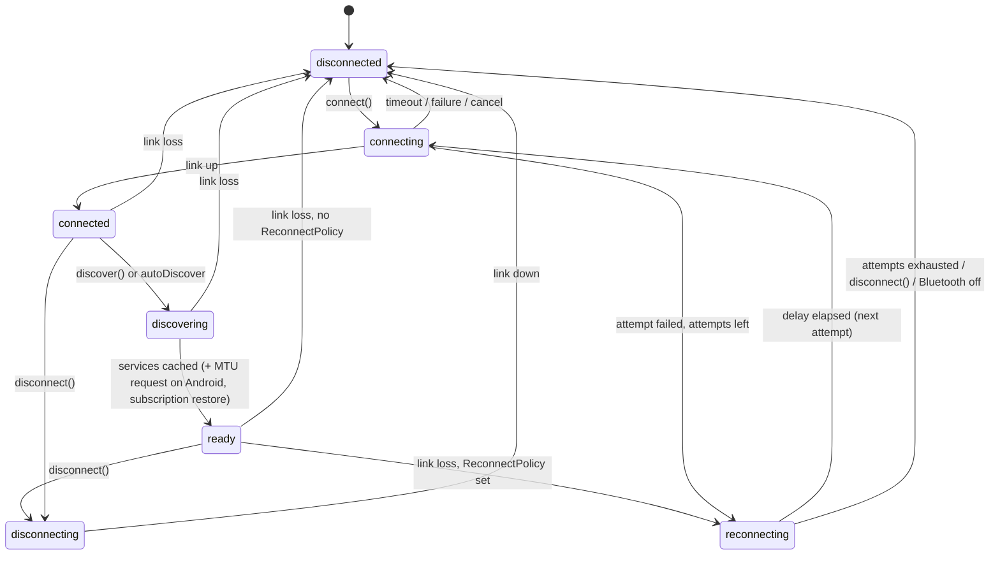

# Expo BLE (`expo-ble-kit`) — Architecture & Implementation Plan

> **Status:** Draft v0.40 · **Date:** 2026-10-05 · **Scope:** proposition #3, an Expo-first Bluetooth Low Energy module · **Changes:** Appendix D
>
> **Package name:** `expo-ble-kit` (D0a, decided 2026-10-02) · native module `ExpoBleKit` · Android package `expo.modules.blekit`.
>
> **Platform baseline:** Expo SDK 57 stable (RN 0.86) · SDK 58 in beta (RN 0.88 RC, Expo Modules 2.0 beta, iOS 27 scene life cycle).
>
> **Repo state (2026-10-02):** P0-03 scaffold on Expo SDK 57 stable. Stable releases only, on every branch (ADR-011); the repo moves to SDK 58 once it is released as stable.

---

## 0. How to use this document (agents: read this first)

- **Read order:** §0 → §3 Decisions → §4 Architecture → §5 Public API → your phase in §7 → Appendix B (rules). Read §4.14 and §10 before touching background or lifecycle code.
- **Normative language:** MUST, MUST NOT, SHOULD, MAY (RFC 2119 meaning).
- **Tasks:** IDs are `P<phase>-<nn>`. Each task lists dependencies and acceptance criteria. Do not start a task whose dependencies are not done.
- **Gates:** `[GATE Dx]` marks a human decision. Stop and ask. Never decide a gate silently.
- **Verify flags:** `⚠️ VERIFY` marks platform facts that must be confirmed against official Apple / Android / Expo docs before implementation. Put the source link in the PR and update this file.
- **Source of truth:** this file. If code has to diverge from it, update this file in the same PR.
- **Definition of Done (every task):** code + tests (at least L1/L2, see §8) + types + docs + example app still builds on iOS and Android + changeset + CI green.
- **Suggested `AGENTS.md` entry for the repo:**

  ```md
  Before any change, read docs/ARCHITECTURE_AND_PLAN.md (§0, §3, Appendix B).
  Only work on tasks from §7 whose dependencies are done. Stop at any [GATE].
  Never weaken a rule from Appendix B to make a test pass.
  ```

---

## 1. Context and goals

### 1.1 Why this library

- There is no first-party Expo BLE module, and the community side is fragmenting instead of consolidating:
  - `react-native-ble-plx`: last release 3.5.1 (2026-02-18). Forks exist to keep it working on RN 0.86 / SDK 57. No peripheral role, bonding, beacons or Bluetooth Classic. Values are base64 strings.
  - Newer Nitro-based libraries (`react-native-ble-nitro`, `munim-bluetooth`) are young. `expo-ble` (Expo Modules, singleton API) releases rarely.
- About 16% of React Native developers use Bluetooth (State of React Native 2025, platform APIs).
- Timing is good: New Architecture only since SDK 55, Expo Modules got much faster across SDK 56–58 with 2.0 in beta, `ArrayBuffer` is first-class, and SDK 58's lifecycle changes force a clean design for background handling.

### 1.2 Goals

| ID | Goal |
|---|---|
| G1 | Expo-first: Expo Modules API + config plugin. Works in dev builds and in bare RN apps with `expo` installed |
| G2 | Complete central role: scan, connect, discover, read, write (with/without response), notify/indicate, descriptors, MTU, RSSI, multiple devices |
| G3 | Peripheral role: advertising + GATT server |
| G4 | Reliable by design: serialized per-connection operation queue, timeouts everywhere, typed errors, reconnection policies, Android GATT hygiene |
| G5 | Binary-first API: `Uint8Array` end to end, never base64 |
| G6 | Background: iOS state restoration, Android foreground service + PendingIntent scans, background events through `expo-task-manager` |
| G7 | Privacy-first onboarding: AccessorySetupKit (iOS 18+) and CompanionDeviceManager (Android) |
| G8 | Testable: public fake adapter for app tests, emulator CI with a virtual peripheral, hardware-in-the-loop suite |
| G9 | Agent-friendly: strict types, typed errors, recipes, co-located agent skill |

### 1.3 Non-goals for 1.0

- Bluetooth Classic (RFCOMM/SPP): Android-only, and iOS requires MFi. Candidate for a separate package later.
- iBeacon ranging (requires CoreLocation on iOS). Raw advertisement access, including Eddystone frames, **is** in scope.
- BLE Mesh, LE Audio / Auracast, vendor DFU/OTA protocols. We ship primitives (`writeStream`, L2CAP) that others can build these on.
- Expo Go (impossible with custom native code) and the Legacy Architecture.
- Apple platforms other than iOS/iPadOS (tvOS, macOS, visionOS, watchOS). The podspec declares iOS only.

### 1.4 Success criteria for 1.0

- Feature coverage ≥ ble-plx core + peripheral role + background restoration.
- Soak suite (§8.5) passes on the device matrix (§8.2) with zero crashes.
- Example apps: Explorer, Heart Rate, Phone-as-Peripheral, Throughput, Background.
- Migration guide and `plx-compat` layer for ble-plx users.

---

## 2. Prior art

| Project | Stack | Latest on npm (checked 2026-10-02) | Notes |
|---|---|---|---|
| `react-native-ble-plx` | classic native module | 3.5.1 (2026-02-18) | Most used. No peripheral, bonding, beacons, Classic. Base64 values. Forks patch RN 0.86 issues |
| `react-native-ble-manager` | native module | 12.5.3 (2026-09-21) | Actively released, not Expo-first |
| `react-native-ble-nitro` | Nitro Modules | 1.15.1 (2026-07-10) | Central role, config plugin |
| `munim-bluetooth` | Nitro Modules | 0.8.1 (2026-09-19) | Central + peripheral, Android Classic, L2CAP, Multipeer. Pre-1.0 |
| `expo-ble` (Daniel Reiling) | Expo Modules | 0.5.0 (2026-01-24) | Singleton API, config plugin, sparse releases. Owns the `expo-ble` name |
| `sfourdrinier/react-native-ble-plx` → "Unified BLE Manager 4.x" | ble-plx fork | — | Targets Expo SDK 57 / RN 0.86 |

**Positioning:** the boring, complete, Expo-native default. Reliability, background support, testability and docs over novelty.

**[GATE D0b] Build vs join — decided 2026-10-02: build** (ADR-012). The maintainer chose to build `expo-ble-kit` rather than join an existing effort.

---

## 3. Key decisions (ADR summaries)

| ID | Decision | Status |
|---|---|---|
| ADR-001 | Bind through the **Expo Modules API** (not Nitro, not raw TurboModules) | Accepted |
| ADR-002 | **Minimum Expo SDK 57, Expo Modules 1.0 DSL**, New Architecture only, iOS ≥ 16.4, **Android `minSdk` 26** (Android 8.0). Move to Expo Modules 2.0, one member at a time, once SDK 58 is stable and documented | Accepted 2026-10-02 (D1, after P0-04; `minSdk` 26 via Q5) |
| ADR-003 | Binary values are `Uint8Array` (JS) / `Data` (Swift) / `ByteArray` (Kotlin). No base64 anywhere in the core API | Accepted |
| ADR-004 | Object model: `BleManager` singleton + native-backed SharedObjects (`Peripheral`, `GattServer`, `L2CAPChannel`) | Accepted |
| ADR-005 | Three layers: native core (no Expo/React imports) → thin binding → TypeScript API | Accepted |
| ADR-006 | Exactly one in-flight GATT operation per connection on **both** platforms (FIFO queue + timeouts) | Accepted |
| ADR-007 | One JS event per native event by default; opt-in native batching for notifications and scan results | Accepted |
| ADR-008 | Background events go through an `expo-task-manager` consumer, backed by a native event buffer | Proposed → spike P0-05. Android's consumer is in place since P3-04 (background scans); iOS waits for the spike |
| ADR-009 | License: MIT, personal ownership (github.com/sbaiahmed1), no CLA | Accepted 2026-10-02 (D2) |
| ADR-010 | Four-layer test pyramid, including a public fake adapter and a Bumble virtual peripheral | Accepted |
| ADR-011 | **Stable releases only.** Every branch, spikes included, builds against the latest stable Expo SDK (57 today) and stable packages. No beta, alpha, RC, canary or `next`-tagged versions, and no experimental or undocumented features of a stable SDK, unless the maintainer explicitly asks. The repo moves to SDK 58 when it is stable | Accepted 2026-10-02, tightened the same day |
| ADR-012 | **Build** `expo-ble-kit` as a new library instead of joining an existing effort (gate D0b) | Accepted 2026-10-02 |

**ADR-001 rationale.** Expo Modules give us everything in one package: app-lifecycle subscribers (needed to create `CBCentralManager` at launch for state restoration), config plugins, SharedObjects with events, and TaskManager interop. Performance is no longer a reason to look elsewhere: on iOS, Expo Modules 2.0 synchronous calls are 2.5–5.6× faster than the 1.0 API, and Expo's Android microbenchmarks show 2.0 faster than a TurboModule in all twelve cases. Nitro was considered and rejected for v1 because we would have to rebuild the lifecycle and plugin integration ourselves. Re-evaluate only if P2 benchmarks show the JS boundary, not the radio, is the bottleneck.

**ADR-002 / [GATE D1] rationale (decided 2026-10-02).** Expo Modules 2.0 (annotated Swift/Kotlin classes: `@ExpoModule`, `@JS`, `@Record`, `@SharedObject`, `@Event`) is beta in SDK 58 and experimental in SDK 57, so ADR-011 rules it out for now. The P0-04 spike (`docs/spikes/P0-04-binding.md`) measured the stable 1.0 DSL on a real Galaxy A52: binary data is a real `Uint8Array` in arguments, return values and event payloads (no base64), events arrive complete and in order at 10k/s, and an async call costs 0.1–0.45 ms, far below a BLE operation. So the library is built on the 1.0 DSL with SDK 57 as the minimum. Because the binding is thin (ADR-005) and both APIs can coexist in one module, moving to 2.0 later only touches the binding layer; Expo's `expo-migrate-module` agent skill can help. SDK 57 apps built with Xcode 27 need `expo-build-properties` `ios.enableSceneSupport` to launch on iOS 27 (see P0-03).

**ADR-002 Android `minSdk` 26 rationale (decided 2026-10-02).** The Android core is built on API 26+ calls: `connectGatt(…, Handler)`, PendingIntent scans, `AdvertisingSet` and `ScanResult.isConnectable()`. Supporting 24–25 would mean fallback paths and a test device for a negligible share of devices. Expo's default is 24, so the config plugin raises the app's `minSdkVersion` to 26 (§4.15), and the library declares `minSdkVersion 26` as a backstop: an app below 26 fails at manifest merge with a clear error instead of crashing at runtime.

**ADR-005 rationale.** A core with no Expo/React dependencies is unit-testable with fakes (XCTest / JVM), reusable from native or brownfield code, and survives binding API churn (1.0 → 2.0) untouched.

---

## 4. Architecture

### 4.1 Layers

```
┌──────────────────────────────────────────────────────────────────────┐
│ App (React)                                                           │
├──────────────────────────────────────────────────────────────────────┤
│ TS API  (src/)   BleManager · Peripheral · GattServer · hooks ·       │
│                  BleError · uuid · testing/ (FakeBleAdapter)          │
├──────────────────────────────────────────────────────────────────────┤
│ Binding (Expo Modules)   module · SharedObjects · events ·            │
│                          lifecycle subscribers · TaskManager consumer │
├───────────────────────────────────┬──────────────────────────────────┤
│ iOS core (Swift, no Expo/RN)      │ Android core (Kotlin, no Expo/RN) │
│ CentralEngine · ScanController ·  │ CentralEngine · ScanController ·  │
│ PeripheralSession · GattQueue ·   │ PeripheralSession · GattQueue ·   │
│ GattServer · Advertiser ·         │ GattServer · Advertiser ·         │
│ Restoration · AccessorySetup      │ BondManager · ConnectionService · │
│                                   │ BackgroundScans · Companion       │
├───────────────────────────────────┼──────────────────────────────────┤
│ CoreBluetooth · AccessorySetupKit │ android.bluetooth(.le) · CDM      │
└───────────────────────────────────┴──────────────────────────────────┘
```

Layer rules:

- The core MUST NOT import `ExpoModulesCore`, React, or any JS-runtime type. It is plain Swift/Kotlin and unit-testable without an app.
- The binding MUST NOT contain BLE logic. It only marshals values, manages object lifetime, converts errors and forwards events.
- The TS layer MUST NOT re-implement queueing or timeouts. It validates input, normalizes UUIDs, applies defaults and shapes the API.

### 4.2 Repository layout

```
expo-ble-kit/
├── AGENTS.md                         # points agents to docs/ARCHITECTURE_AND_PLAN.md
├── docs/
│   ├── ARCHITECTURE_AND_PLAN.md      # this file
│   ├── spikes/                       # P0 spike reports (one file per spike)
│   └── guides/                       # getting-started, permissions, bare-setup, background, migration-from-plx
├── package.json                      # `exports` map: `.`, `./testing`, `./app.plugin.js`, `./package.json` (§4.6)
├── app.plugin.js                     # re-exports plugin/build
├── expo-module.config.json · tsconfig.json
├── src/
│   ├── index.ts                      # public exports only (§5)
│   ├── BleManager.ts  Peripheral.ts  GattServer.ts  Advertiser.ts  L2CAPChannel.ts
│   ├── hooks/                        # useBleState, useBlePermissions, useScan, usePeripheral, useCharacteristicValue
│   ├── errors.ts  uuid.ts  constants.ts  types.ts  permissions.ts  background.ts
│   ├── internal/port.ts              # NativeBleKitPort interface (real module + fake implement it)
│   ├── internal/native.ts            # requireNativeModule('ExpoBleKit')
│   ├── testing/                      # public entry `expo-ble-kit/testing`: FakeBleAdapter, VirtualPeripheral
│   └── compat/plx/                   # P6: ble-plx compatibility layer
├── plugin/src/                       # config plugin: index.ts, ios.ts, android.ts, schema.ts
├── ios/
│   ├── Core/                         # CentralEngine, ScanController, PeripheralSession, GattQueue,
│   │                                 # GattServer, Advertiser, L2CAP, Restoration, AccessorySetup,
│   │                                 # Errors, UUIDs, Logging, CBAbstractions
│   ├── Binding/                      # ExpoBleKitModule, PeripheralObject, GattServerObject,
│   │                                 # AppLifecycleSubscriber, TaskConsumer
│   └── Tests/                        # XCTest with fake CB implementations. Excluded from the pod's
│                                     # source_files; run via a podspec test_spec or a SwiftPM
│                                     # package over Core/ (chosen in P1-01)
├── android/src/main/java/expo/modules/blekit/
│   ├── core/                         # CentralEngine, ScanController, PeripheralSession, GattQueue,
│   │                                 # GattServer, Advertiser, L2cap, BondManager, ConnectionService,
│   │                                 # BackgroundScans, Companion, Errors, Uuids, Log, BtAbstractions
│   └── binding/                      # ExpoBleKitModule, PeripheralObject, GattServerObject,
│                                     # LifecycleListener, BackgroundScanTaskConsumer
├── android/src/test/                 # JVM unit tests with fakes
├── example/                          # Expo app: Explorer, HeartRate, PhoneAsPeripheral, Throughput, Background.
│                                     # Uses CNG: example/ios and example/android are gitignored and
│                                     # generated by `expo prebuild`, so every build exercises the plugin
├── test-peripherals/
│   ├── profile.json                  # the test GATT profile (§8.3), single source for all test peripherals
│   ├── bumble/                       # Python virtual peripheral for the Android emulator (netsim)
│   └── zephyr/                       # nRF52840 firmware implementing the same profile
├── e2e/maestro/                      # E2E flows for the example app
├── benchmarks/                       # native reference apps (Kotlin, Swift) for docs/benchmarks.md (P2-08)
└── skills/                           # co-located agent skill (P6) ⚠️ VERIFY Expo convention
```

### 4.3 iOS core

| Component | Responsibility |
|---|---|
| `CentralEngine` | Owns one `CBCentralManager` on a private serial queue `expo.blekit.central`. Publishes adapter state. Owns `ScanController` and `[UUID: PeripheralSession]`. Created **lazily** (creating it can trigger the permission prompt), except when restoration is enabled **and** `CBManager.authorization == .allowedAlways` |
| `ScanController` | `scanForPeripherals(withServices:options:)`, advertisement parsing into `ScanResult`, name/manufacturer filtering in the core (CoreBluetooth only filters by service). CoreBluetooth runs one scan at a time (a new call replaces the previous one), so the controller multiplexes JS scan sessions (§5.3) |
| `PeripheralSession` | Wraps `CBPeripheral` and its delegate. Connection state machine (§4.8), `GattQueue`, discovery cache, subscription registry, write-without-response flow control (`canSendWriteWithoutResponse`, `peripheralIsReady(toSendWriteWithoutResponse:)`), `maximumWriteValueLength(for:)` |
| `GattQueue` | Generic serial operation queue (§4.9) |
| `Advertiser`, `GattServer` | One `CBPeripheralManager` on queue `expo.blekit.peripheral`. Service publication, read/write requests, `updateValue` with `peripheralManagerIsReady(toUpdateSubscribers:)` flow control. P4-01: the manager is created with the first server (`ShowPowerAlert` off, after the authorization check, so it never prompts); iOS answers static values and keeps subscriptions itself; a write request array is one long write, answered through its first request (Apple's `didReceiveWrite` docs). iOS tells a peripheral nothing about central disconnects, so cached long-read values just expire |
| `Restoration` | `willRestoreState` for both managers. Rehydrates sessions and re-arms subscriptions natively. Buffers events until the binding attaches |
| `AccessorySetup` (iOS 18+) | `ASAccessorySession` lifecycle, picker presentation, mapping authorized accessories to peripherals. Opt-in only (see §10) |
| `CBAbstractions` | Protocols over CoreBluetooth types (`CentralManaging`, `PeripheralLike`, `PeripheralManaging`) so XCTest can inject fakes |

iOS platform rules:

- Creating a CoreBluetooth manager without `NSBluetoothAlwaysUsageDescription` in Info.plist crashes the app. Check for the key before creating any manager and reject with `MISCONFIGURED` instead. Reading `CBManager.authorization` without the key is safe (checked on the iOS 27 simulator).
- Lazy creation (P1-03): the manager is created by `requestPermissionsAsync()`, or as soon as JS reads or observes the state while the app is already authorized (no prompt can appear then). Before that, `state` is `unauthorized` when the authorization is denied or restricted, and `unknown` otherwise. The manager is created with `CBCentralManagerOptionShowPowerAlertKey: false`: the app sees `poweredOff` and decides what to show.
- The iOS Simulator reports `CBManager.authorization == .allowedAlways` without a prompt, and the adapter as `unsupported`. Permission prompts can only be tested on a device.
- There is no MTU API. Report `mtu = maximumWriteValueLength(for: .withoutResponse) + 3`.
- Bonding is implicit: it is triggered when an encrypted attribute is accessed. There is no `createBond` on iOS.
- A pending `connect` never times out on its own. Our connect timeout MUST call `cancelPeripheralConnection`.
- On iOS 17+, use the auto-reconnect connect option and the `isReconnecting` disconnect callback (implemented in P2-01 behind `ios.enableAutoReconnect`; ⚠️ VERIFY on a device).
- Background scanning requires service UUID filters, and duplicates are coalesced. Background advertising drops the local name and moves service UUIDs to the overflow area.
- Apps the user force-quit are not relaunched for state restoration. Document this.

### 4.4 Android core

`minSdk` is 26 (ADR-002), so the API 26+ calls below need no fallbacks. Anything newer than API 26 is feature-detected at runtime.

| Component | Responsibility |
|---|---|
| `CentralEngine` | `BluetoothManager` / `BluetoothAdapter`. Adapter state via `ACTION_STATE_CHANGED`, registered on the BLE thread without an export flag: it is a protected system broadcast, and it comes from the Bluetooth process, so `RECEIVER_NOT_EXPORTED` would drop it (registration checked on Android 14, targetSdk 36). One `HandlerThread` named `blekit-gatt`, plus a coroutine dispatcher built from its `Handler` |
| `ScanController` | `BluetoothLeScanner` with `ScanFilter` / `ScanSettings`. `ScanCallback` runs on the main thread, so its results are posted to the BLE thread before the controller sees them. Multiplexes JS scan sessions (§5.3). Scan-start throttle guard, matching AOSP's `AppScanStats` (a sixth start within 30 s of the fifth-latest is "scanning too frequently", ⚠️ VERIFY on other vendors): it tracks the last 5 platform starts and delays a start that would break the limit until 30 s + 1 s after the oldest, with a `SCAN_THROTTLED` warning. Restarts caused by session changes are debounced by 300 ms, and a session change that leaves the union unchanged doesn't restart the scan. On the Galaxy A52, 10 start/stop cycles in 20 s gave a warning for each delayed start, logcat showed the platform starts exactly as the guard counted them and no "scanning too frequently" from Android, and the delayed session got results once it started. Unfiltered scans pause when the screen is off (Android 8.1+), so docs recommend filters. Android 7+ silently downgrades a scan running longer than about 30 minutes to opportunistic ⚠️ VERIFY, so long-running scans restart before that limit (each restart counts against the throttle window) |
| `PeripheralSession` | `connectGatt(context, autoConnect, callback, TRANSPORT_LE, phyMask, handler)` (API 26+) so every callback lands on `blekit-gatt`. State machine, `GattQueue`, API 33+ overloads (`writeCharacteristic(c, value, writeType)` returning a status, `onCharacteristicChanged(gatt, c, value)`) with legacy fallbacks, CCCD handling, `requestMtu` (≤ 517), `close()` discipline, bounded retry for status 133 |
| `BondManager` | `createBond()`, `ACTION_BOND_STATE_CHANGED` receiver, bond state per device. Never auto-confirms pairing |
| `Advertiser` | `BluetoothLeAdvertiser` and `AdvertisingSet` (extended advertising when `isLeExtendedAdvertisingSupported`) |
| `GattServer` | `BluetoothGattServer`, request handling, `notifyCharacteristicChanged` gated by `onNotificationSent`. `openGattServer` takes no Handler and the stub calls the callback on Binder threads (checked in the API 34 sources), so `AndroidGattServerOpener` posts every callback to `blekit-server`. Services are added one at a time (`addService` docs: wait for `onServiceAdded`). Static values and descriptors are answered by the core (Android asks the app for every read); notifiable characteristics get a CCCD the core tracks per central |
| `ConnectionService` | Foreground service of type `connectedDevice` (Android 14+ also needs `FOREGROUND_SERVICE_CONNECTED_DEVICE`). Runs while at least one session has `keepAliveInBackground`. Android 12+ refuses foreground-service starts from the background (`ForegroundServiceStartNotAllowedException`; exemptions include CompanionDeviceManager apps holding `REQUEST_COMPANION_START_FOREGROUND_SERVICES_FROM_BACKGROUND` or `REQUEST_COMPANION_RUN_IN_BACKGROUND`, verified in [Restrictions on starting a foreground service from the background](https://developer.android.com/develop/background-work/services/fgs/restrictions-bg-start)), so the service starts when a `keepAliveInBackground` connect is issued while the app is in the foreground. It then stays up through link loss and reconnects until the last such session ends, and never needs a restart from the background. If a start is refused, emit a `warning` (`FOREGROUND_SERVICE_FAILED`) and continue without keep-alive. Implementation (P3-03): `AndroidKeepAlive` starts it with `startService` (refused at once from the background) and the service calls `startForeground(id, notification, FOREGROUND_SERVICE_TYPE_CONNECTED_DEVICE)` in `onStartCommand`. Unlike `startForegroundService`, a refused promotion can't crash the app with `ForegroundServiceDidNotStartInTimeException` ([troubleshooting](https://developer.android.com/develop/background-work/services/fgs/troubleshooting)). Android 14+ throws `SecurityException` there unless a Bluetooth runtime permission is granted ([service types](https://developer.android.com/develop/background-work/services/fgs/service-types)); connecting already needs `BLUETOOTH_CONNECT`. `START_NOT_STICKY`: after the process dies there's no connection to keep. Observed on Android 14 (A52): Android allows a background start for 10 s after the adapter's `ACTION_STATE_CHANGED` broadcast (`code:BLUETOOTH_BROADCAST` in ActivityManager's log), so reconnecting with keep-alive when Bluetooth comes back on works. Without `POST_NOTIFICATIONS` (Android 13+) the service still runs and its notice only shows in the Task Manager ([notification permission](https://developer.android.com/develop/ui/views/notifications/notification-permission)) |
| `BackgroundScans` | `startScan(filters, settings, PendingIntent)` (API 26+) → TaskManager → the JS task. Works even when the process is dead. The PendingIntent comes from TaskManager (`TaskManagerUtilsInterface.createTaskIntent`: a mutable broadcast to expo-task-manager's own `TaskBroadcastReceiver`, which restores the task and calls the consumer's `didReceiveBroadcast`, the path expo-location takes for geofencing), so the library declares no receiver (P3-04 replaced the planned `ScanResultReceiver`). Low power, first match where the controller filters, else 10 s batches. `AndroidBackgroundScanner` (core) starts, stops and reads the scan; `BackgroundScanTaskConsumer` (binding) is the TaskManager glue |
| `Companion` | `CompanionDeviceManager` association (system picker) and device presence observation ⚠️ VERIFY API levels (31 / 33 / 36 differ) |
| `BtAbstractions` | Interfaces over adapter, scanner, GATT client and GATT server for JVM unit tests |

GATT cache (P2-06):

- API 31+ `BluetoothGattCallback.onServiceChanged` reports a Service Changed indication: the session discovers again (§5.4 service-change rules). Before API 31 the stack consumes the indication and apps aren't told.
- `BluetoothGatt.refresh()` (hidden, public in the platform class) is the one reflection-based API §4 allows (Appendix B rule 11): it is reached only through `peripheral.android.refreshGattCache()`, which is the opt-in, it is looked up at runtime (`getMethod("refresh")`), and a missing or blocked method answers `false` instead of failing.

### 4.5 Binding layer

- Module `ExpoBleKit`: manager functions plus module-level events `stateChange`, `scanResults`, `scanError`, `restoration`, `bondStateChange`, `warning`, `log`.
- Scanning (P1-04): JS numbers its scan sessions. `startScan(sessionId, options)` resolves once the session is accepted and rejects when it can't start; `stopScan(sessionId)`. Results arrive as `scanResults { sessionId, results }`; a session that ends natively gets one `scanError { sessionId, code, message }`. `warning { code, message }` carries non-fatal problems such as `SCAN_THROTTLED`. Expo runs async functions in call order on one serial queue on both platforms, so a stop never overtakes its start.
- SharedObjects:
  - `PeripheralObject`, with events `connectionStateChange`, `notification` / `notificationBatch`, `mtuChange`, `servicesChanged`.
  - `GattServerObject`, with events `readRequest`, `writeRequest`, `subscriptionChange`.
  - `L2CAPChannelObject`, with events `data`, `close`.
- Identity: the binding keeps an `id → weak SharedObject` map, so one native peripheral always maps to the same JS object. `getPeripheral(id)` is the only way to get one (the JS constructor throws; Expo's Android `Class` requires a constructor, and a missing one crashes the app at start). Ids are normalized first: upper-case addresses on Android, upper-case UUIDs on iOS. The object holds no BLE state; `state` reads the core's published snapshot.
- Errors: core errors become coded exceptions carrying `code` (§4.11) plus `nativeDomain`, `nativeCode`, `gattStatus`.
- Cancellation (P1-12): operations an `AbortSignal` may cancel carry a JS-assigned `operationId` (in the attribute request record, or as the last argument of `discover`, `requestMtu` and `readRssi`), and `cancelOperation(operationId)` on the peripheral object cancels it in the session's queue. Calls run in order, so a cancel never overtakes its operation.
- Lookups (P1-12): `getKnownPeripherals(ids)` and `getSystemConnectedPeripherals(services)` resolve with ids, which the TS layer turns into peripherals with `getPeripheral`. `name` is a synchronous snapshot: the latest advertised name seen in a scan, then the name the device reports once connected (iOS: `CBPeripheral.name`, also on `peripheralDidUpdateName`), kept for the 1,000 most recent peripherals.
- Lifecycle: an iOS app-delegate subscriber (declared in `expo-module.config.json`) creates engines early when restoration is enabled. An Android application lifecycle listener wires receivers and the service. Under SDK 58's scene life cycle, Expo forwards app-delegate events to subscribers; the background relaunch path is confirmed in spike P0-05.
- TaskManager consumer for headless background delivery on both platforms. Verified on Android for SDK 57 (P3-04) in the sources of `expo-modules-core` 57.0.20 and `expo-task-manager` 57.0.21: the interfaces (`TaskConsumer`, `TaskInterface`, `TaskManagerUtilsInterface`) live in `expo-modules-core`; a module gets the task manager with `appContext.legacyModule<TaskManagerInterface>()`, as `ExpoTaskManager` itself does; TaskService creates any consumer class by name (`Class.forName`, a `(Context, TaskManagerUtilsInterface)` constructor, a static `VERSION`), so the library ships ProGuard keep rules for it. iOS ⚠️ VERIFY with P3-02.

### 4.6 TypeScript layer

- The public surface is exactly §5, exported from `src/index.ts`. Everything else is internal.
- An internal port interface, `NativeBleKitPort`, is implemented by the real native module and by `FakeBleAdapter`. Tests inject the fake through the public `expo-ble-kit/testing` entry.
- `src/internal/native.ts` resolves the native module lazily, on first use, with `requireOptionalNativeModule`. It also exposes an internal setter that `installFakeBle` uses. So importing `expo-ble-kit` in Jest, where no native module exists, doesn't throw; a call without a native module or a fake rejects with `NOT_SUPPORTED`, saying the app needs a rebuild. The package has no default export: the public API (§5) is `BleManager`, the hooks and the utilities, built on this port (P1-12).
- The port (`src/internal/port.ts`) covers what the native bindings implement; P1-08 and P1-09 extend it. `FakeBleAdapter` runs its operations through a TypeScript twin of the native `GattQueue`, and one set of contract cases, `test-contracts/gatt-queue.json`, runs against all three queues (Jest, XCTest, JUnit), so the fake orders, times out, cancels and fails operations exactly like the native cores.
- `package.json` declares an `exports` map (`.`, `./testing`, `./app.plugin.js`, `./package.json`) so that `expo-ble-kit/testing` resolves in Metro, Jest and TypeScript.
- Web: until D3 is decided, the web build exports the same API with `state === 'unsupported'`, and every call rejects with `NOT_SUPPORTED`.
- The TS layer owns UUID normalization, option defaults, the `BleError` class, hooks (built on `useSyncExternalStore`) and `AbortSignal` wiring. Input validation failures reject with `INVALID_ARGUMENT`.

### 4.7 Threading model

| Concern | iOS | Android | Rule |
|---|---|---|---|
| BLE callbacks and core state | Serial queues `expo.blekit.central` / `expo.blekit.peripheral` | `HandlerThread` `blekit-gatt` (+ `blekit-server`) | All core state is confined to these threads |
| Calls from JS | Hop onto the BLE queue | Hop onto the BLE thread | Never touch CoreBluetooth / `BluetoothGatt` objects anywhere else |
| Synchronous reads from JS (`BleManager.state`, `Peripheral.state` / `name` / `mtu` / `services`) | Immutable snapshot | Immutable snapshot | The BLE thread publishes a new snapshot atomically (lock or atomic reference) after every change. Getters read the latest snapshot and never block on the BLE queue |
| Promise settlement, events | From the BLE queue | From the BLE thread | Allowed; Expo marshals them to JS |
| Main thread | Never used | Never used (except where Android requires it to start a foreground service) | Nothing blocks the UI |

### 4.8 State machines

**Adapter state (JS):** `unknown | resetting | unsupported | unauthorized | poweredOff | poweredOn`.
iOS maps `CBManagerState` one to one. Android: `STATE_OFF` → `poweredOff`, `STATE_TURNING_ON` / `STATE_TURNING_OFF` → `resetting`, `STATE_ON` → `poweredOn`, missing runtime permission → `unauthorized`, no adapter or no LE → `unsupported`.

**Connection (per `PeripheralSession`):**



During a reconnection attempt, a failure or link loss in `connecting`, `connected` or `discovering` counts as a failed attempt: the session waits again in `reconnecting`, or ends in `disconnected` with that error after the last attempt.

The JS-visible `ConnectionState` maps the native states as follows:

| Native | JS |
|---|---|
| `connecting`, `connected`, `discovering` | `connecting` (`reconnecting` during a reconnection attempt) |
| `ready` | `connected` |
| `disconnecting` | `disconnecting` |
| `disconnected` | `disconnected` |
| `reconnecting` (including iOS system auto-reconnect, `isReconnecting == true`) | `reconnecting` |

`ready` means the link is up and post-connect setup is done: discovery (when `autoDiscover`), the Android MTU request and subscription restore. With `autoDiscover: false`, `ready` follows link-up directly. JS sees `connected` and `connect()` resolves at the same moment, so an op issued from a `connected` listener never races the discovery cache, including after a reconnect.

Invariants:

- Entering `disconnected` rejects every queued and in-flight op with `DISCONNECTED`, marks subscriptions inactive and, on Android, calls `gatt.close()` exactly once.
- Entering `reconnecting` rejects every queued and in-flight op with `DISCONNECTED` (and closes the Android GATT client); ops issued while reconnecting reject with `DISCONNECTED` too.
- `reconnecting` is only reachable from `ready`, and only when a `ReconnectPolicy` is set. Calling `disconnect()` from JS cancels it.
- With `restoreSubscriptionsOnReconnect`, CCCDs are re-enabled natively before `connected` is emitted again (and before a `connect()` that joined the reconnection resolves).

### 4.9 GATT operation queue

- One FIFO per `PeripheralSession`, exactly one op in flight.
- Op kinds: discover (services, characteristics, descriptors), read, write with response, write without response, descriptor read/write (including CCCD), set notify/indicate, read RSSI, request MTU, connection priority, PHY, bond.
- **Timeouts:** default 10 s per op, configurable globally and per call. On Android, two consecutive timeouts force a disconnect + `close()`: the connect option `android.resetAfterTimeouts` sets the count (default 2, `false` never resets, P2-06). A ready connection then ends as a link loss (it reconnects when a `reconnect` policy is set); during setup the connect (or reconnection attempt) fails. The count starts again with each connection. Discovery counts as one op with a 30 s default: on iOS it chains services, then characteristics, then descriptors.
- **Cancellation:** `AbortSignal` removes queued ops. An in-flight op can't be aborted at the radio, so its result is discarded and its promise rejects with `OPERATION_CANCELLED`. An already aborted signal rejects at once without starting anything. A `connect()` signal cancels the attempt like `disconnect()`; a `subscribe()` signal removes that subscriber (the pending subscribe rejects); an `unsubscribe()` signal only stops the wait, because abandoning the CCCD write would leave notifications on.
- **Write without response** (no acknowledgement from the peer; flow control decided in P2-02, verified in the sources below). The op completes once the phone's stack took the packet, never before, so no packet is dropped on the phone and queued writes go out in order:
  - iOS: while `canSendWriteWithoutResponse` is false, CoreBluetooth drops writes; the packet waits for `peripheralIsReady(toSendWriteWithoutResponse:)` and completes once `writeValue(_:for:type:)` took it. A waiting packet whose op ended (timeout, cancel, disconnect) is never sent. Sources: Apple, [`canSendWriteWithoutResponse`](https://developer.apple.com/documentation/corebluetooth/cbperipheral/cansendwritewithoutresponse) and [`peripheralIsReady(toSendWriteWithoutResponse:)`](https://developer.apple.com/documentation/corebluetooth/cbperipheraldelegate/peripheralisready(tosendwritewithoutresponse:)).
  - Android, every version: the op completes on `onCharacteristicWrite`. While the link is congested, `GattService` holds write callbacks until it clears, which paces the queue. A callback status of `GATT_CONNECTION_CONGESTED` (0x8F) means the stack took the packet and the link is now congested: the write succeeded (AOSP maps it to success when it holds the callback), and the next packet waits 10 ms. Status 0x81 (`GATT_INTERNAL_ERROR`) on a write without response means L2CAP refused the packet while congested and freed it, so nothing was sent: it is sent again after 10 ms, within the op's timeout. Sources (AOSP, `android12-release` and `android14-release`): `GattService.java` `onWriteCharacteristic` and `onClientCongestion`; `att_protocol.cc` `attp_send_msg_to_l2cap` ("ATT congested, message accepted") and `attp_cl_send_cmd`; `l2c_api.cc` `L2CA_SendFixedChnlData` (refuses data while `cong_sent`).
  - Android submit: `BluetoothGatt` allows one outstanding write (`mDeviceBusy`, cleared by the callback; Android 13+ also one per device across clients). Android 13+ returns `ERROR_GATT_WRITE_REQUEST_BUSY`; before Android 13, `writeCharacteristic` / `writeDescriptor` return false, and with the client open and the attribute checked, busy is the remaining reason. Both are retried every 5 ms within the op's timeout. Sources: AOSP `BluetoothGatt.java` `writeCharacteristic` (`android12-release`, `android14-release`) and `GattService.java` `writeCharacteristic` permits (`android14-release`).
- **Long values:** writes with response larger than MTU − 3 rely on the platform's long-write support, up to the 512-byte ATT maximum ⚠️ VERIFY on both platforms. Larger payloads use `writeStream()` (chunked, flow-controlled, progress callback, abortable).
- **Ordering:** for a given peripheral, completion order equals submission order. There is no ordering across peripherals.
- **Streams** (P2-03): `writeStream` runs as one queue op per chunk. A chunk's completion queues the next chunk at the front of the queue, before the next op can start (the pump is always asynchronous), so a stream keeps its place: ops submitted after it run after its last chunk, and the ordering rule holds for the stream as a whole. The queue contract has the `first` and `thenFirst` cases for this.

### 4.10 Events and batching

- Default: one JS event per native event.
- Notifications: `subscribeBatched(..., { intervalMs, maxItems })` coalesces natively into `{ values: Uint8Array[]; timestamps: number[]; dropped: number }`. Each timestamp is captured natively when the event arrives, so timing survives batching. Decided in P2-04:
  - Batching is per subscriber, in the native session (`NotificationBatcher` on both platforms, its TS twin in the fake). The first value of an empty batch starts the interval, so a batch arrives at most `intervalMs` after its first value, and an idle characteristic costs nothing: at most `1000 / intervalMs` events per second (62.5 at 16 ms).
  - A characteristic gets the per-value `notification` event only while it has an unbatched subscriber; batched subscribers get `notificationBatch { subscriptionId, bytes, lengths, timestamps, dropped }`, where `bytes` holds the values one after another and `lengths` cuts them (one buffer crosses the bridge instead of one object per value). The TS layer rebuilds the values as separate `Uint8Array`s.
  - `unsubscribe` drops what a subscriber collected (delivery stops at once). When a subscription ends with the link (a disconnect, or a reconnection that doesn't restore it), the collected values are delivered first: a disconnect emits the batches before the `disconnected` state.
- **Timestamps** (`ScanResult.timestamp`, notification timestamps, `LogEntry.timestamp`) are milliseconds since the Unix epoch, comparable with `Date.now()` on both platforms. They are computed as the engine-start wall-clock time plus monotonic elapsed time, so they never go backwards within a process.
- Scan results: `reportIntervalMs` batches results and de-duplicates per device within each window.
- Overflow: a bounded buffer per subscription (default 4096 items; `maxItems` sets it). Policy is drop-oldest, with a `dropped` count and a `warning` event (`BUFFER_OVERFLOW`, the first time a subscription drops; later drops only show in `dropped`). A radio can't be back-pressured, so JS must keep up or batch.

### 4.11 Error model

```ts
export class BleError extends Error {
  code: BleErrorCode;
  retryable: boolean;
  platform: 'ios' | 'android' | 'web';
  peripheralId?: string;
  serviceUUID?: string;
  characteristicUUID?: string;
  nativeDomain?: string;  // e.g. CBErrorDomain, CBATTErrorDomain, android.bluetooth
  nativeCode?: number;
  gattStatus?: number;    // Android GATT/HCI status when relevant
}
```

| `BleErrorCode` | When | Retryable |
|---|---|---|
| `BLUETOOTH_UNSUPPORTED` | No BLE hardware | No |
| `BLUETOOTH_UNAUTHORIZED` | Bluetooth permission denied or restricted | No |
| `BLUETOOTH_POWERED_OFF` | Adapter is off | After user action |
| `BLUETOOTH_RESETTING` | Stack is resetting | Yes |
| `PERMISSION_DENIED` | A specific runtime permission is missing (Android) | No |
| `MISCONFIGURED` | A required Info.plist key, manifest permission, component or background mode is not declared. The message names the missing entry and links the setup guide | No |
| `INVALID_ARGUMENT` | Input rejected by validation: malformed UUID, out-of-range MTU or chunk size, conflicting options | No |
| `SCAN_FAILED` | Scanner error (Android scan failure codes) | Depends |
| `SCAN_THROTTLED` | Android scan-start limit reached | Yes, later |
| `PERIPHERAL_NOT_FOUND` | Unknown id, or not retrievable (iOS only; Android can't detect unknown addresses, see §4.12) | No |
| `CONNECTION_FAILED` | Link could not be established (includes Android 133) | Yes |
| `CONNECTION_TIMEOUT` | Our connect timeout fired | Yes |
| `DISCONNECTED` | Link lost, or disconnected while an op was pending | Depends |
| `OPERATION_TIMEOUT` | Per-op timeout fired | Yes |
| `OPERATION_CANCELLED` | `AbortSignal` or `disconnect()` | No |
| `SERVICE_NOT_FOUND`, `CHARACTERISTIC_NOT_FOUND`, `DESCRIPTOR_NOT_FOUND` | Not in the discovery cache | No |
| `NOT_SUPPORTED` | The property or platform doesn't support this op | No |
| `READ_NOT_PERMITTED`, `WRITE_NOT_PERMITTED` | ATT permission errors | No |
| `INSUFFICIENT_AUTHENTICATION`, `INSUFFICIENT_ENCRYPTION`, `INSUFFICIENT_AUTHORIZATION` | ATT security errors | After bonding |
| `INVALID_ATTRIBUTE_LENGTH`, `INVALID_OFFSET` | ATT value errors | No |
| `CONGESTED` | Android connection congested | Yes, with backoff |
| `BUFFER_OVERFLOW` | A batched subscription's buffer was full and dropped its oldest values (a `warning`, §4.10) | No |
| `GATT_ERROR` | Any other ATT/GATT status (see `gattStatus`) | Maybe |
| `BOND_FAILED` | Bonding failed or was rejected | Maybe |
| `ADVERTISING_FAILED` | Advertiser error (reason included) | Depends |
| `FOREGROUND_SERVICE_FAILED` | Android refused the `keepAliveInBackground` foreground service, for example because the app was in the background (a `warning`, §4.14); the connection continues without it | No |
| `L2CAP_FAILED` | Channel open or I/O error | Maybe |
| `INTERNAL` | A bug. Include `getDiagnostics()` output in reports | No |

Mapping: Appendix A, implemented in `ErrorMapping.swift` / `ErrorMapping.kt` and verified against the iOS 27 SDK headers and android.jar (API 36) in P1-10. Native rejections carry the code, and extra fields as a `[blekit]{json}` marker in the message that `BleError.fromNative` strips.

### 4.12 Identifiers and UUIDs

- `Peripheral.id` is opaque. iOS: `CBPeripheral.identifier`, a per-app UUID, not a MAC address. Android: the device address, which may be a random private address. IDs MUST NOT be compared across platforms.
- Reconnect by id: iOS `retrievePeripherals(withIdentifiers:)`, Android `BluetoothAdapter.getRemoteDevice(address)`.
- Android caveats:
  - `getRemoteDevice(address)` never fails and assumes a public address, so unknown ids can't be detected up front.
  - `BluetoothDevice.getAddressType()` is public only from API 35 (`getRemoteLeDevice(address, type)` exists from API 33), so the type can't be read on Android 13–14. Instead the core keeps the `BluetoothDevice` handle from each scan result (the latest 1,000 devices), which carries the address type the scan saw on every API level, and connects through it. ⚠️ VERIFY in P1-05 that this keeps a random address type.
  - Connecting by address to a random-static device not scanned in this process may fail with `CONNECTION_FAILED` or `CONNECTION_TIMEOUT`. Docs recommend a short `scanFor` before reconnecting by a stored id.
- UUID inputs may be 16-bit (`'180d'` or `0x180d`), 32-bit or 128-bit. Outputs are always lowercase 128-bit (`0000180d-0000-1000-8000-00805f9b34fb`). Compare normalized values only. Ship constants for common Bluetooth SIG services and characteristics.

### 4.13 Permissions

| Platform / API level | Needed for | Declarations / runtime permissions | Notes |
|---|---|---|---|
| iOS | Any CoreBluetooth use | `NSBluetoothAlwaysUsageDescription` | Prompt appears when the first manager is created, hence lazy creation |
| iOS | Central role in background | `UIBackgroundModes: bluetooth-central` | Opt-in via plugin |
| iOS | Peripheral role in background | `UIBackgroundModes: bluetooth-peripheral` | Opt-in via plugin |
| iOS 18+ | AccessorySetupKit | `NSAccessorySetupKitSupports` (+ Bluetooth services / names / company identifiers keys) | Opt-in. May change CoreBluetooth discovery behavior app-wide ⚠️ VERIFY |
| Android ≤ 11 (API ≤ 30) | Scan | `ACCESS_FINE_LOCATION`, plus `BLUETOOTH` / `BLUETOOTH_ADMIN` with `maxSdkVersion="30"` | Location services often must be on to get results |
| Android 10–11 (API 29–30) | Scan while the app is in the background (PendingIntent scans, scans under the foreground service) | `ACCESS_BACKGROUND_LOCATION` with `maxSdkVersion="30"`, requested at runtime after fine location | Opt-in via plugin (`android.backgroundLocation`). Google Play requires a background-location declaration ⚠️ VERIFY which background scan paths need it |
| Android 12+ (API 31+) | Scan | `BLUETOOTH_SCAN` (optionally `usesPermissionFlags="neverForLocation"`) | `neverForLocation` filters some beacon advertisements from results |
| Android 12+ | Connect, GATT, bond | `BLUETOOTH_CONNECT` | |
| Android 12+ | Advertise | `BLUETOOTH_ADVERTISE` | Opt-in via plugin |
| Android 13+ | Foreground service notification | `POST_NOTIFICATIONS` | Only if the foreground service is enabled |
| Android 14+ | Foreground service | `FOREGROUND_SERVICE`, `FOREGROUND_SERVICE_CONNECTED_DEVICE`, service type `connectedDevice` | Opt-in via plugin |
| Android | CompanionDeviceManager | Feature/permission declarations per API level ⚠️ VERIFY | Opt-in via plugin |

Runtime API: `getPermissionsAsync()` and `requestPermissionsAsync({ scan, connect, advertise, backgroundScan })`. On iOS, "request" means creating the manager (prompts once); the status comes from `CBManager.authorization`. `backgroundScan` only differs from `scan` on Android 10–11. Elsewhere it mirrors `scan`; iOS background scanning needs the background mode, not a permission.

Rules (decided in P1-03):

- `requestPermissionsAsync()` with no flag set asks for `scan` and `connect`. iOS ignores the flags: one prompt covers every capability.
- Both calls reject with `MISCONFIGURED` when the base declarations are missing: the Info.plist key on iOS; on Android, the `scan` and `connect` entries for the device's API level. A request also rejects for any other requested capability that isn't declared.
- A capability the manifest doesn't declare (for example `advertise` before P4) reads `denied`, and its permissions don't count towards `canAskAgain`.
- Android reads the declarations from `PackageInfo.requestedPermissions`, which leaves out entries whose `maxSdkVersion` is below the device's API level. When `BLUETOOTH_SCAN` lacks `neverForLocation`, scanning on Android 12+ also needs `ACCESS_FINE_LOCATION` (declared without `maxSdkVersion`), and the request asks for it.
- On Android 10–11, background location is requested last and alone, only after the foreground permissions are granted.
- `undetermined`, `denied` and `canAskAgain` on Android come from Expo's permission manager, which remembers what was asked and when a permission became blocked.
- Adapter state on Android 12+ is `unauthorized` until `BLUETOOTH_CONNECT` is granted. The engine re-reads the state after each request and whenever the app returns to the foreground, so a grant made in Settings shows up without a restart.

### 4.14 Background and lifecycle

**iOS**

1. The plugin adds `UIBackgroundModes` (`bluetooth-central` and/or `bluetooth-peripheral`) only when configured.
2. With `ios.restoreIdentifier` set, the system may relaunch the app for BLE events. The app-delegate subscriber creates engines at launch, but only if Bluetooth is already authorized → `willRestoreState` → sessions rehydrated, subscriptions re-armed natively, events buffered.
3. Delivery: buffered events flush to JS through the `restoration` event once the runtime is ready, or to the registered TaskManager task when the app runs headless.
4. Pending connects persist in the background. Use them for "connect when in range" via `connect({ timeoutMs: null })` (the explicit exception to Appendix B rule 4).
5. **Spike P0-05:** confirm exactly what runs on a background relaunch under SDK 58's scene life cycle, where no scene connects: is the subscriber called, does the JS runtime start, does the TaskManager path work?

**Android**

1. Long-lived background connections: `ConnectionService` (foreground service type `connectedDevice`), started and stopped automatically based on sessions with `keepAliveInBackground`. It must be started while the app is in the foreground (§4.4). Notification content comes from plugin defaults or JS.
2. Background discovery without a foreground service: PendingIntent scans → receiver → TaskManager task (headless JS).
3. Companion presence (CompanionDeviceManager) → service → TaskManager task.
4. Document OEM battery management (Doze, app standby, vendor-specific killers) and cover it in the device matrix.

**JS side:** `BleManager.registerBackgroundTask(taskName, options)` plus `TaskManager.defineTask(taskName, ...)` at module scope. TaskManager requires module-scope definitions because no components are mounted when the app is launched in the background.

### 4.15 Config plugin

```ts
export type ExpoBleKitPluginProps = {
  /** iOS NSBluetoothAlwaysUsageDescription. `false` skips it (only for apps that set it elsewhere). */
  bluetoothAlwaysPermission?: string | false;
  ios?: {
    backgroundModes?: Array<'central' | 'peripheral'>;
    /** Enables CoreBluetooth state preservation/restoration. */
    restoreIdentifier?: string;
    /** iOS 18+ AccessorySetupKit. Opt-in; see §10 before enabling. */
    accessorySetupKit?: { services?: string[]; names?: string[]; companyIdentifiers?: string[] };
  };
  android?: {
    neverForLocation?: boolean;        // default true
    requireBleHardware?: boolean;      // <uses-feature android:required>, default false
    advertise?: boolean;               // adds BLUETOOTH_ADVERTISE
    foregroundService?: boolean;       // declares ConnectionService + FGS permissions (P3-03)
    backgroundLocation?: boolean;      // ACCESS_BACKGROUND_LOCATION (maxSdkVersion 30), see §4.13 (P3-04)
    companionDevice?: boolean;         // CompanionDeviceManager declarations
  };
};
```

Plugin rules:

- Idempotent, never duplicates entries, everything beyond the base permissions is opt-in, one snapshot test per option.
- Android `minSdk` (ADR-002): the plugin sets `android.minSdkVersion=26` in `gradle.properties` when it is absent or lower. It never lowers a higher value. Expo's autolinking reads this property into its version catalog (checked on SDK 57). Snapshot tests run with `expo-build-properties` before and after this plugin. If another plugin later writes a lower value, the library's own `minSdkVersion 26` fails the manifest merge with a clear error.
- Legacy permissions use `maxSdkVersion`, but the plugin never adds `maxSdkVersion` to a permission that is already declared without it. Otherwise an app that also uses location for other reasons (e.g. through `expo-location`) loses it on Android 12+. Snapshot tests run with `expo-location` listed both before and after this plugin, and the result must be identical in both orders.
- With `neverForLocation: false`, `ACCESS_FINE_LOCATION` is declared without `maxSdkVersion`, because Android 12+ then needs location permission to scan.
- Ordering (verified on SDK 57): the Android changes run in `withFinalizedMod`, after every other plugin's mods, and only add entries that are absent. A plain `withAndroidManifest` / `withGradleProperties` mod would depend on the app's plugin order, because Expo runs mods in reverse registration order.
- Hardware features: the plugin declares `android.hardware.bluetooth` and `android.hardware.bluetooth_le` with `android:required` from `requireBleHardware` (default `false`). It also declares `android.hardware.location` as not required when it adds `ACCESS_FINE_LOCATION` itself. Without these lines, Google Play treats the features the legacy permissions imply as required and hides the app from devices without them (seen with `aapt2 dump badging` on the example APK). If the app declared location itself, the app decides whether location hardware is required.
- Unknown options, and options that belong to later phases, fail prebuild with an error naming the option, instead of being ignored.

**Bare React Native apps (G1).** The config plugin never runs in bare apps. The library's own `AndroidManifest.xml` therefore declares **no** permissions and **no** components:

- A library-declared `maxSdkVersion` would merge into the app's own location permission (see the rule above).
- A declared `connectedDevice` foreground service would make every app justify the service type in Play Console: apps targeting Android 14+ declare "any foreground service types that you use", with a description and a video ([Play Console help](https://support.google.com/googleplay/android-developer/answer/13392821), checked for P3-03). So the service stays opt-in (`android.foregroundService`).

Bare apps follow `docs/guides/bare-setup.md`, which lists exactly the entries the plugin writes, including `minSdkVersion 26`; a test keeps the guide and the plugin in sync. At runtime the core checks declarations before first use, so a missing entry rejects with `MISCONFIGURED` instead of crashing or failing silently:

- Android: the requested permissions from `PackageManager`, plus the service and receiver components.
- iOS: the Info.plist keys and `UIBackgroundModes`.

### 4.16 Logging and diagnostics

- Levels: `none | error | warn | info | debug | verbose`. Native logs go to `os.Logger` (subsystem `expo.blekit`) and Logcat (tag `BleKit`). An optional JS log handler is available through `BleManager.setLogHandler`.
- Every GATT op gets an id. Debug logs include op id, peripheral, op kind, duration and status.
- `BleManager.getDiagnostics()` returns adapter state, permissions, sessions and their queue depths, active subscriptions and a ring buffer of the last 100 errors.
- Decided in P2-07:
  - The default level is `warn`. `error`: nothing native yet (failures reach JS as rejections); `warn`: warnings (every `warning` event), connections that ended or failed unexpectedly, scan sessions that ended with an error, and failed fire-and-forget `remove()` calls (written by the TS layer); `info`: connection states and scan sessions starting and stopping; `debug`: one line per GATT op when its caller is answered; `verbose`: one line per notification (characteristic and size, never the bytes).
  - The core has a logger (`BleLogger`, Kotlin and Swift) owned by the engine and shared with the sessions. Lines are built only when their level is on. Each queue reports every settled op with its duration from start (`onSettled`; ops that never started say so), so the debug line reads `read <target>: ok in 34 ms` with the op id and peripheral id as fields. Op ids count up per peripheral's queue.
  - Lines go to Logcat (tag `BleKit`) or `os.Logger` (subsystem `expo.blekit`, category `ble`, public text), and to JS as module `log` events only while `setLogHandler` has a handler (`setLogForwarding` natively), so an app without a handler pays no bridge traffic. The binding owns the platform output: the cores write nowhere in unit tests.
  - `setLogLevel` sets the native level and the JS one; a throwing handler is reported like a listener error. The fake adapter logs the same lines (ops at debug, states at info and warn, warnings).

---

## 5. Public API (v1 specification)

This section is the contract. Changing it requires updating `src/types.ts`, docs and tests in the same PR (Appendix B, rule 8).

Members owned by later tasks are added to the exported types when those tasks land; until then they are absent, not stubs: the members of `Peripheral.android` other than `refreshGattCache` (P5-01, P5-02), `openL2CAPChannel` (P5-03), the peripheral role (P4), background tasks (P3), and `BleManager.ios` / `BleManager.android` (P5-04, P5-05). `src/__tests__/publicApi.test.ts` compares every §5 interface with `src/types.ts` and the testing entry, member by member, with this list as the only exception, and checks the exported values.

### 5.1 Common types

```ts
export type UUID = string; // inputs: 16/32/128-bit, outputs: lowercase 128-bit
export type BleState = 'unknown' | 'resetting' | 'unsupported' | 'unauthorized' | 'poweredOff' | 'poweredOn';
export type PermissionStatus = 'granted' | 'denied' | 'undetermined';
/** See §4.8 for how native states map onto these. `connected` means ready for GATT ops. */
export type ConnectionState = 'disconnected' | 'connecting' | 'connected' | 'disconnecting' | 'reconnecting';
export type Phy = 'le1m' | 'le2m' | 'leCoded';
export type LogLevel = 'none' | 'error' | 'warn' | 'info' | 'debug' | 'verbose';

/** Removes a JS listener. Synchronous, no I/O, never fails. */
export interface Subscription { remove(): void }
export interface OpOptions { timeoutMs?: number; signal?: AbortSignal }
export interface BlePermissions {
  scan: PermissionStatus;
  connect: PermissionStatus;
  advertise: PermissionStatus;
  /** Android 10–11: ACCESS_BACKGROUND_LOCATION. Elsewhere mirrors `scan`. */
  backgroundScan: PermissionStatus;
  canAskAgain: boolean;
}
export interface BlePermissionRequest { scan?: boolean; connect?: boolean; advertise?: boolean; backgroundScan?: boolean }
```

### 5.2 Manager (module singleton)

```ts
export interface BleManagerApi {
  readonly state: BleState;
  addStateListener(listener: (state: BleState) => void): Subscription;

  getPermissionsAsync(): Promise<BlePermissions>;
  requestPermissionsAsync(request?: BlePermissionRequest): Promise<BlePermissions>;

  /** Sessions may overlap; the core multiplexes them (§5.3). */
  startScan(options: ScanOptions, onResults: (results: ScanResult[]) => void, onError?: (error: BleError) => void): ScanSession;
  /** Scans until the first match or the timeout. Resolves null on timeout. */
  scanFor(options: ScanOptions & { timeoutMs: number; match?: (r: ScanResult) => boolean; signal?: AbortSignal }): Promise<ScanResult | null>;

  /**
   * No I/O. Returns the cached native-backed object for this id (same object for the same id).
   * Never touches CoreBluetooth and never creates a manager (no permission prompt). The native
   * peripheral is resolved on the first async call, which rejects with PERIPHERAL_NOT_FOUND
   * when iOS can't retrieve the id.
   */
  getPeripheral(id: string): Peripheral;
  /** iOS: retrievePeripherals(withIdentifiers:), drops unknown ids. Android: getRemoteDevice(address), never drops ids (§4.12). */
  getKnownPeripherals(ids: string[]): Promise<Peripheral[]>;
  /** Peripherals connected at the OS level, possibly by another app. */
  getSystemConnectedPeripherals(services: UUID[]): Promise<Peripheral[]>;

  // Peripheral role (P4)
  openGattServer(services: ServiceDefinition[]): Promise<GattServer>;
  startAdvertising(data: AdvertisingData, options?: AdvertisingOptions): Promise<Advertisement>;

  // Background (P3)
  registerBackgroundTask(taskName: string, options: BackgroundTaskOptions): Promise<void>;
  unregisterBackgroundTask(taskName: string): Promise<void>;

  // Onboarding (P5)
  readonly ios: { showAccessoryPicker(items: AccessoryPickerItem[]): Promise<Peripheral | null> };
  readonly android: {
    /** P3-03. The keep-alive service's notification; updates it while it runs. No-op on iOS. */
    setForegroundServiceNotification(notification: ForegroundServiceNotification): void;
    associateCompanionDevice(filter: CompanionDeviceFilter): Promise<Peripheral | null>; // P5
    isLocationServicesEnabled(): Promise<boolean>; // matters on API <= 30 (P5)
  };

  setLogLevel(level: LogLevel): void;
  setLogHandler(handler: ((entry: LogEntry) => void) | null): void;
  getDiagnostics(): Promise<Diagnostics>;
}

export declare const BleManager: BleManagerApi;
```

### 5.3 Scanning

```ts
export interface ScanOptions {
  /** Strongly recommended. Required for background scanning on iOS. */
  services?: UUID[];
  allowDuplicates?: boolean;      // default false
  /** Batch window for onResults in ms. 0 = deliver immediately (default). */
  reportIntervalMs?: number;
  namePrefix?: string;
  manufacturerData?: Array<{ companyId: number; data?: Uint8Array; mask?: Uint8Array }>;
  android?: {
    scanMode?: 'opportunistic' | 'lowPower' | 'balanced' | 'lowLatency'; // default 'balanced'
    callbackType?: 'allMatches' | 'firstMatch' | 'matchLost';
    matchMode?: 'aggressive' | 'sticky';
    legacy?: boolean;             // default true
    phy?: 'le1m' | 'leCoded' | 'all';
    reportDelayMs?: number;       // hardware batching
  };
  ios?: { solicitedServices?: UUID[] };
}

export interface ScanResult {
  id: string;
  name: string | null;
  rssi: number;
  txPowerLevel: number | null;
  isConnectable: boolean | null;
  serviceUUIDs: UUID[];
  serviceData: Record<UUID, Uint8Array>;
  manufacturerData: Record<number, Uint8Array>; // key = Bluetooth SIG company id
  /** Raw advertising + scan response bytes. Android only; null on iOS. */
  rawAdvertisement: Uint8Array | null;
  timestamp: number;
}

export interface ScanSession { readonly active: boolean; stop(): void }
```

**Overlapping scan sessions** (e.g. two components using `useScan`) are multiplexed in the core:

- One platform scan runs at a time, using the union of all active sessions' filters. Any unfiltered session makes the platform scan unfiltered.
- Results are filtered per session before delivery, so each session only sees its own matches.
- Settings that can't be merged use the most demanding active value: `allowDuplicates` is true if any session asks for it, and `android.scanMode` takes the highest duty cycle.
- Starting or stopping a session restarts the platform scan with the new union. On Android, restarts are debounced because they count against the throttle window.
- Stopping one session never stops another.

Scanning rules (decided in P1-04):

- `startScan` never shows a permission prompt. It rejects with `MISCONFIGURED`, `BLUETOOTH_UNAUTHORIZED` (iOS: not yet requested, or denied), `PERMISSION_DENIED` (Android: a scan permission is missing), `BLUETOOTH_POWERED_OFF`, `BLUETOOTH_RESETTING` or `BLUETOOTH_UNSUPPORTED`. On iOS, a session started while a new manager still reports `unknown` waits for the first real state.
- When Bluetooth leaves `poweredOn`, every session ends with the matching error. Sessions don't resume on their own.
- `allowDuplicates: false` reports each device once per session. With `reportIntervalMs`, each window delivers the latest result per device, and empty windows deliver nothing.
- Filters: every given criterion must match; within `services` or `manufacturerData`, any entry may. `services` matches advertised service UUIDs only, not service-data keys. A manufacturer filter compares a prefix of the data under its mask; a mask needs data of the same length.
- iOS drops results with RSSI 127 (not available). Service UUIDs from the overflow area count as advertised.
- Android hardware filters cover services and manufacturer data; a name-prefix session makes the platform scan unfiltered and is filtered in the core.

### 5.4 Peripheral (central role)

```ts
export interface ConnectOptions extends Omit<OpOptions, 'timeoutMs'> {
  /**
   * Default 15000. `null` = no timeout: the connect stays pending until the device appears
   * ("connect when in range": iOS pending connect, Android autoConnect). It is still cancelled by
   * disconnect() or `signal`. This is the only exception to Appendix B rule 4.
   */
  timeoutMs?: number | null;
  autoDiscover?: boolean;                    // default true
  reconnect?: ReconnectPolicy | false;       // default false
  restoreSubscriptionsOnReconnect?: boolean; // default true when reconnect is set
  keepAliveInBackground?: boolean;           // Android: foreground service until the connection ends (P3-03, §4.14). iOS: NOT_SUPPORTED until P3-01 (background mode)
  android?: { autoConnect?: boolean; requestMtu?: number | false; resetAfterTimeouts?: number | false; phy?: Phy[] }; // requestMtu default 517 (see Q3), resetAfterTimeouts default 2 (§4.9)
  ios?: { enableAutoReconnect?: boolean; notifyOnDisconnection?: boolean };
}

export interface ReconnectPolicy {
  maxAttempts?: number;    // default Infinity
  initialDelayMs?: number; // default 1000
  maxDelayMs?: number;     // default 30000
  backoff?: 'exponential' | 'fixed';
}

export interface WriteOptions extends OpOptions { withResponse?: boolean } // default true
export interface StreamOptions extends OpOptions {
  /** Default false. true = every chunk waits for the ATT acknowledgement (slower; for peripherals that require it, e.g. some DFU protocols). */
  withResponse?: boolean;
  /** Default: one packet, MTU − 3 (maximumWriteValueLength(.withoutResponse) on iOS), for either write type. At most one packet without response, 512 with response. */
  chunkSize?: number;
  onProgress?: (sent: number, total: number) => void;
}
export interface SubscribeOptions extends OpOptions { mode?: 'auto' | 'notify' | 'indicate' } // default 'auto'
export interface BatchOptions extends SubscribeOptions { intervalMs: number; maxItems?: number }
export interface NotificationBatch { values: Uint8Array[]; timestamps: number[]; dropped: number }

/**
 * A GATT subscription. Several subscriptions to the same characteristic share one CCCD:
 * - the first enables it, removing the last disables it;
 * - batched and unbatched subscribers can share a characteristic (batching is per subscriber);
 * - a later subscriber that asks for an explicit `mode` different from the active one rejects
 *   with INVALID_ARGUMENT.
 */
export interface CharacteristicSubscription extends Subscription {
  readonly active: boolean;
  /** Stops delivery immediately. If this was the last subscriber, disables the CCCD and rejects with a coded error if that write fails. */
  unsubscribe(options?: OpOptions): Promise<void>;
  /** Fire-and-forget unsubscribe(). CCCD failures go to the `warning` event and the log. */
  remove(): void;
}

export type CharacteristicProperty =
  | 'broadcast' | 'read' | 'writeWithoutResponse' | 'write' | 'notify' | 'indicate'
  | 'authenticatedSignedWrites' | 'extendedProperties';

export interface Service { uuid: UUID; isPrimary: boolean; characteristics: Characteristic[] }
export interface Characteristic { uuid: UUID; serviceUUID: UUID; properties: CharacteristicProperty[]; descriptors: Descriptor[] }
export interface Descriptor { uuid: UUID; characteristicUUID: UUID }

export interface Peripheral {
  readonly id: string;
  readonly name: string | null;
  readonly state: ConnectionState;
  /** ATT MTU. On iOS derived from maximumWriteValueLength(.withoutResponse) + 3. */
  readonly mtu: number;
  /** Discovery cache; empty before discovery. */
  readonly services: Service[];

  connect(options?: ConnectOptions): Promise<void>;
  disconnect(): Promise<void>;
  discover(services?: UUID[], options?: OpOptions): Promise<Service[]>;

  read(service: UUID, characteristic: UUID, options?: OpOptions): Promise<Uint8Array>;
  write(service: UUID, characteristic: UUID, value: Uint8Array, options?: WriteOptions): Promise<void>;
  /** Chunked, flow-controlled write for payloads larger than one packet (without response by default). */
  writeStream(service: UUID, characteristic: UUID, data: Uint8Array, options?: StreamOptions): Promise<void>;
  readDescriptor(service: UUID, characteristic: UUID, descriptor: UUID, options?: OpOptions): Promise<Uint8Array>;
  writeDescriptor(service: UUID, characteristic: UUID, descriptor: UUID, value: Uint8Array, options?: OpOptions): Promise<void>;

  subscribe(service: UUID, characteristic: UUID,
    onValue: (value: Uint8Array, timestamp: number) => void, options?: SubscribeOptions): Promise<CharacteristicSubscription>;
  subscribeBatched(service: UUID, characteristic: UUID,
    onBatch: (batch: NotificationBatch) => void, options: BatchOptions): Promise<CharacteristicSubscription>;

  readRssi(options?: OpOptions): Promise<number>;
  /** Android: negotiates. iOS: resolves the current MTU (not negotiable). */
  requestMtu(mtu: number, options?: OpOptions): Promise<number>;

  addConnectionStateListener(listener: (state: ConnectionState, error?: BleError) => void): Subscription;
  addServicesChangedListener(listener: () => void): Subscription;

  /** Android-only. Elsewhere these reject with NOT_SUPPORTED (bondState is 'none'). */
  readonly android: {
    readonly bondState: 'none' | 'bonding' | 'bonded';
    createBond(options?: OpOptions): Promise<void>;
    requestConnectionPriority(priority: 'balanced' | 'high' | 'lowPower'): Promise<void>;
    setPreferredPhy(tx: Phy[], rx: Phy[], codedOption?: 's2' | 's8'): Promise<{ tx: Phy; rx: Phy }>;
    /** Hidden API through reflection. Unstable and opt-in; may stop working on new Android versions. */
    refreshGattCache(): Promise<boolean>;
  };

  /** P5. iOS: channel security is set by the publishing side. */
  openL2CAPChannel(psm: number, options?: OpOptions & {
    android?: { secure?: boolean }; // default true: createL2capChannel; false: createInsecureL2capChannel
  }): Promise<L2CAPChannel>;
}

export interface L2CAPChannel {
  readonly psm: number;
  /** Resolves when the OS accepted the bytes (backpressure). */
  write(data: Uint8Array): Promise<void>;
  addDataListener(listener: (data: Uint8Array) => void): Subscription;
  close(): Promise<void>;
}
```

Connection rules (decided in P1-05):

- `connect()` never shows a permission prompt. It rejects with `INVALID_ARGUMENT` (an id that isn't an address on Android or a UUID on iOS), `MISCONFIGURED`, `BLUETOOTH_UNAUTHORIZED` (iOS), `PERMISSION_DENIED` (Android: `BLUETOOTH_CONNECT` missing), `BLUETOOTH_POWERED_OFF`, `BLUETOOTH_RESETTING` or `BLUETOOTH_UNSUPPORTED`; on iOS with `PERIPHERAL_NOT_FOUND` when `retrievePeripherals` doesn't know the id.
- A connect while one is pending joins it (the first call's options apply); a connect while disconnecting starts once the disconnect completes; a connect while connected resolves at once.
- `disconnect()` during a connect cancels it: the connect rejects with `OPERATION_CANCELLED`, and the state listener sees `disconnected` without an error. A `disconnect()` on a disconnected or unknown peripheral resolves at once. A disconnect the stack never confirms completes after 5 s anyway (rule 4).
- Android: `autoConnect` defaults to true exactly when `timeoutMs` is null. Status 133 during a connect is retried, up to 3 attempts with 250 ms and 500 ms backoff, inside the connect timeout; other statuses aren't retried. Every attempt's `BluetoothGatt` is closed exactly once, and callbacks from a closed attempt are ignored.
- iOS: a timed-out or cancelled connect calls `cancelPeripheralConnection`; a late `didConnect` for it drops the link again. A failed connect is `CONNECTION_FAILED` whatever CBError it carried; the native code is kept.
- When Bluetooth leaves `poweredOn`, every session ends with the matching error (`BLUETOOTH_POWERED_OFF` …), and pending connects fail with it.
- The state listener hears only changes of the JS state, and hears `connected` before `connect()` resolves.

Discovery rules (decided in P1-06):

- `discover(services?)` needs a ready connection (else `DISCONNECTED`) and resolves with the requested services, each with all its characteristics and descriptors. Android always discovers the whole database (`discoverServices` has no filter), so `services` only narrows the result; iOS asks CoreBluetooth for just those services.
- The cache (`peripheral.services`) keeps everything found: an unfiltered discovery replaces it, a filtered one adds or replaces the services it found. It is cleared on every disconnect.
- With `autoDiscover` (default), discovery runs between link-up and `connected`, inside the connect timeout. A discovery failure fails the connect with the discovery's error and closes the link; a link drop during discovery fails it with `CONNECTION_FAILED`.
- Several instances of one service or characteristic UUID: the cache lists them all; addressing by UUID (P1-07) takes the first.

Attribute rules (decided in P1-07):

- `read`, `write`, `readDescriptor` and `writeDescriptor` need a ready connection (`DISCONNECTED`) and a discovered attribute (`SERVICE_NOT_FOUND`, `CHARACTERISTIC_NOT_FOUND`, `DESCRIPTOR_NOT_FOUND`), and check the characteristic's properties before using the radio (`READ_NOT_PERMITTED`, `WRITE_NOT_PERMITTED`; a write without response needs `writeWithoutResponse`). Each goes through the queue with a 10 s default timeout.
- Lengths: a value is at most 512 bytes; a write without response must fit one packet (MTU − 3 on Android, `maximumWriteValueLength(for: .withoutResponse)` on iOS). Longer values reject with `INVALID_ATTRIBUTE_LENGTH` before the radio. Long reads and long writes with response are left to the stack.
- Writing the CCCD (0x2902) rejects with `INVALID_ARGUMENT` on both platforms: subscriptions own it (P1-08), and CoreBluetooth throws an exception that would crash the app.
- Writes without response follow the flow control of §4.9 (P2-02): they resolve once the phone's stack took the packet, waiting while it can't take more. Writes issued without awaiting each other keep their order; the fake completes them on later ticks.
- iOS reports reads and notifications through the same callback: an update while a read of that characteristic is in flight answers the read.
- The native functions take one request object (`service`, `characteristic`, `descriptor`, `withResponse`, `timeoutMs`) plus the value; the TS layer normalizes UUIDs and fills the defaults (`src/internal/attributeRequest.ts`).

Subscription rules (decided in P1-08):

- Native keeps the subscribers of each characteristic, under ids JS assigns: `subscribe(request, id, mode)` and `unsubscribe(id, timeoutMs)`. The first subscriber enables the CCCD through the queue (Android: `setCharacteristicNotification` plus the CCCD write; iOS: `setNotifyValue`); later subscribers share it, waiting for that write if it is still in flight. Removing the last subscriber disables it, and a failed write rejects `unsubscribe`. Delivery to the removed subscriber stops at once either way.
- Values arrive as one `notification { service, characteristic, value, timestamp }` event on the peripheral object per value, whatever the number of subscribers; the TS layer fans them out. Batched subscribers (P2-04) get `notificationBatch` events instead, and the per-value event stops when a characteristic has only batched subscribers (§4.10). The native `subscribe` takes the batch options in the request (`request.batch: { intervalMs, maxItems }`), which the TS layer validates (`intervalMs` a number ≥ 1, `maxItems` an integer ≥ 1, default 4096). Values of a characteristic nobody subscribes to are dropped.
- `mode: 'auto'` takes notifications when a characteristic has both. A characteristic with neither, or without the asked mode, is `NOT_SUPPORTED`; Android also needs its CCCD to be discovered (`DESCRIPTOR_NOT_FOUND`). An explicit mode different from the active one is `INVALID_ARGUMENT`, as is an id already in use. Unsubscribing an unknown id, or after the connection ended, resolves.
- An `unsubscribe` while the enabling write is still in flight rejects that subscriber's `subscribe` with `OPERATION_CANCELLED`, and the CCCD is disabled again after it is enabled, so nothing stays on.
- Indications are acknowledged by the stack on both platforms.
- A disconnect ends every subscription without writing (the link is gone). A reconnection keeps them (`restoreSubscriptionsOnReconnect`, P2-01; rules below).

MTU and RSSI rules (decided in P1-09):

- `mtu` is 23 until the connection is ready and again after a disconnect. It holds the setup value when `connected` is emitted: on Android the result of the setup exchange, on iOS `maximumWriteValueLength(for: .withoutResponse) + 3`.
- Android setup: after discovery (or after link-up when `autoDiscover` is off), the connect asks for `android.requestMtu` through the queue, inside the connect timeout. The default is 517; `false` skips the exchange. A refused, failed or timed-out exchange isn't fatal: the connection becomes ready with the MTU it has, and a module `warning` says why. A link drop during the exchange fails the connect.
- `requestMtu(mtu)` takes an integer from 23 to 517 (`INVALID_ARGUMENT` otherwise) and needs a ready connection (`DISCONNECTED`). Android negotiates through the queue and resolves the agreed MTU. iOS can't negotiate: it reads the derived MTU again, because iOS may finish its own exchange after `connected`, and resolves it.
- `mtuChange { mtu }` fires on the peripheral object when the MTU of a ready connection changes: after `requestMtu()`, or an exchange the peer or the stack started (Android); on iOS, when `requestMtu()` reads a new value. It never fires during setup, nor for the reset to 23 at a disconnect.
- `readRssi()` needs a ready connection and reads the link RSSI in dBm through the queue (10 s default timeout).
- The native `connect` takes `android.requestMtu` as a number or null; the TS layer applies the default and checks the range (`src/internal/connectOptions.ts`, `validateMtu` for P1-12).

API rules (decided in P1-12):

- Connect options of later tasks reject with `NOT_SUPPORTED` instead of being ignored: `keepAliveInBackground: true` on iOS (P3-01; Android has it since P3-03), a non-empty `android.phy` on Android (P5-02). (`reconnect` and `ios.enableAutoReconnect` landed with P2-01.) `restoreSubscriptionsOnReconnect` is accepted and has no effect without `reconnect`.
- Every rejection is a `BleError`. Peripheral calls carry `peripheralId`, and attribute calls `serviceUUID` and `characteristicUUID`. Invalid input rejects with `INVALID_ARGUMENT` before any native call; synchronous calls (`startScan`, `getPeripheral`, listeners) throw it.
- Notifications are fanned out in JS: each subscriber gets every value of its characteristic. A subscriber callback that throws doesn't stop the others; the error is rethrown asynchronously. A disconnect marks every subscription inactive.
- `getPeripheral(id)` returns the same object for the same id while it is in use. `getKnownPeripherals` and `getSystemConnectedPeripherals` resolve with those objects; both use the manager without showing a prompt, so they reject like `connect()` when it can't be used. Android keeps every valid address in `getKnownPeripherals` (§4.12).
- `getDiagnostics()` combines the native snapshot with the permissions (all `undetermined` when they can't be read, the error then being among the recent errors) and the last 100 errors the API returned (`recentErrors`, kept in JS).

Service-change rules (decided in P2-06):

- A service change while ready (Android API 31+ `onServiceChanged`, iOS `peripheral(_:didModifyServices:)`, or `android.refreshGattCache()`) empties the discovery cache, pauses delivery and queues a full discovery ahead of the queued operations (the queue's `first`, §4.9). Subscriptions then move to the newly discovered characteristics with their CCCD written again (like a reconnection's restore, P2-01); one whose characteristic is gone ends with `subscriptionEnded` (`CHARACTERISTIC_NOT_FOUND`). Then the peripheral object emits `servicesChanged`, so listeners read a current `services`. A failed discovery leaves the cache empty, emits a `warning` and still emits `servicesChanged`.
- During setup (connecting, discovering) a service change is left to the discovery under way. Android before API 31 reports nothing; `refreshGattCache()` is the way out there (§4.4).
- `peripheral.android.refreshGattCache()` resolves `true` once the new discovery and restore are done, `false` where the hidden API is missing (nothing else happens), and rejects with `DISCONNECTED` when not ready. On iOS it rejects with `NOT_SUPPORTED` in the TS layer (CoreBluetooth has no cache to clear). The other members of `Peripheral.android` land with P5.

Multi-device rules (decided in P2-05):

- Every peripheral has its own session: state, `GattQueue`, discovery cache, subscriptions, timers and (Android) GATT client. Sessions share only the BLE thread (Android) or the engine's queue (iOS), where no call blocks, so an operation waiting on one device never delays another, and a link loss, a 133 retry or a reconnection on one device leaves the others untouched. `getDiagnostics()` lists every session with its queue depth and subscription count.
- Android limits, from AOSP (`bt_target.h`, `android-9.0.0_r1` and `android14-release`): `GATT_MAX_PHY_CHANNEL` 7 LE links by default (OEMs may override it, and controllers may support fewer) and `GATT_MAX_APPS` 32 GATT client registrations per phone (2 internal), one per `BluetoothGatt`. Beyond the link limit a connect fails, often with status 133, which the session retries and then reports as `CONNECTION_FAILED`.
- Android 8–9 allow "only one BLE connection request outstanding at a time" (`l2c_ble.cc`): direct connects queue in the stack, so concurrent connects wait behind a device that isn't there, and their timeouts (which start at `connect()`) can fire first. Android 10+ (`connection_manager.cc`) puts every target on the accept list with a 30 s direct-connect timeout each, so they connect together. The library doesn't serialize connects itself (a connect's timeout keeps meaning "from the call"); the docs tell apps to connect one after another on Android 8–9.

Stream rules (decided in P2-03):

- `writeStream(service, characteristic, data, options)` takes any length of `data` and writes it natively, one chunk per write, without a JS round trip per chunk. The native function is `writeStream(request, data, chunkSize | null)` with a JS-assigned `operationId` in the request; the TS layer validates the input (`chunkSize` an integer ≥ 1, `onProgress` a function, `data` a `Uint8Array`) and applies `withResponse: false`.
- Chunks are one packet by default for both write types: MTU − 3 on Android, `maximumWriteValueLength(for: .withoutResponse)` on iOS. Firmware-update protocols expect one ATT write per chunk, so a stream with response doesn't default to long writes. `chunkSize` above one packet without response, or above 512 with response, is `INVALID_ARGUMENT` (checked natively, where the MTU is known). Chunks without response follow the flow control of §4.9.
- `timeoutMs` (10 s default) applies to each chunk. The first failed chunk rejects the stream with its code; the message adds how many bytes were written before it. A disconnect rejects with `DISCONNECTED` (rule 5).
- Cancelling (`signal`) answers at once with `OPERATION_CANCELLED`: a queued chunk is removed, a running one finishes at the radio, and no further chunk is queued. The native core queues the next chunk in the same step as the last one completes, so a cancel always finds the stream's current chunk.
- Progress: native emits `streamProgress { operationId, sent, total }` on the peripheral object about every 1 % (when at least `max(chunkSize, total / 100)` bytes passed) and after the last chunk, at most about 101 events. Events and the promise travel separately, so the TS layer calls `onProgress(total, total)` itself before resolving if that event hasn't arrived, and ignores events after it. A throwing `onProgress` is reported like a listener error and doesn't stop the stream. Empty `data` resolves without writing or reporting.

Reconnection rules (decided in P2-01):

- A policy applies only after a ready connection is lost unexpectedly. A first connect that fails still rejects; `disconnect()` stops a reconnection, and a `connect()` called during one joins it (and rejects with `OPERATION_CANCELLED` if `disconnect()` stops it). Bluetooth turning off ends it with `BLUETOOTH_POWERED_OFF`.
- JS sees `connected` → `reconnecting` (with the error that ended the link) → `connected`, or → `disconnected` with the last attempt's error after `maxAttempts`. The listener hears each JS state once: the setup states of an attempt all read `reconnecting`.
- The wait before attempt n is `min(initialDelayMs × 2^(n−1), maxDelayMs)` (`'fixed'`: `initialDelayMs`); `maxAttempts` defaults to no limit (null natively). Each attempt has the connect's `timeoutMs`. The TS layer validates and fills the policy (`src/internal/connectOptions.ts`); native gets every field.
- Android: attempt 1 connects directly, later attempts use `autoConnect` (the stack then waits for the device without the 30 s direct-connect cap; our timeout still applies). Each attempt opens a fresh GATT client, and the previous one is closed once.
- iOS 17+: `ios.enableAutoReconnect: true` (only with `reconnect`, else `INVALID_ARGUMENT`) passes `CBConnectPeripheralOptionEnableAutoReconnect`. A disconnect with `isReconnecting == true` enters `reconnecting` without our attempts, and the system's wait has no timeout; when the system reconnects, discovery and restore run as usual; when it fails, our policy takes over from attempt 2. Earlier iOS versions ignore the option.
- Subscriptions are kept through `reconnecting`. Each attempt discovers again (even with `autoDiscover: false`, so the restored characteristics are found), re-enables the CCCDs through the queue and only then emits `connected`. A subscription that can't be restored (characteristic gone, CCCD write failed) ends alone: native emits `subscriptionEnded { subscriptionId, code, message }`, JS marks it inactive and records the error, and the connection still becomes ready. With `restoreSubscriptionsOnReconnect: false`, every subscription ends with `subscriptionEnded` (`DISCONNECTED`) when the link is lost.
- `useCharacteristicValue` doesn't rely on restore: it drops its subscription when the state leaves `connected` and subscribes again on `connected` (§5.7).

### 5.5 Peripheral role (P4)

```ts
export type AttributePermission = 'readable' | 'writeable' | 'readEncryptionRequired' | 'writeEncryptionRequired';

export interface ServiceDefinition { uuid: UUID; primary?: boolean; characteristics: CharacteristicDefinition[] } // primary default true
export interface CharacteristicDefinition {
  uuid: UUID;                              // unique within the server: requests name a characteristic by UUID
  properties: CharacteristicProperty[];    // read, write, writeWithoutResponse, notify, indicate
  permissions: AttributePermission[];      // read needs a read permission, writes a write permission
  /** Static value, answered without the handler. Read-only on both platforms (iOS caches it): properties ['read']. */
  value?: Uint8Array;
  /** Only 2901 (user description, UTF-8) and 2904 (format): the two iOS publishes. The CCCD is added automatically. */
  descriptors?: Array<{ uuid: UUID; value: Uint8Array }>;
}

export interface ReadRequest { centralId: string; characteristic: UUID; offset: number }
/** A long write (prepared writes) arrives as one request with offset 0 once executed. iOS reports withResponse true unless the characteristic only allows writes without response. */
export interface WriteRequest { centralId: string; characteristic: UUID; offset: number; value: Uint8Array; withResponse: boolean }

export interface GattServer {
  /**
   * Must answer within 25 s (ATT gives 30 s), otherwise the core answers with an ATT error (unlikely
   * error) and logs a warning. The handler returns the whole value; the core answers with the part
   * from the request's offset. Long reads: the handler is called once per read sequence, with
   * offset 0. The core caches the returned value (per central and characteristic, 30 s) and answers
   * the continuation requests (offset > 0) from that cache. A central therefore never sees a value
   * stitched together from two different handler results. A request that starts at a non-zero
   * offset with no cached value is passed to the handler with that offset, and its value cached.
   * Shared contract: test-contracts/gatt-server-reads.json. Verified (P4-01): both platforms
   * deliver each Read / Read Blob as one request with its offset and expect the value from that
   * offset (Apple's CBATTRequest docs and the peripheral-role guide; Android's sendResponse passes
   * the value through with the offset as a separate field). Thrown BleErrors map to ATT errors
   * (READ_NOT_PERMITTED 0x02 … INSUFFICIENT_ENCRYPTION 0x0F, else 0x0E); without a handler, reads
   * get READ_NOT_PERMITTED and writes WRITE_NOT_PERMITTED. Registering another handler replaces it.
   */
  onReadRequest(handler: (request: ReadRequest) => Uint8Array | Promise<Uint8Array>): Subscription;
  onWriteRequest(handler: (request: WriteRequest) => void | Promise<void>): Subscription;
  /** Flow-controlled. Resolves once queued for every target central. (P4-02) */
  notify(characteristic: UUID, value: Uint8Array, options?: { centrals?: string[] }): Promise<void>;
  addSubscriptionListener(listener: (e: { centralId: string; characteristic: UUID; subscribed: boolean }) => void): Subscription;
  close(): Promise<void>; // turning Bluetooth off closes the server too
}

export interface AdvertisingData {
  localName?: string;
  serviceUUIDs?: UUID[];
  /** Android only. Ignored with a warning on iOS. */
  manufacturerData?: { companyId: number; data: Uint8Array };
  /** Android only. Ignored with a warning on iOS. */
  serviceData?: Record<UUID, Uint8Array>;
  includeTxPower?: boolean;
}
export interface AdvertisingOptions {
  connectable?: boolean; // default true
  android?: {
    mode?: 'lowPower' | 'balanced' | 'lowLatency';
    txPower?: 'ultraLow' | 'low' | 'medium' | 'high';
    extended?: boolean;
    timeoutMs?: number;
  };
}
export interface Advertisement { stop(): Promise<void> }
```

### 5.6 Background and onboarding

```ts
/** A background task's `data`. Delivered so far: `scanResults` on Android (P3-04). */
export type BleBackgroundEvent =
  | { type: 'restored'; peripheralIds: string[] }
  | { type: 'scanResults'; results: ScanResult[] }
  | { type: 'connectionStateChange'; peripheralId: string; state: ConnectionState }
  | { type: 'notification'; peripheralId: string; service: UUID; characteristic: UUID; value: Uint8Array; timestamp: number }
  | { type: 'devicePresence'; peripheralId: string; present: boolean };

/** Android's keep-alive notification (P3-03). Defaults: the app's name, "Keeping Bluetooth connections open", channel "Bluetooth connections", the app icon. */
export interface ForegroundServiceNotification { title?: string; text?: string; channelName?: string; smallIcon?: string /* drawable name */ }

export interface BackgroundTaskOptions {
  events: Array<BleBackgroundEvent['type']>; // Android so far: 'scanResults'; other events NOT_SUPPORTED until their task; iOS NOT_SUPPORTED until P3-02
  /** Android: filters for PendingIntent background scans. `services` or `manufacturerData` required (controller filtering); `namePrefix` checked on delivery. */
  scan?: Pick<ScanOptions, 'services' | 'manufacturerData' | 'namePrefix'>;
}

/** iOS 18+. productImage is a bundled asset. ⚠️ VERIFY picker item requirements. */
export interface AccessoryPickerItem { name: string; productImage: string; services?: UUID[]; namePrefix?: string; companyId?: number }
export interface CompanionDeviceFilter { services?: UUID[]; namePattern?: string; singleDevice?: boolean }
```

### 5.7 Hooks, utilities, errors

```ts
export function useBleState(): BleState;
export function useBlePermissions(): [BlePermissions | null, (req?: BlePermissionRequest) => Promise<BlePermissions>];
export function useScan(options: ScanOptions & { enabled?: boolean; maxResults?: number }): {
  results: ScanResult[]; isScanning: boolean; error: BleError | null; start(): void; stop(): void; clear(): void;
};
export function usePeripheral(id: string | null): { peripheral: Peripheral | null; state: ConnectionState; error: BleError | null };
export function useCharacteristicValue(peripheral: Peripheral | null, service: UUID, characteristic: UUID,
  options?: { mode?: 'subscribe' | 'read'; batchMs?: number }): { value: Uint8Array | null; error: BleError | null };

export function normalizeUUID(input: string | number): UUID;
export function uuid16(short: number): UUID;
export declare const GattServices: Readonly<Record<'HeartRate' | 'Battery' | 'DeviceInformation' | 'GenericAccess', UUID>>;
export declare const GattCharacteristics: Readonly<Record<'HeartRateMeasurement' | 'BatteryLevel' | 'ManufacturerName' | 'DeviceName', UUID>>;
export { BleError, BleErrorCode }; // §4.11

export interface LogEntry { level: LogLevel; message: string; timestamp: number; peripheralId?: string; opId?: number }
export interface Diagnostics {
  state: BleState;
  permissions: BlePermissions;
  sessions: Array<{ id: string; state: ConnectionState; queueDepth: number; subscriptions: number }>;
  recentErrors: BleError[]; // ring buffer, last 100
  /** Android: GATT clients opened and not yet closed (stable across connect cycles when nothing leaks), and whether the keep-alive service runs. */
  android?: { openGattClients: number; foregroundService: boolean };
}
```

Hook rules (decided in P1-12; all built on `useSyncExternalStore` or effects over the API above):

- `useBlePermissions` reads the permissions on mount, again on every adapter state change and whenever the app returns to the foreground. Reading never prompts; a failed read keeps the last value.
- `useScan` scans while `enabled` (default `true`). It keeps the latest result per device in order of first sighting, at most `maxResults` (default 100), dropping the least recently seen device. `start()` and `stop()` override `enabled` until it changes. Options are compared by value, so an inline object doesn't restart the scan; changing them does. A scan that ended because Bluetooth went off or wasn't allowed starts again when the state is back to `poweredOn`. Invalid options are reported as `error` without scanning.
- `usePeripheral` never connects by itself. `error` is the error that ended or failed the last connection, cleared when it connects again; an invalid id is reported as `error`.
- `useCharacteristicValue` acts while the peripheral is `connected`: `mode: 'subscribe'` (default) follows notifications, `mode: 'read'` reads once per connection. It subscribes or reads again after a reconnect, keeps the last value across disconnects, and unsubscribes on unmount. `batchMs` limits renders to one per window with the latest value (JS-side; native batching is P2-04).

### 5.8 Testing entry (`expo-ble-kit/testing`)

```ts
export function installFakeBle(options?: { state?: BleState; permissions?: Partial<BlePermissions> }): FakeBle;

export interface VirtualPeripheralConfig {
  id?: string;   // generated when omitted
  name?: string;
  rssi?: number; // default -60
  mtu?: number;  // the largest ATT MTU the peripheral accepts; default 23
  services: Array<{
    uuid: UUID;
    characteristics: Array<{
      uuid: UUID; properties: CharacteristicProperty[]; value?: Uint8Array;
      /** Notify and indicate characteristics also get a CCCD (0x2902). */
      descriptors?: Array<{ uuid: UUID; value?: Uint8Array }>;
    }>;
  }>;
}

export interface FakeBle {
  addPeripheral(config: VirtualPeripheralConfig): VirtualPeripheral;
  setState(state: BleState): void;
  /** Make the next matching op fail with this code. Ops: requestPermissions, startScan, connect, discover, read, write, readDescriptor, writeDescriptor, subscribe, unsubscribe, requestMtu, readRssi. */
  injectError(match: { op: string; peripheralId?: string; characteristic?: UUID }, code: BleErrorCode): void;
  reset(): void;
  /** P4-01: a central connected to the open GATT server, to test the server's handlers. mtu default 23. */
  connectCentral(options?: { id?: string; mtu?: number }): VirtualCentral;
}

/** Reads and writes like a real central: long reads as Read + Read Blobs of MTU − 1, long writes as prepared writes. */
export interface VirtualCentral {
  readonly id: string;
  read(characteristic: UUID): Promise<Uint8Array>;
  write(characteristic: UUID, value: Uint8Array, options?: { withResponse?: boolean }): Promise<void>;
  subscribe(characteristic: UUID, mode?: 'notify' | 'indicate'): Promise<void>;
  unsubscribe(characteristic: UUID): Promise<void>;
  disconnect(): void;
}

export interface VirtualPeripheral {
  readonly id: string;
  advertise(on: boolean): void;
  setValue(service: UUID, characteristic: UUID, value: Uint8Array): void;
  notify(service: UUID, characteristic: UUID, value: Uint8Array): void;
  /** The peripheral side of the CCCD: whether a client has notifications or indications on. */
  isNotifying(service: UUID, characteristic: UUID): boolean;
  /** What advertising and readRssi() report from now on. */
  setRssi(rssi: number): void;
  disconnect(reason?: 'peer' | 'linkLoss'): void;
  /** Replaces the GATT database and tells a connected client (Service Changed), P2-06. */
  setServices(services: VirtualPeripheralConfig['services']): void;
  readonly writes: ReadonlyArray<{ characteristic: UUID; value: Uint8Array; withResponse: boolean }>;
}
```

Fake rules (P1-13): Bluetooth is on and every permission granted unless `installFakeBle` says otherwise; a peripheral advertises from `addPeripheral` until `advertise(false)`; a connect to a peripheral that isn't advertising waits (times out, or completes when it advertises), like a real absent device; writes store the value, so a later read returns it; writes without response take at most MTU − 3 bytes (20 at the default MTU); the MTU is negotiated like on Android, during the connect and in `requestMtu()`, as the smaller of the request and the peripheral's `mtu` (23 unless its config says more), and a failed setup exchange (`injectError` op `requestMtu`) is a `warning`; results and operation answers arrive on later timer ticks, so tests advance timers (Jest fake timers work). `notify()` reaches a connected client only while it has the CCCD enabled, as on a real peripheral, and a disconnect resets the CCCDs; `mode: 'indicate'` follows Android (allowed on a characteristic that also notifies). A peripheral's `name` is known once a scan delivered it or a connection reached `connected`. `getKnownPeripherals` drops ids without a virtual peripheral (like iOS); `getSystemConnectedPeripherals` lists the connected ones that have one of the services. Cancelled operations behave like the native queues: a queued one never runs, a running one finishes at the radio after its caller was answered. `writeStream` chunks like the native cores (each chunk a queued write, recorded in `writes`, queuing the next one first) and emits the same progress events. Batched subscriptions batch like the native cores (same interval, overflow and end-of-link rules, `BUFFER_OVERFLOW` warning). `setServices()` replaces a peripheral's database and, when connected, follows the service-change rules (§5.4); `android.refreshGattCache()` discovers again and resolves `true`. The fake logs like the native cores (§4.16). The fake GATT server (P4-01) follows the native cores: one server at a time behind the connect preconditions, closed when the adapter leaves `poweredOn`; static values answered without the handler; the 25 s deadline with its warning; the shared long-read contract; prepared writes delivered as one value per characteristic at execute; subscriptions through the CCCD, ended by `VirtualCentral.disconnect()`; ATT errors reach the virtual central as the matching BleErrorCode (else `GATT_ERROR`).

### 5.9 Usage examples

```ts
import { BleManager, GattServices, GattCharacteristics } from 'expo-ble-kit';

await BleManager.requestPermissionsAsync({ scan: true, connect: true });

const found = await BleManager.scanFor({ services: [GattServices.HeartRate], timeoutMs: 10_000 });
if (found) {
  const hrm = BleManager.getPeripheral(found.id);
  await hrm.connect({ timeoutMs: 10_000, reconnect: { maxAttempts: 5 } });

  const sub = await hrm.subscribe(GattServices.HeartRate, GattCharacteristics.HeartRateMeasurement, (v) => {
    const bpm = v[0] & 0x01 ? v[1] | (v[2] << 8) : v[1]; // flags bit 0 = 16-bit value
    console.log('bpm', bpm);
  });
  // later: sub.remove(); await hrm.disconnect();
}
```

```ts
// App-level unit test with the fake adapter (Jest)
import { installFakeBle } from 'expo-ble-kit/testing';
import { GattServices, GattCharacteristics } from 'expo-ble-kit';

const ble = installFakeBle({ state: 'poweredOn' });
const hrm = ble.addPeripheral({
  name: 'HRM',
  services: [{ uuid: GattServices.HeartRate, characteristics: [{ uuid: GattCharacteristics.HeartRateMeasurement, properties: ['notify'] }] }],
});
hrm.advertise(true);
// ...render the screen under test, then:
hrm.notify(GattServices.HeartRate, GattCharacteristics.HeartRateMeasurement, Uint8Array.of(0x00, 72));
```

---

## 6. Platform capability matrix

| Capability | iOS | Android | Web (optional, P6) |
|---|---|---|---|
| Scan with service filters | ✅ | ✅ | Picker only (`requestDevice`) |
| Scan in background | ✅ service filter required, no duplicates | ✅ via foreground service or PendingIntent | ❌ |
| Keep a connection while backgrounded (`keepAliveInBackground`) | ❌ `NOT_SUPPORTED` until P3-01 (the `bluetooth-central` background mode) | ✅ foreground service `connectedDevice` (P3-03); must start while the app is in the foreground | ❌ |
| Raw advertisement bytes | ❌ (parsed fields only) | ✅ | ❌ |
| Connect / GATT client | ✅ | ✅ | ✅ Chromium browsers |
| MTU negotiation | ❌ automatic | ✅ up to 517 | ❌ |
| `getSystemConnectedPeripherals(services)` | ✅ filtered by services | Every LE device connected at the OS level: services can't be read without connecting, so they don't filter | ❌ |
| Write-without-response flow control | ✅ | ✅ (busy and congestion statuses, §4.9) | Partial |
| Service change notifications (`servicesChanged`) | ✅ | ✅ API 31+; before, `android.refreshGattCache()` (hidden API) | ❌ |
| Several connections at once | ✅ (no documented limit) | ✅ 7 LE links by default (AOSP `GATT_MAX_PHY_CHANNEL`; OEMs and controllers may allow fewer). Android 8–9 make direct connections one at a time | ✅ |
| Connection priority / PHY | ❌ | ✅ | ❌ |
| Explicit bonding | ❌ implicit | ✅ | ❌ |
| Indications on a characteristic that also notifies | ❌ CoreBluetooth picks notifications (`mode: 'indicate'` rejects with `NOT_SUPPORTED`) | ✅ | ❌ |
| Advertise local name + service UUIDs | ✅ | ✅ | ❌ |
| Advertise manufacturer / service data | ❌ | ✅ | ❌ |
| GATT server | ✅ | ✅ | ❌ |
| L2CAP connection-oriented channels | ✅ | ✅ (API 29+) | ❌ |
| State restoration after relaunch | ✅ (not after user force-quit) | n/a: foreground service / PendingIntent / CDM instead | ❌ |
| System accessory picker | ✅ AccessorySetupKit (iOS 18+) | ✅ CompanionDeviceManager | ✅ `requestDevice` |
| Bluetooth Classic, iBeacon ranging | Out of scope | Out of scope | Out of scope |

---

## 7. Implementation plan

### 7.1 Phase overview

Estimates assume one developer with native iOS/Android experience, assisted by coding agents.

| Phase | Goal | Estimate | Exit criteria |
|---|---|---|---|
| P0 | Foundations, gates, risky spikes | 2 weeks | D0a, D0b, D1, D2 decided. Spike reports merged in `docs/spikes/` |
| P1 | Central-role MVP | 4 weeks | `0.1.0` on the `next` tag. Explorer works against Bumble and nRF52840 on iOS and Android |
| P2 | Robustness | 3 weeks | Soak suite green on the device matrix. `0.2.0` |
| P3 | Background | 3–4 weeks | Background scenarios S-B1…S-B6 pass. `0.3.0` |
| P4 | Peripheral role | 3 weeks | Two-phone suite green in all four iOS/Android combinations. `0.4.0` |
| P5 | Advanced features | 3–4 weeks | Feature tests green. `0.5.0` |
| P6 | Ecosystem and 1.0 | 2–3 weeks | §1.4 success criteria met. `1.0.0` |
| **Total** | | **≈ 20–23 weeks** | Usable MVP after ≈ 6 weeks |

Parallelism: P0-06/P0-07 can run alongside P0-03/P0-04. With two people, P4 can start after P2 in parallel with P3. P6-01 can start any time after P1.

### 7.2 P0 — Foundations and spikes

- [ ] **P0-01 Name and npm scope** `[GATE D0a]` — deps: none.
  **Decided 2026-10-02: `expo-ble-kit`** (unscoped; free on npm that day). Remaining: reserve it on npm (needs the owner's npm login).
  **Accept:** name recorded in this file's header ✅; name reserved on npm.
- [x] **P0-02 Build vs join** `[GATE D0b]` — deps: none.
  Contact the maintainers of the two most active Expo-compatible projects (§2). Assess their code against Appendix B.
  **Accept:** decision and rationale recorded in §3.
  **Decided 2026-10-02: build** (ADR-012). The maintainer decided without the maintainer conversations.
- [ ] **P0-03 Scaffold** — deps: P0-01.
  Scaffold on the latest stable SDK, 57 today (ADR-011): iOS + Android, no native view, example app, strict TypeScript, ESLint/Prettier, SwiftLint, ktlint, changesets, CI skeleton (lint, typecheck, unit tests, example builds on both platforms).
  - Findings from 2026-10-02: the module template pins stale root devDependencies (RN 0.82.1, `jest-expo` / `babel-preset-expo` 55.x) even in its SDK 58 version; only `expo` moves. The module sources are identical in the SDK 57 and 58 templates, so a later SDK bump only changes dependency versions. jest-expo 57+ also needs `@react-native/jest-preset` as a peer.
  - Yarn 4 is pinned in the repo (`.yarnrc.yml` + `.yarn/releases`, `nodeLinker: node-modules`). Its default one-day age gate rejects packages published less than 24 hours ago; use version ranges rather than disabling the gate.
  - **iOS 27:** an SDK 57 app built with Xcode 27 crashes at launch on iOS 27 (`_UIApplicationEvaluateRuntimeIssueForNoSceneLifecycleAdoption`: apps linked against the iOS 27 SDK must adopt the UIScene life cycle). **Resolved** in the example (not the library) with `expo-build-properties` → `ios.enableSceneSupport: true` (needs Expo ≥ 57.0.23; moves RN startup to Expo's scene delegate and adds the scene manifest). Remove it when `main` moves to SDK 58, which adopts scenes by default. Verified on the iOS 27 and 26.5 simulators. The getting-started docs (P1-16) must tell SDK 57 users on Xcode 27 to do the same.
  - Run `git init`. Move this file to `docs/`, add the root `AGENTS.md` from §0, and replace the template `example/AGENTS.md` (it prescribes Expo Router, which the example doesn't use).
  - Align the root devDependencies with the example's SDK: `expo`, `react-native`, `react`, `@types/react`, `jest-expo`, `babel-preset-expo`, `typescript`.
  - Set the package version to `0.0.0`. The podspec reads version, summary, author and homepage from `package.json`, declares iOS only (§1.3) and excludes `Tests/` (§4.2).
  - `android/build.gradle` sets `minSdkVersion 26` explicitly (ADR-002), and the example app builds with `android.minSdkVersion=26`.
  - Add the `exports` map and `app.plugin.js` (§4.2, §4.6). The example uses CNG (§4.2).
  **Accept:** CI green on the empty module; example app launches on both platforms; `npx expo install --check` is clean in `example/`; root and example resolve the same `react-native` version.
- [x] **P0-04 Binding spike** `[GATE D1]` — deps: P0-03.
  Stable only (ADR-011): SDK 57 and the 1.0 DSL, on both platforms. Expo Modules 2.0 is beta on SDK 58 and experimental on SDK 57, so it is out of scope until SDK 58 is stable. Implement an async `readValue` returning bytes, a `notification` event with a `Uint8Array` payload, and a `PeripheralObject` SharedObject. Measure 10k async calls, a 10k events/s burst, and binary round-trip correctness (no base64).
  **Accept:** `docs/spikes/P0-04-binding.md` with numbers and a recommendation; a human decides D1.
  **Status 2026-10-02:** report written with real-device numbers from a Galaxy A52 (Android 14): binary data is a real `Uint8Array` everywhere (arguments, return values, module and shared-object events), no events lost or reordered, async calls 0.1–0.45 ms, 10k events/s sustained. **D1 decided 2026-10-02: 1.0 DSL, minimum SDK 57** (ADR-002). The iOS real-device run was not done before deciding; it can follow when signing is set up.
- [ ] **P0-05 iOS background relaunch spike** — deps: P0-03.
  Minimal restoration prototype (`restoreIdentifier`, `bluetooth-central` mode) against a physical peripheral (nRF52840 or a second phone acting as peripheral). Simulate system termination (not a user force-quit) ⚠️ VERIFY Apple's recommended method. Answer: does the app-delegate subscriber run under SDK 58's scene life cycle? Does the JS runtime start without a scene? Can a TaskManager consumer deliver events headlessly?
  **Accept:** `docs/spikes/P0-05-ios-background.md` with findings and the chosen delivery strategy; ADR-008 updated.
- [ ] **P0-06 Android emulator BLE spike** — deps: P0-03, P0-07.
  Start the emulator with netsim enabled (emulator 37.1 starts `netsimd` by itself and writes `$TMPDIR/netsim.ini`, so no extra flag was needed in P0-07 ⚠️ VERIFY on CI runners), attach the Bumble virtual peripheral over the `android-netsim` transport, and run a test that scans, connects and reads. Add a CI job marked allowed-to-fail.
  **Accept:** green locally; the CI job runs and uploads logcat, `dumpsys bluetooth_manager` and the Bumble log.
  **Status 2026-10-02 — green locally, CI pending the first push:**
  - `e2e/android-netsim/run.sh` starts the Bumble peripheral on the emulator's netsim radio, runs the library's instrumented tests (`:expo-ble-kit:connectedDebugAndroidTest`) and collects logcat, `dumpsys bluetooth_manager`, the Bumble log and the JUnit reports.
  - `android/src/androidTest/.../l3/NetsimPeripheralTest.kt` scans by the TEST service UUID (checks name and manufacturer data), connects, requests the MTU, discovers, and reads `STATIC_READ` and the 512-byte `LONG_READ`. It uses raw Android APIs (no library core yet) and reads UUIDs and expected values from `profile.json`, which the build copies into the test APK.
  - Passed on the Android 15 (API 35) emulator image, emulator 37.1. Requesting MTU 247 still produced an ATT Exchange MTU request of 517 on the wire (see Q3).
  - `.github/workflows/nightly.yml` runs the same script on an API 35 emulator via `reactivecircus/android-emulator-runner`, `continue-on-error: true`, and uploads the artifacts. Not run yet: the GitHub repo doesn't exist.
- [x] **P0-07 Test peripheral profile** — deps: none.
  Define `test-peripherals/profile.json` (§8.3) and implement it with Bumble. The Zephyr firmware for nRF52840 can follow during P1.
  **Accept:** the Bumble peripheral is discoverable from a real phone (Bumble over a USB Bluetooth dongle) or from the emulator.
  **Done 2026-10-02:** `test-peripherals/profile.json` (UUID base `0c6c0000-b347-4cfa-9827-1c5a13658519`) and `test-peripherals/bumble/` (Bumble 0.0.219, run with `uv run blekit-peripheral`). Discovered as `BleKit-Test` from the Android emulator (Android 15 / API 35 image, emulator 37.1) over netsim. 26 hardware-free pytest tests (in-memory radio) cover every characteristic and command, and run in CI. Bumble's GATT server lacks prepared writes and service removal, so the peripheral adds both itself (see `test-peripherals/README.md`).
- [x] **P0-08 License and governance** `[GATE D2]` — deps: none.
  License, CODEOWNERS, CONTRIBUTING, SECURITY, issue templates (with a field for `getDiagnostics()` output). D2 decided 2026-10-02: MIT, personal ownership, no CLA (ADR-009).
  **Accept:** files merged.
  **Done 2026-10-02:** `LICENSE` (the template's copyright line named 650 Industries / Expo; now Ahmed Sbai, also in `example/LICENSE`), `.github/CODEOWNERS`, `CONTRIBUTING.md`, `SECURITY.md` (GitHub private vulnerability reporting, which must be enabled in the repository settings after creation), issue forms (bug report with `getDiagnostics()` and debug-log fields, feature request), a PR template carrying the §0 Definition of Done, and a short `README.md`.

### 7.3 P1 — Central-role MVP

- [x] **P1-01 Core abstractions and fakes** — deps: P0-04.
  CoreBluetooth / Android Bluetooth interfaces (§4.3, §4.4) plus fake implementations. Set up the native unit-test harnesses: iOS core tests outside the pod's sources (podspec `test_spec` or a SwiftPM package over `ios/Core`, pick one), and JVM tests under `android/src/test`. Both run in CI.
  **Accept:** at least one unit test per platform runs against the fakes, in CI.
  **Done 2026-10-02:**
  - iOS: `ios/Core/CBAbstractions.swift` (`CentralManaging`, `PeripheralLike`, `ServiceLike`, `CharacteristicLike`, `DescriptorLike`), real adapters in `CBAdapters.swift`, `Scheduling` (+ `QueueScheduler`). Fakes and a virtual-time `TestScheduler` in `ios/Tests/Fakes`. Harness: the SwiftPM package `ios/Package.swift`, run with `swift test --package-path ios` (macOS host, no simulator); it also enforces the no-Expo rule at compile time.
  - Android: `core/BtAbstractions.kt` (`BluetoothAdapterPort`, `LeScannerPort`, `RemoteDevicePort`, `GattClientPort` with plain data types, since `android.bluetooth` classes can't be created in JVM tests), real adapters in `AndroidBtAdapters.kt`, `SerialExecutor` (+ `HandlerExecutor`). Fakes and a virtual-time `ManualExecutor` in `android/src/test`. JVM tests check the mirrored constants against android.jar and fail on Expo or React imports in `core/`.
  - The template module moved to `ios/Binding` and `android/.../binding` (§4.2).
  - Scope note: the peripheral-role abstractions (`PeripheralManaging`, GATT server, advertiser) are added with P4-01, which first needs them.
  - 7 iOS and 8 Android tests pass locally; both example apps still build. CI jobs added (`ios-core-tests`, Android unit tests in `example-android`); not run yet.
- [x] **P1-02 GattQueue (iOS + Android)** — deps: P1-01.
  **Accept:** unit tests for ordering, per-op timeout, `AbortSignal` cancellation, reject-all on disconnect, and a randomized test proving no op starts while another is in flight.
  **Done 2026-10-02:** `ios/Core/GattQueue.swift` and `android/.../core/GattQueue.kt`, same semantics and the same tests on both platforms (7 each). Decisions recorded here:
  - Completions are matched to the in-flight operation by a caller-supplied predicate (kind and target); late callbacks after a timeout are ignored.
  - Cancelling the running operation answers the caller at once with `OPERATION_CANCELLED`, but the queue stays busy until the radio answers or the timeout fires (rule 2).
  - The queue counts consecutive timeouts and reports each one; the session (P1-05) applies the Android two-timeout disconnect.
  - The next operation always starts on a later turn, never re-entrantly from inside a completion.
  - The randomized test (25 seeds × 2,000 random actions) was checked against a deliberately broken queue on both platforms and fails on it.
  - `CoreError` with the full §4.11 code list was added here; the platform mapping tables remain P1-10.
- [ ] **P1-03 Adapter state and permissions** — deps: P1-01, P1-14 (the example needs the Info.plist key and manifest permissions before any manager can be created).
  Lazy iOS manager creation, Android 12+ and legacy permission paths, `getPermissionsAsync` / `requestPermissionsAsync`, `stateChange`, declaration checks (`MISCONFIGURED`, §4.15).
  **Accept:** state transitions verified by toggling Bluetooth on devices; permission flows verified on Android 11, 12 and 14, and on iOS; removing `NSBluetoothAlwaysUsageDescription` or a manifest permission yields `MISCONFIGURED`, not a crash.
  **Progress 2026-10-02 (open):** native `CentralEngine` state and permissions on both platforms, the binding (`getState`, `getPermissionsAsync`, `requestPermissionsAsync`, `stateChange`), §5.1 types in `src/types.ts`, the web stub, and an example screen. Tests: 10 iOS (`CentralEngineTests`), 16 Android (`PermissionsTest`, `CentralEngineTest`), and a Jest test that keeps the state and permission names identical across TypeScript, Swift and Kotlin. The rules are in §4.3, §4.4 and §4.13.
  - Verified on the Galaxy A52 (Android 14): `unauthorized` before the grant; first denial → `denied` with `canAskAgain: true`, second → `canAskAgain: false`, after which a request answers without a dialog; a grant made while backgrounded → `poweredOn` on return, without a restart; Allow → `granted` and `poweredOn`; Bluetooth off → `resetting`, `poweredOff`; on → `resetting`, `poweredOn`; off at launch → `poweredOff`. A build without `BLUETOOTH_CONNECT` → `MISCONFIGURED` naming it, from both calls, no crash.
  - Verified on the iOS 27 simulator: a build without `NSBluetoothAlwaysUsageDescription` → `MISCONFIGURED` from both calls, no crash, no manager created. Found: Expo's iOS JS message is the exception's `debugDescription` (class name plus Swift file and line), so `BleKitException` overrides it to keep the message plain for `BleError.fromNative`.
  - Found: the plugin's `neverForLocation: false` capped location at API 30, so scanning on Android 12+ would have been MISCONFIGURED. Fixed (§4.15).
  - Deferred (owner's call, 2026-10-02): permission flows on Android 11 and 12 move to later device testing or community testers; the API 30/31 rules are covered by unit tests. Still open: the iOS prompt and Bluetooth toggling on a physical iPhone (the simulator has no prompt and no adapter).
- [ ] **P1-04 Scanning** — deps: P1-03.
  Filters, options, advertisement parsing, session multiplexing (§5.3), Android throttle guard and long-scan restart, `reportIntervalMs` batching, address-type memory (§4.12).
  **Accept:**
  - The test peripheral is found with and without filters, and parsed fields match `profile.json`.
  - 10 start/stop cycles within 20 s on Android produce a `SCAN_THROTTLED` warning instead of a silent failure.
  - Two concurrent sessions with different filters each receive only their own matches, and stopping one leaves the other running.
  **Progress 2026-10-02 (open):** `ScanController` and advertisement parsing on both platforms, scanning in `CentralEngine`, the binding (`startScan`, `stopScan`, `scanResults`, `scanError`, `warning`), §5.3 types in `src/types.ts`, option validation for P1-12 (`src/internal/scanOptions.ts`), and scan controls in the example. Tests: 15 Android (`ScanningTest`, `ScanControllerTest`, constants), 10 iOS (`ScanningTests`, engine scan tests), and Jest tests for option validation and for the `ScanResult` keys both natives produce. The rules are in §4.4, §4.5, §4.12 and §5.3.
  - Verified on the Galaxy A52 (Android 14): an unfiltered scan finds the devices around (18–31); three concurrent sessions (unfiltered, name prefix, Apple manufacturer data `0x004C`) each received only their own matches; the throttle run as described in §4.4. Unit tests cover stopping one session while others keep running, on both platforms.
  - Pending: the test-peripheral item, on a real device only (owner's rule: device checks on real hardware, not emulators or simulators). It needs a real peripheral: the nRF52840, or Bumble on a USB Bluetooth dongle. Parsing is unit-tested with the `profile.json` values on both platforms. iOS scanning needs a physical iPhone.
- [ ] **P1-05 Connect and disconnect** — deps: P1-02, P1-04.
  Timeouts, iOS cancel-on-timeout, Android `close()` on every path, bounded status-133 retry (max 3 attempts with backoff).
  **Accept:**
  - 100 connect/disconnect cycles without leaks (Android GATT client count stable in diagnostics).
  - Connecting to an absent device fails with `CONNECTION_TIMEOUT` within timeout + 1 s.
  - `connect({ timeoutMs: null })` stays pending until the device appears, and `disconnect()` or `signal` cancels it.
  - `connect()` resolves at the same moment the state listener sees `connected`.
  **Progress 2026-10-02 (open):** `PeripheralSession` on both platforms (§4.8 states, timeouts, cancel, link loss; Android 133 retry and close-once), connections in `CentralEngine`, the `PeripheralObject` binding (`getPeripheral`, `connect`, `disconnect`, `state`, `connectionStateChange`), `getDiagnosticsAsync` (state, sessions, Android open GATT clients), connect-option validation for P1-12 (`src/internal/connectOptions.ts`), and connection controls in the example. Tests: 14 Android, 9 iOS, and Jest tests for the options and the connection-state values. Rules in §4.5 and §5.4. P1-12 must reject or document the connect options that aren't implemented yet (`autoDiscover` P1-06, `android.requestMtu` P1-09, `reconnect` and `ios.enableAutoReconnect` P2-01, `keepAliveInBackground` P3); `autoDiscover` and `android.requestMtu` have since landed.
  - Verified on the Galaxy A52 (Android 14): a connect to an absent device with `timeoutMs: 5000` rejected with `CONNECTION_TIMEOUT` after 5,059 ms, the `disconnected` event a millisecond before; `timeoutMs: null` stayed pending for 10 s and `disconnect()` cancelled it with `OPERATION_CANCELLED`; 100 connect/cancel cycles left 0 open GATT clients, and the stack log showed 100 `registerClient` and 100 `unregisterClient`, all on the same client slot. In 22 of those cycles `close()` ran before Android finished registering the client (`unregisterApp() - mClientIf=0`); Samsung's stack still unregistered them. Other vendors: P2-06.
  - Found on the device: Expo's Android `Class` needs a constructor, or the app crashes at start; fixed with a constructor that throws.
  - Pending real hardware: 100 connect/disconnect cycles with a real peripheral, a `timeoutMs: null` connect that completes when the device appears, and `connect()` resolving with `connected` on a live link; all of iOS on a physical iPhone.
- [ ] **P1-06 Discovery and cache** — deps: P1-05.
  **Accept:** full profile discovered; filtered discovery works; cache cleared on disconnect.
  **Progress 2026-10-02 (open):** discovery on both platforms as one queued operation (Android `discoverServices`; iOS services → characteristics → descriptors, with late callbacks after a timeout ignored), `autoDiscover` inside the connect, the cache with thread-safe snapshots for `peripheral.services`, `discover(services, timeoutMs)` in the binding, and the §5.4 `Service` types. Also from P1-02/§4.9, now that sessions queue operations: Android resets the connection after two operations in a row time out. Fixed on the way: a disconnect failed the queued discovery while the state still read `discovering`, so the connect rejected with `DISCONNECTED` instead of the real error; the state now changes first. Tests: 9 Android, 7 iOS, Jest for `autoDiscover` and the property names. Rules in §4.9 and §5.4.
  - Verified on the Galaxy A52: `discover()` without a connection rejects with `DISCONNECTED` and the cache is empty; a 5 s connect with `autoDiscover` to an absent device still times out on time (5,218 ms from JS).
  - Pending real hardware: discovering the full test profile, filtered discovery and the cache cleared on disconnect, on both platforms.
- [ ] **P1-07 Read, write, descriptors** — deps: P1-06.
  With and without response (basic pacing only; full flow control is P2-02). Long values up to 512 bytes.
  **Accept:** every profile characteristic read/written as its properties allow; 512-byte read and write succeed on both platforms ⚠️ VERIFY long-write behavior.
  **Progress 2026-10-02 (open):** reads, writes with and without response, and descriptor reads and writes on both platforms through the queue, with the checks and limits of §5.4, attribute callbacks matched by attribute (iOS: by object, which also tells instances apart), the binding functions, and the TS request builder with Jest tests. Android tracks the MTU (23 until P1-09 negotiates). Tests: 8 Android, 7 iOS, 3 Jest.
  - Verified on the Galaxy A52: `read()` and `write()` without a connection reject with `DISCONNECTED`, through the native request record and byte conversion.
  - Pending real hardware: every profile characteristic read and written as its properties allow, and the 512-byte read and long write on both platforms (the ⚠️ VERIFY above stays open until then).
- [ ] **P1-08 Notify and indicate** — deps: P1-06.
  CCCD handling, `subscribe`, CCCD sharing across subscribers, `unsubscribe()` / `remove()`, cleanup on disconnect.
  **Accept:**
  - 20 Hz stream for 5 minutes with zero sequence gaps, and indications acknowledged.
  - No CCCD is left enabled after the last subscriber is removed (checked on the peripheral side).
  - With two subscribers on one characteristic, removing one keeps the other receiving.
  - `unsubscribe()` rejects with a coded error when the CCCD write fails.
  **Progress 2026-10-02 (open):** subscriptions on both platforms (shared CCCD per characteristic, mode resolution, delivery, cleanup on disconnect), the binding (`subscribe`, `unsubscribe`, `notification` events with epoch timestamps), the §5.4 `SubscribeOptions` and `CharacteristicSubscription` types, mode validation for P1-12, and subscriptions in the fake with a peripheral-side CCCD (`isNotifying`). iOS now tells reads and notifications apart: an update while a read of that characteristic is in flight answers the read. Tests: 6 Android, 5 iOS, 3 Jest. Rules in §5.4; the iOS indicate limit in §6.
  - Verified on the Galaxy A52: `subscribe()` without a connection rejects with `DISCONNECTED`, and `unsubscribe()` of an unknown id resolves, through the binding.
  - Pending real hardware: the 20 Hz stream for 5 minutes, indications, the CCCD state on the peripheral side, two subscribers on one characteristic, and a failed CCCD write, on both platforms (each is unit-tested against the fakes).
- [ ] **P1-09 MTU and RSSI** — deps: P1-06.
  Android `requestMtu` after discovery (default per Q3; note the Android 14+ behavior in Q3), iOS-derived MTU, `readRssi`.
  **Accept:** `mtu` reflects the negotiated value; `mtuChange` fires on Android; the value requested vs. negotiated is recorded on API 33 and API 34+ devices for Q3.
  **Progress 2026-10-02 (open):** the Android setup exchange after discovery (`android.requestMtu`, default 517, `false` skips it; a failure is a `warning`), `requestMtu()` and `readRssi()` through the queue on both platforms, the iOS-derived MTU, `mtuChange` on ready connections, the binding (`mtu`, `requestMtu`, `readRssi`, `mtuChange`), connect-option and MTU validation for P1-12, and MTU and RSSI in the fake (`mtu` in `VirtualPeripheralConfig`, `setRssi`). Tests: 12 Android, 4 iOS, 9 Jest. Rules in §5.4.
  - Verified on the Galaxy A52: `requestMtu()` and `readRssi()` without a connection reject with `DISCONNECTED`, `mtu` reads 23, and a connect with `android.requestMtu` still times out on an absent device (5,071 ms). The iOS binding compiles.
  - Pending real hardware: the negotiated MTU and `mtuChange` against a peripheral, the requested vs. negotiated values on API 33 and API 34+ for Q3, and `readRssi()` on a live link, on both platforms.
- [x] **P1-10 Error model** — deps: P1-02.
  `BleError`, codes, iOS and Android mapping tables (Appendix A).
  **Accept:** every native failure path maps to a code; unit tests cover the mapping tables.
  **Done 2026-10-02:** `src/errors.ts` (`BleError`, `BleErrorCode`, `BleError.fromNative`), `ErrorMapping.swift` / `ErrorMapping.kt`, and per-error `retryable` on `CoreError`. Tests walk every CBError, CBATTError and Android status (5 iOS, 6 Android, 6 Jest), and a Jest test fails if the TypeScript, Swift and Kotlin code lists drift apart. Found while verifying: Android's `GATT_CONNECTION_TIMEOUT` (147) and iOS 27's channel-sounding errors (19, 20), now in Appendix A.
- [x] **P1-11 UUID utilities and constants** — deps: none.
  **Accept:** normalization tests for 16/32/128-bit inputs, numbers and mixed casing.
  **Done 2026-10-02:** `src/uuid.ts` (`normalizeUUID`, `uuid16`, `UUID`) and `src/constants.ts` (`GattServices`, `GattCharacteristics`), 37 Jest tests. Accepted inputs: 16- and 32-bit hex with an optional `0x` prefix, numbers up to 0xFFFFFFFF, dashed or compact 128-bit; any case. Everything else (wrong length, whitespace, braces, non-integers) throws `INVALID_ARGUMENT`.
- [x] **P1-13 Port and fake adapter** — deps: P1-10, P1-11.
  Define `NativeBleKitPort` (`src/internal/port.ts`) from §5; the native binding tasks implement it as they land. Add the lazy native-module resolution (§4.6), `FakeBleAdapter`, and the public `expo-ble-kit/testing` entry as specified in §5.8. Done before P1-12 so the TS API and hooks are built test-first against the fake.
  **Accept:** the `testing` entry resolves through the `exports` map in Jest and TypeScript; importing `expo-ble-kit` in Jest without a native module doesn't throw; the fake follows the same ordering and error semantics as the native core (shared contract test cases with P1-02).
  **Done 2026-10-02:** `src/internal/port.ts` (`NativeBleKitPort`, `NativePeripheralPort`), lazy resolution and the fake override in `src/internal/native.ts`, `FakeBleAdapter` and `installFakeBle` in `src/testing/`, the `./testing` entry in `exports` (plus `typesVersions` for the older `node` resolution), and the shared queue contract `test-contracts/gatt-queue.json` (9 cases) run by `gattQueueContract.test.ts`, `GattQueueContractTests.swift` and `GattQueueContractTest.kt` against the TypeScript, Swift and Kotlin queues.
  - Accept: a Jest test resolves `expo-ble-kit/testing` from a consumer that links the package, through the exports map, and TypeScript resolves its types with both `bundler` and `node10` resolution; importing the package in Jest doesn't throw; the contract cases pass on all three queues, and breaking one expectation on purpose fails all three. 16 Jest tests cover the fake (scanning, connecting, operations, errors, ordering).
  - Found on the way: Gradle reused an up-to-date result after the contract file changed, because the file wasn't a task input; it is now (`android/build.gradle`). The npm package check now also fails when a file named by `main`, `types`, `exports` or `typesVersions` is missing.
  - The example (now on the lazy default export) still works on the Galaxy A52.
- [x] **P1-12 TS API and hooks** — deps: P1-03 … P1-10, P1-13.
  `BleManager`, `Peripheral`, `useBleState`, `useBlePermissions`, `useScan`, `usePeripheral`, `useCharacteristicValue`.
  **Accept:** exported types match §5 exactly; hooks tested with the fake adapter.
  **Done 2026-10-02:** `src/BleManager.ts`, `src/Peripheral.ts`, `src/hooks/`, `src/internal/operations.ts` (errors with context, the recent-errors buffer, `AbortSignal` wiring), and the §5.2 / §5.4 types. The members of §5 no task owned are native now: `Peripheral.name`, `getKnownPeripherals` and `getSystemConnectedPeripherals` on both platforms, plus operation ids and `cancelOperation` for `AbortSignal` (§4.5, §4.9). The package's default export (the raw module) is gone. Rules in §5.4, §5.7, §5.8 and §6.
  - Accept: `publicApi.test.ts` compares every §5 interface with the exported types (later-task members listed, §5), and breaking one member fails it; 59 new Jest tests over the fake (manager, peripheral, hooks with `@testing-library/react-native` 14 and `test-renderer` 1.2, the release line that matches React 19.2). Native: 4 Android and 3 iOS tests (cancel by id, names, lookups).
  - Verified on the Galaxy A52 (example rewritten on the public API): operations on an absent device reject with `DISCONNECTED`, an invalid UUID with `INVALID_ARGUMENT`, `reconnect` with `NOT_SUPPORTED`; a connect aborted by a signal after 2 s rejects with `OPERATION_CANCELLED` (2,058 ms); 100 connect/cancel cycles leave 0 open GATT clients; `getKnownPeripherals` keeps the address and `getSystemConnectedPeripherals` works with the permission; `startScan` sessions multiplex (all: 45 devices, Apple 0x004C: 18, name `BleKit`: 0); `scanFor` resolves null after 10 s; `useScan` keeps 5 devices, reports `BLUETOOTH_POWERED_OFF` when Bluetooth goes off and resumes by itself when it comes back; `useBleState` and `useBlePermissions` follow. The iOS binding compiles; iOS on a device is pending a physical iPhone.
- [x] **P1-14 Config plugin v1** — deps: P0-03.
  Base iOS/Android declarations from §4.13 and §4.15 (no background or peripheral-role options yet), the `minSdkVersion` raise, and `docs/guides/bare-setup.md`.
  **Accept:** snapshot tests, including the `expo-location` and `expo-build-properties` ordering cases (§4.15); an app left on Expo's default `minSdk` builds after adding the plugin; running `npx expo prebuild --clean` twice gives identical native projects; a test checks that the bare-setup guide lists exactly what the plugin writes.
  **Done 2026-10-02:** `plugin/src/` (`schema.ts`, `ios.ts`, `android.ts`) and `docs/guides/bare-setup.md`; 19 Jest tests in `plugin/src/__tests__` (`yarn test plugin`, also in CI). The ordering tests run the real mod pipeline (`compileModsAsync`) with stand-ins for `expo-location` and `expo-build-properties` (which sets `minSdk` 24) in both orders, and assert byte-identical output. Two `prebuild --clean` runs of the example gave identical trees (70 files). On the Galaxy A52 (API 34), the release APK has `minSdk` 26 and requests only `BLUETOOTH_SCAN` and `BLUETOOTH_CONNECT`; `aapt2` lists no Bluetooth or location hardware as required. Found on the device build: the legacy permissions made classic Bluetooth and location hardware required on Google Play, so the plugin now declares them optional (§4.15).
- [ ] **P1-15 Explorer and Heart Rate examples** — deps: P1-12.
  Explorer: scan list → device → services → read / write / subscribe, with hex and UTF-8 views. Heart Rate: scan for `0x180D`, connect with a reconnect policy, live BPM.
  **Accept:** both work against Bumble (emulator) and the nRF52840 on iOS and Android devices; Maestro flows `explorer-basic.yaml` and `heart-rate.yaml` pass; example screens have Jest tests using the fake adapter.
  **Progress 2026-10-03 (open: waits for a test peripheral and an iPhone):** the example app now has tabs for Explorer, Heart Rate and the developer checks (`example/App.tsx`, `example/src/screens/`).
  - Explorer: a live scan list (named devices first), then a device page with connect, MTU and RSSI, and every service and characteristic. Each characteristic offers read, write (UTF-8 or hex, with or without response) and subscribe, and shows values as hex and UTF-8; descriptors can be read too. Names come from the SIG list and from `profile.json`.
  - Heart Rate: scans for `0x180D`, parses the measurement (8- and 16-bit values, skin contact, energy, RR intervals), and shows the live BPM and the last 40 readings. It stays connected with `connect({ reconnect: { maxAttempts: 5 } })` (P2-01; an app-level loop until then). A "Reconnected n×" count shows that it worked, and on the test peripheral a button makes it drop the link (`CONTROL` `DISCONNECT_AFTER`).
  - Demo mode: a header switch installs the fake adapter with the test peripheral built from `profile.json` (values, descriptors, Heart Rate). A small driver plays the peripheral's side: notifications, `ECHO_WRITE` → `ECHO_READ`, `DISCONNECT_AFTER`. The screens then work without hardware.
  - The test profile now advertises `0x180D` (§8.3); Bumble and its tests follow (26 pass).
  - Tests: 17 Jest tests in `example/` (the screens against the demo device, the byte and Heart Rate parsers), with the library mapped from `../src`; CI runs them. The Maestro flows `e2e/maestro/explorer-basic.yaml` and `heart-rate.yaml` take `DEVICE_NAME` and `DEMO`.
  - Verified on the Galaxy A52 (debug build with Metro): both Maestro flows pass in demo mode (Explorer twice in a row), and Explorer lists real nearby devices.
  - Pending: the flows against Bumble on a USB dongle (the emulator option is ruled out) or the nRF52840, and both screens on an iPhone.
- [ ] **P1-16 Docs v1** — deps: P1-12.
  Getting started (requirements: Expo SDK 57+, iOS 16.4+, Android 8.0 / API 26+; SDK 57 apps built with Xcode 27 need `ios.enableSceneSupport`), permissions, bare setup, API reference (TypeDoc), troubleshooting (Android 133, location services on API ≤ 30, reconnecting by id on Android (§4.12), no Bluetooth in the iOS Simulator).
  **Accept:** docs build; every public symbol is documented. Publish `0.1.0` on `next`.
  **Progress 2026-10-02 (open: publishing waits for the maintainer):** `docs/getting-started.md`, `docs/guides/permissions.md`, `docs/troubleshooting.md` (also the iOS 27 scene crash, `MISCONFIGURED`, the missing native module, `SCAN_THROTTLED`, value lengths), the README as the docs index, and the API reference: `yarn docs` runs TypeDoc 0.28 over both entry points (`expo-ble-kit`, `expo-ble-kit/testing`) with the guides as project documents into `docs/api/` (gitignored), and fails on any undocumented public symbol, interface member or error code (`typedoc.json`: `notDocumented`, `invalidLink`, warnings as errors). CI runs it. Removing one doc comment on purpose fails the build.
  - Pending: publishing `0.1.0` on `next` needs the npm name and account (D0a) and the maintainer's go-ahead; the reference isn't hosted until the GitHub repository exists.

### 7.4 P2 — Robustness

- [ ] **P2-01 Reconnection policies** — deps: P1-05, P1-08.
  Exponential/fixed backoff, iOS 17+ auto-reconnect, Android direct-then-`autoConnect` strategy, subscription restore, the `reconnecting` state.
  **Accept:** power-cycling the peripheral 20 times reconnects every time and notifications resume; the state listener sees `reconnecting` → `connected`; a read issued from the `connected` listener succeeds (no `CHARACTERISTIC_NOT_FOUND`).
  **Progress 2026-10-03 (open: waits for a test peripheral and an iPhone):** `connect({ reconnect, restoreSubscriptionsOnReconnect, ios: { enableAutoReconnect } })` works on both platforms and in the fake (rules in §5.4, states in §4.8).
  - Native: `ReconnectPolicy` and the reconnection cycle in `PeripheralSession` (Android: direct, then `autoConnect`; iOS: `PeripheralSession+Reconnect.swift`, iOS 17 system auto-reconnect first). Subscriptions are restored before `connected`; one that can't be ends with the new `subscriptionEnded` event.
  - TS: policy validation and defaults (`src/internal/connectOptions.ts`), `reconnecting` in `ConnectionState`, `subscriptionEnded` handling in `Peripheral`, and the same cycle in `FakeBleAdapter`. The Heart Rate example uses `connect({ reconnect })` instead of its own loop; the getting-started guide has a "Staying connected" section.
  - Tests: 11 Android (`ReconnectTest`), 10 iOS (`ReconnectTests`), Jest for the options and the fake's cycle, and the Heart Rate screen tests (reconnect, give up after 5 attempts, try again).
  - Verified on the Galaxy A52 (debug build): both Maestro flows pass in demo mode, so the screen and the TS layer reconnect; the iOS binding compiles.
  - Pending: the acceptance runs against the test peripheral (20 power cycles, a read from the `connected` listener) on Android and an iPhone, including iOS 17 auto-reconnect.
- [ ] **P2-02 Write-without-response flow control** — deps: P1-07.
  **Accept:** 1 MB sent through repeated writes arrives complete (peripheral byte counter) on every matrix device.
  **Progress 2026-10-03 (open: waits for a test peripheral and the device matrix):** the rules are verified in Apple's docs and the AOSP sources, and written in §4.9 (the ⚠️ VERIFY is closed).
  - Android: `GATT_CONNECTION_CONGESTED` on a write without response is a success and pauses the next packet; a packet refused while congested (0x81) is sent again; before Android 13 a refused write counts as busy and is retried (`WriteStatuses`, `PeripheralSession.sendPacket`).
  - iOS: a packet waiting for `peripheralIsReady(toSendWriteWithoutResponse:)` belongs to its op, so after a timeout or cancel it is never sent (before, a later ready callback sent it and could complete the next write); a ready callback while `canSendWriteWithoutResponse` is still false keeps waiting.
  - Example: "Send 1 MB without response" in the developer checks resets the counters, writes 1 MB to `SINK_NO_RSP` in MTU − 3 packets (8 in flight) and compares `SINK_COUNTER`, with the throughput; the demo peripheral counts too. Maestro flow `e2e/maestro/sink.yaml`.
  - Tests: 4 Android (congestion, refused packets until the timeout, 64 KB through a congested link in order), 3 iOS (with a fake that buffers 4 packets and drops writes made while it can't send: 1,000 packets in order, none dropped), 3 example Jest (64 KB counted, counter reset, first failure rejects).
- [ ] **P2-03 `writeStream()`** — deps: P2-02.
  Chunking, progress, abort.
  **Accept:** 1 MB completes; abort stops within one chunk; throughput is logged.
  **Progress 2026-10-03 (open: waits for a test peripheral and the device matrix):** `Peripheral.writeStream` on both platforms and in the fake (stream rules in §5.4, queue rule in §4.9).
  - Queue: an op can be queued first; the shared contract has two new cases (`first`, `thenFirst`), run by the Kotlin, Swift and TypeScript queues.
  - Native: `PeripheralSession.writeStream` (Android) and `PeripheralSession+Stream.swift` (iOS): chunks through the queue with the flow control of P2-02, progress about every 1 %, per-chunk timeouts, cancel within the chunk in flight; the bindings emit `streamProgress`.
  - TS: validation, the progress callback (with the final report guaranteed before the promise), `AbortSignal` wiring; the fake chunks the same way.
  - Example: "Stream 1 MB (writeStream)" and "Stream 1 MB, abort at 25 %" in the developer checks, with the throughput and where the peripheral's counter stopped; `e2e/maestro/sink.yaml` runs them after the P2-02 check.
  - Tests: 8 Android and 8 iOS (1 MB-scale ordering, chunk sizes, ops waiting for the stream, cancel, failures, per-chunk timeouts, disconnect, validation), 10 Jest on the public API (1 MB in order through the fake), 2 example Jest.
- [ ] **P2-04 Native notification batching** — deps: P1-08.
  Batching and the overflow policy from §4.10.
  **Accept:** 100 Hz × 20 B for 60 minutes with `intervalMs: 16` gives ≤ ~63 JS events/s and `dropped == 0`.
  **Progress 2026-10-03 (open: waits for a test peripheral and the device matrix):** `Peripheral.subscribeBatched` on both platforms and in the fake (rules in §4.10 and §5.4, `BUFFER_OVERFLOW` in §4.11).
  - Native: `NotificationBatcher` (Kotlin, Swift) per batched subscriber in `PeripheralSession`, the `notificationBatch` event in both bindings, and the module `warning` event on iOS (declared before, never sent).
  - TS: `subscribeBatched`, `BatchOptions`, `NotificationBatch`, the batch event split back into values, and the fake's batching (`src/internal/notificationBatcher.ts`).
  - Example: "100 Hz batched stream, 30 s / 60 min" in the developer checks (CONTROL SET_STREAM at 100 Hz × 20 B, `intervalMs` 16): frames, sequence gaps, drops and batches per second; the demo peripheral streams too. Maestro flow `e2e/maestro/batching.yaml` (30 s).
  - Tests: 6 Android and 6 iOS (one batch per interval with arrival times, batched and unbatched sharing a characteristic, drop-oldest with one warning, unsubscribe, disconnect delivering first, 10 virtual minutes of 100 Hz × 20 B: ≤ 63 batches/s, in order, none dropped), 8 Jest on the public API (60 virtual seconds), 2 example Jest.
- [ ] **P2-05 Multiple devices** — deps: P1-05.
  **Accept:** 5+ concurrent connections (several Bumble devices or boards) with independent queues; one device dropping doesn't affect the others.
  **Progress 2026-10-03 (open: waits for 5+ test peripherals and the device matrix):** the sessions were already independent; P2-05 proves it and documents the platform limits (multi-device rules in §5.4, a §6 row, a troubleshooting entry).
  - Fix: `getDiagnostics().sessions[].subscriptions` was always 0 on both platforms and in the fake; it counts the active subscriptions now.
  - Tests: 4 Android and 3 iOS with six connections (all ready with their own client, a stuck operation on one device doesn't delay the others, one link loss leaves the others connected, delivering and answering, a 133 retry on one device), 3 Jest through the public API.
  - Example: demo mode has five test peripherals (`BleKit-Test`, `BleKit-Test-2`…, like extra hardware instances). "All test peripherals at once (5+)" in the developer checks connects every test peripheral it finds, streams 20 Hz from each, drops the first (`DISCONNECT_AFTER`) and checks the others kept streaming and answer reads. Maestro flow `e2e/maestro/multi-devices.yaml`; 2 example Jest tests.
- [ ] **P2-06 Android GATT hygiene** — deps: P1-05.
  `close()` audit, service-changed handling (API 31+ callback), opt-in cache refresh.
  **Accept:** 500-cycle soak with a stable GATT client count; a service change on the peripheral invalidates the cache and emits `servicesChanged`.
  **Progress 2026-10-03 (open: waits for a test peripheral and the device matrix):** service changes, the cache refresh and the configurable stuck-stack reset on both platforms and in the fake (service-change rules in §5.4, GATT cache in §4.4, timeouts in §4.9, a §6 row).
  - `close()` audit: every path that ends a client already closed it once; a JVM soak of 500 connections ending every way (clean disconnect, connect timeout, 133 retries then a drop during discovery, cancel, link loss with a failed reconnection, a stuck-stack reset, Bluetooth off) closes every client exactly once and leaves none open.
  - Service changes: Android `onServiceChanged` (API 31+) and iOS `didModifyServices` rediscover ahead of queued operations, restore what is still there, end the rest, then emit `servicesChanged`; `Peripheral.addServicesChangedListener`; the fake's `VirtualPeripheral.setServices()`.
  - `peripheral.android.refreshGattCache()`: hidden `BluetoothGatt.refresh()` by reflection, then the same rediscovery; `false` without it, `NOT_SUPPORTED` on iOS.
  - `android.resetAfterTimeouts` (default 2, `false` never); a reset of a ready connection reconnects with a policy; the count restarts with each connection.
  - Example: "Toggle the secondary service" and "Connect/disconnect ×500" in the developer checks; the demo peripheral toggles SECONDARY too. Maestro flow `e2e/maestro/gatt-hygiene.yaml`.
  - Tests: 9 Android (service change, ahead of queued operations, during setup, refresh, the reset default, count and off, with reconnection, the count per connection, the 500-cycle soak), 2 iOS, 4 + 1 Jest, 2 example Jest.
- [ ] **P2-07 Logging and diagnostics** — deps: P1-10.
  **Accept:** debug logs show op id, duration and status; `getDiagnostics()` snapshot test.
  **Progress 2026-10-03 (open: the debug log on a device waits for a test peripheral):** `BleManager.setLogLevel` and `setLogHandler`, `LogLevel`, `LogEntry`; the native logs and the forwarding on both platforms and in the fake (rules in §4.16).
  - Native: `BleLogger` and the queues' `onSettled` on both platforms, op lines from the sessions, connection, scan and warning lines from the engines, Logcat and `os.Logger` output from the bindings, and the module `log` event.
  - `getDiagnostics()`: the "not counted yet" note on `subscriptions` is gone (P2-05 counts them); a snapshot test pins the whole result.
  - Example: a Log group in the developer checks (level buttons and the last 12 lines). Maestro flow `e2e/maestro/logging.yaml`.
  - Tests: 2 Android and 2 iOS (levels, lazy messages, forwarding; op lines with ids, durations, timeouts and cancels), 5 Jest (the diagnostics snapshot, op lines at debug, levels and removing the handler, the `remove()` warning, validation).
- [ ] **P2-08 Throughput example and benchmarks** — deps: P2-03, P2-04.
  Minimal native reference apps (Swift and Kotlin) using the same profile.
  **Accept:** `docs/benchmarks.md`; `writeStream` and notify throughput ≥ 80% of the native reference.
  **Progress 2026-10-03 (open: the measurements wait for a test peripheral and an iPhone):** the method, the apps on both sides and the results table are ready.
  - `docs/benchmarks.md`: the transfers (1 MiB without response, 256 KiB with response, 10 s of `STREAM` at 1000 Hz, plus unbatched notifications for comparison), what is timed, release builds, three runs and the median, and the results table to fill.
  - Reference apps in `benchmarks/` (not shipped): `android-reference` (Kotlin, `android.bluetooth`, no AndroidX; built offline with the example's AGP 8.12.0 and Kotlin 2.1.20) and `ios-reference` (SwiftUI and CoreBluetooth; a small Xcode project with a folder-synchronized group, iOS 17). Both use the platform's own flow control and print the same result lines; `yarn lint:native` covers them.
  - Example: a **Throughput** tab (`src/screens/ThroughputScreen.tsx`, `src/lib/throughput.ts`) runs the same transfers through `writeStream` and `subscribeBatched`. Maestro flow `e2e/maestro/throughput.yaml`; 4 example Jest tests.
- [ ] **P2-09 OEM pass and soak** — deps: P2-01 … P2-08.
  **Accept:** soak suite (§8.5) green on the matrix. Publish `0.2.0`.
  **Progress 2026-10-03 (open: the matrix runs wait for a test peripheral, the other phones of §8.2 and an iPhone; publishing `0.2.0` waits for the maintainer):** the soak suite is built, and the Galaxy A52 has run the parts it can run without a peripheral.
  - `docs/soak.md`: each §8.5 run (what it does, when it passes, how to start it) and the results table for the §8.2 phones.
  - Bluetooth toggles: a **Soak** group in the developer checks (`src/screens/SoakChecks.tsx`, `src/lib/soak.ts`) keeps operations running (a filtered scan restarted after each off, connects to an absent device with a 20 s timeout, and with a test peripheral connect → subscribe → reads, writes and 8 KiB streams) and counts how each settles. It passes when every rejection has an error code, every operation pending at an off settles within 5 s, nothing is pending 25 s after the end, and the app saw every off. `e2e/soak/bluetooth-toggle.sh` toggles Bluetooth over adb (`svc bluetooth`; Samsung's `BLE_ON` counts as off), starts and reports the check with Maestro (`_soak-toggle-start.yaml`, `_soak-toggle-report.yaml`), checks for a crash (same pid, empty crash log) and prints PSS before and after; Bluetooth is back on at exit. In demo mode the check toggles the fake itself (`soak-toggle.yaml`).
  - Connect cycles: `runConnectCycles` passes at ≥ 99 % connected (was: no failure), no open GATT client and no zombie session (a session not `disconnected`, or with queued operations, in `getDiagnostics()`).
  - Long scan: a 45-minute filtered scan with `allowDuplicates` counts results per minute and fails on an empty minute or an error; the screen stays on (`expo-keep-awake`, example only). It filters on the test service, or on Apple manufacturer data where there is no test peripheral. Flow `long-scan.yaml`.
  - Notifications for 60 minutes: the existing 60-minute batched stream (`soak-notifications.yaml`) plus `e2e/soak/meminfo.sh`, which samples PSS every minute and compares minute 5 with the end (< 10 %).
  - Tests: 4 example Jest tests (the toggle soak with five offs, an operation that never settles, too few offs, the long scan with and without an empty minute, a scan ended by the adapter); the connect-cycle test checks zombie sessions.
  - Galaxy A52 (Android 14, debug build, no peripheral): **50 Bluetooth toggles pass** (`bluetooth-toggle.sh`, 3 s off, 6 s on, 620 s): 50 offs seen, 106 operations, every connect pending at an off rejected with `BLUETOOTH_POWERED_OFF` right away (50), 3 `CONNECTION_TIMEOUT` while on, every scan ended with `BLUETOOTH_POWERED_OFF` (50); 0 uncoded, 0 late, 0 unsettled; same process throughout, nothing in the crash log. PSS 243 → 275 MB over the 10 minutes (debug build; the memory bar belongs to the 60-minute run). The run with a test peripheral (reads, writes and streams in flight at each off) waits for one.
  - **Found by the long scan:** the A52 crashed a few minutes into the Apple-filtered scan (`ConcurrentModificationException` in `ScanController.flush`, on `blekit-gatt`). Android calls `ScanCallback` on the main thread, and `AndroidLeScanner` handed results straight to the controller, so `deliver` wrote a session's `reportIntervalMs` batch (and `seenDevices`) while `flush` read it on the BLE thread. Fixed: the scan callback posts to the BLE handler like the GATT and state callbacks, and drops callbacks from a scan stopped meanwhile (patch changeset). iOS was not affected: its `CBCentralManager` already runs on the engine's queue.
  - Long scan on the fixed build (A52, debug, filtered on Apple manufacturer data, screen kept on): **passes**, 45 / 45 minutes with 171–300 results every minute, through the 25-minute restart, same process throughout.
  - Demo mode on the A52: `soak-toggle.yaml` passes (50 offs, 1319 operations, `BLUETOOTH_POWERED_OFF` for the pending connects and `DISCONNECTED` for queued operations, as in the native cores; 0 uncoded, 0 late, 0 unsettled).

### 7.5 P3 — Background

- [ ] **P3-01 iOS restoration** — deps: P0-05, P2-01.
  Background modes, central restoration, authorization-aware early creation.
  **Accept:** S-B2 passes.
- [ ] **P3-02 Event buffer and delivery** — deps: P3-01.
  Native buffer, `restoration` event, TaskManager consumer on iOS.
  **Accept:** S-B1 and S-B2 deliver events to JS in the foreground and to the task when headless, per the P0-05 strategy.
- [ ] **P3-03 Android foreground service** — deps: P2-01.
  `ConnectionService` (`connectedDevice`), notification config, `keepAliveInBackground`, foreground-only start (§4.4).
  **Accept:** S-B3 passes on Pixel, Samsung and Xiaomi; a link loss and reconnect while the app is backgrounded keeps the service running without a restart; a refused start produces a `warning`, not a crash.
  **Progress 2026-10-03 (open: S-B3 and the backgrounded link loss wait for a test peripheral, and the Pixel and Xiaomi for the matrix):** `keepAliveInBackground` works on Android; the ⚠️ VERIFY items of §4.4 and §4.15 are checked against Android's and Google Play's docs (links in §4.4 and §4.15).
  - Core: `KeepAlivePort` and `missingKeepAliveDeclarations` (`KeepAlive.kt`); `CentralEngine` keeps the set of keep-alive sessions, starts the service with the first (still connecting) and stops it when the last one reaches `disconnected` (reconnecting keeps it), checks the declarations first (`MISCONFIGURED` names what's missing), and turns a refusal into a `FOREGROUND_SERVICE_FAILED` warning, retrying at the next keep-alive connect. `getDiagnostics().android.foregroundService`.
  - Android: `ConnectionService` (shows the notification, `START_NOT_STICKY`) and `AndroidKeepAlive` (`startService` while in the foreground, then `startForeground` with `FOREGROUND_SERVICE_TYPE_CONNECTED_DEVICE`; reports from older service runs are ignored by generation).
  - JS: `ConnectOptions.keepAliveInBackground` reaches the native connect on Android (iOS rejects with `NOT_SUPPORTED` until P3-01); `BleManager.android.setForegroundServiceNotification` (title, text, channel name, small icon; validated on both platforms, no-op on iOS); new code `FOREGROUND_SERVICE_FAILED` in §4.11 and the three error lists.
  - Plugin: `android.foregroundService` (from P3-05, needed to test this task) declares the service and `FOREGROUND_SERVICE`, `FOREGROUND_SERVICE_CONNECTED_DEVICE`, `POST_NOTIFICATIONS`, only where absent; snapshot test, and `bare-setup.md` lists the same entries (kept in sync by a test).
  - Example: a **Keep alive** group in the developer checks (`src/screens/KeepAliveChecks.tsx`); the example enables `android.foregroundService`. Flows `keep-alive.yaml` and `keep-alive-background-start.sh`.
  - Tests: 9 Android (`KeepAliveTest`: start and stop with two sessions, link loss and reconnection without a restart and the stop when reconnection gives up, no keep-alive, a failed connect, `MISCONFIGURED` before any GATT client, a refused start and a later refusal as warnings with a retry, the notification before and after the start, close, the declarations per API level), 10 Jest, 2 example Jest, 3 plugin.
  - Galaxy A52 (Android 14, debug build, no peripheral): `keep-alive.yaml` passes: the pending keep-alive connect started the service; with the launcher in front, `dumpsys activity services` showed `isForeground=true`, `types=00000010` (`connectedDevice`) and the library's notification id, for 30 s; the disconnect stopped it. A keep-alive connect fired from the background (`keep-alive-background-start.sh`, at a scan result 15 s after leaving the app) **is refused without a crash**: Android let `startService` through, then `startForeground` threw `ForegroundServiceStartNotAllowedException` ("mAllowStartForeground false"); the log got the `FOREGROUND_SERVICE_FAILED` warning, the connect stayed pending without the service, and the process kept its pid. Two exemptions showed up in ActivityManager's log while setting this up: the debug build's `SYSTEM_ALERT_WINDOW` (React Native's dev overlay; the script's `--deny-overlay` turns it off for the run), and `code:BLUETOOTH_BROADCAST`, a 10 s allowance after the adapter's `ACTION_STATE_CHANGED`, so a keep-alive connect made when Bluetooth turns back on is allowed.
- [ ] **P3-04 Android background scans** — deps: P1-04.
  PendingIntent scans, `ScanResultReceiver`, TaskManager headless delivery, `ACCESS_BACKGROUND_LOCATION` handling on API 29–30 (§4.13).
  **Accept:** S-B4 passes, including on an API 29 or 30 device with background location granted; without it, `registerBackgroundTask` rejects with `PERMISSION_DENIED` naming the missing permission.
  **Progress 2026-10-03 (open: S-B4 on an API 29 or 30 device, and against the test peripheral):** background scans work on Android; the TaskManager ⚠️ VERIFY of §4.5 is resolved for Android (sources named there).
  - Design change: the scan's PendingIntent targets expo-task-manager's own `TaskBroadcastReceiver` (`createTaskIntent`), which wakes the app and calls the consumer, so the planned `ScanResultReceiver` and the plugin option `android.backgroundScanReceiver` are dropped (§4.4, §4.15, P3-05).
  - Core: `BackgroundScanning` (settings: low power, first match where the controller filters, else 10 s batches; the `backgroundScan` checks of §4.13, with Android 10–11's `ACCESS_BACKGROUND_LOCATION` named in `PERMISSION_DENIED`; the options TaskManager persists as JSON) and `AndroidBackgroundScanner` (start, stop and read a PendingIntent scan, filtering by name prefix on delivery). `CentralEngine.checkBackgroundScan`.
  - Binding: `BackgroundScanTaskConsumer` (TaskManager consumer, VERSION 1, ProGuard keep rules in `consumer-rules.pro`): starts the scan on registration, leaves it alone when TaskManager restores the task in a new process within 60 s of the last start (a restart on every wake would hit the scan-start limit), restarts it after an app update or a boot, runs the task with `{ type: 'scanResults', results }` (the foreground `ScanResult` shape; bytes arrive as `Uint8Array`), and stops it on unregistration. Module functions `registerBackgroundTask` (`MISCONFIGURED` without expo-task-manager) and `unregisterBackgroundTask` (idempotent).
  - JS: `BleManager.registerBackgroundTask` / `unregisterBackgroundTask`, `BackgroundTaskOptions`, `BleBackgroundEvent`; only `scanResults` so far (other events `NOT_SUPPORTED`), iOS `NOT_SUPPORTED` until P3-02; a scan needs `services` or `manufacturerData`. The fake keeps registered tasks behind the same preconditions.
  - Plugin: `android.backgroundLocation` (from P3-05) declares `ACCESS_BACKGROUND_LOCATION` with `maxSdkVersion="30"`, never changing an entry the app declared; snapshot-free assertions and `bare-setup.md` entries kept in sync by a test.
  - Example: `src/background/scanTask.ts` (the task, imported first in `index.ts`), a **Background scan** group (`src/screens/BackgroundScanChecks.tsx`); the example installs `expo-task-manager` and enables `android.backgroundLocation`. Script `e2e/maestro/background-scan.sh` (S-B4: register, `am kill`, wait for the headless delivery, unregister).
  - Tests: 4 Android (`BackgroundScanningTest`: settings by controller support, Android 10–11 declarations and permissions, Android 12+ and the adapter, the persisted options), 11 Jest, 2 example Jest, 2 plugin.
  - Galaxy A52 (Android 14, debug build, filtered on Apple manufacturer data, no test peripheral): **S-B4 passes**: after `am kill`, a matching advertisement started a new process (pid 18086 → 18366) and the headless task logged the results; `dumpsys bluetooth_manager` showed the scan registered with `pid=0`, LowPower, OnFound, filter `ManufacturerId=4c`. It survived Bluetooth off and on (this Samsung keeps LE on, `BLE_ON`; a phone whose Bluetooth turns fully off may drop it), and the next kill was again followed by a delivery with the bytes as `Uint8Array(4)`. Repeated wakes caused no "scanning too frequently". Unregistering removed the scan.
- [ ] **P3-05 Plugin options and background guide** — deps: P3-01, P3-03, P3-04.
  Options `ios.backgroundModes: ['central']`, `ios.restoreIdentifier`, and the matching bare-setup entries (`android.foregroundService` landed with P3-03 and `android.backgroundLocation` with P3-04; `android.backgroundScanReceiver` is gone, TaskManager declares its receiver). The guide includes App Store review notes for background modes and the Google Play background-location declaration.
  **Accept:** snapshot tests; guide reviewed by a human.
- [ ] **P3-06 Background example and scenario suite** — deps: P3-02 … P3-05.
  The Background example screen hosts scenarios S-B1 … S-B6.
  **Accept:** S-B1 … S-B6 recorded per device in `docs/qa/background.md`. Publish `0.3.0`.

### 7.6 P4 — Peripheral role

- [ ] **P4-01 GATT server** — deps: P2-07.
  Definitions, static and dynamic values, read/write requests with deadlines, long reads served from a per-sequence cache (§5.5), long writes, subscriptions.
  **Accept:** nRF Connect acting as a central can read, write and subscribe against the example app; a 512-byte dynamic value read at MTU 23 returns one consistent snapshot even when the handler's value changes mid-read.
  **Progress 2026-10-05 (open: the nRF Connect check needs advertising, P4-03, and a phone or computer as the central; the Galaxy A52 was disconnected for the device run):** the GATT server works on both platforms in unit tests and the fake; the ⚠️ VERIFY of §5.5 on blob reads is resolved (sources in §5.5).
  - Shared contract `test-contracts/gatt-server-reads.json` (6 cases: one snapshot, a new sequence, per central and characteristic, offsets at and past the end, the 30 s expiry, a disconnect), run by Kotlin (through the whole server), Swift and the TS fake.
  - Android core: `GattServerSpecs.kt` (definitions, `AttributePermissions`, `AttErrors`, the `GattServerPort`/`GattServerEvents` port, `ServerReadCache`), `GattServer.kt` (services added one at a time with a 10 s timeout each, static values and descriptors answered natively, JS requests by the core's own ids with the 25 s deadline and its warning, prepared writes assembled per characteristic at execute and answered once every JS write is, CCCD subscriptions per central, a disconnect dropping requests, cache, prepared writes and subscriptions), `AndroidGattServerOpener` (Binder callbacks posted to `blekit-server`; CCCDs added to notifiable characteristics). `CentralEngine.checkGattServer` (connect permission, adapter on).
  - iOS core: `GattServerSpecs.swift` (definitions, `ATTRequestLike`/`PeripheralManaging` abstraction, `ServerReadCache`), `GattServer.swift` (waits for a new manager to leave `.unknown`, maps its state to errors, the same request, deadline, cache and long-write rules), `PeripheralManagerAdapter.swift` (`CBPeripheralManager`, `CBMutableService`; a user description descriptor takes a string).
  - Bindings: `GattServerObject` on both platforms (events `readRequest`, `writeRequest`, `subscriptionChange`; `respondToRead`, `respondToWrite`, `close`); `openGattServer` (one at a time); the server closes when the adapter leaves `poweredOn`; its warnings go through the engine's log and `warning` event.
  - JS: `BleManager.openGattServer`, `GattServer` (`notify` waits for P4-02), `ServiceDefinition`, `CharacteristicDefinition`, `AttributePermission`, `ReadRequest`, `WriteRequest`; definitions validated identically for both platforms (unique characteristic UUIDs, supported properties, permissions matching properties, static values read-only, descriptors 2901 and 2904 only, values ≤ 512 bytes); thrown BleErrors become ATT errors; one handler per kind, replaced by the next. Testing: `FakeBle.connectCentral()` and `VirtualCentral` (§5.8), the fake server in `src/testing/FakeGattServer.ts`.
  - Example: a **GATT server** group (`src/screens/ServerChecks.tsx`) serving the test profile's TEST service (`src/lib/serverProfile.ts`: STATIC_READ static, LONG_READ shifting by one per handler call so a stitched read would show, ECHO_WRITE/ECHO_READ, SINK_NO_RSP/SINK_COUNTER, STREAM with its user description); the profile value decoder moved to `src/lib/profile.ts`.
  - Tests: 10 Android (`GattServerTest`, the contract included), 6 Swift (`GattServerTests`), 22 Jest (16 server, 6 contract), 1 example.
- [ ] **P4-02 Server notifications with flow control** — deps: P4-01.
  **Accept:** 100 Hz notifications from phone B to phone A for 10 minutes with zero sequence gaps.
- [ ] **P4-03 Advertiser** — deps: P4-01.
  Legacy advertising, Android extended advertising, iOS limitations surfaced as warnings. Plugin options `android.advertise` and `ios.backgroundModes: ['peripheral']`, plus the matching bare-setup entries.
  **Accept:** advertisements show the expected fields on both platforms; iOS warns on unsupported fields; plugin snapshot tests for both options.
- [ ] **P4-04 iOS peripheral restoration** — deps: P3-01, P4-01.
  **Accept:** services and advertising survive the system-relaunch scenario.
- [ ] **P4-05 Phone-as-peripheral example and two-phone suite** — deps: P4-01 … P4-03.
  **Accept:** suite green for iOS→iOS, iOS→Android, Android→iOS and Android→Android. Publish `0.4.0`.

### 7.7 P5 — Advanced features

- [ ] **P5-01 Bonding** — deps: P1-07.
  Android bonding API and events; iOS docs for implicit pairing via an encrypted characteristic.
  **Accept:** bonding through the `SECURE` characteristic works on both platforms, and `INSUFFICIENT_ENCRYPTION` / `INSUFFICIENT_AUTHENTICATION` surface correctly before bonding.
- [ ] **P5-02 Connection priority and PHY (Android)** — deps: P1-05.
  **Accept:** 2M PHY negotiated with the nRF52840; throughput difference recorded.
- [ ] **P5-03 L2CAP channels** — deps: P1-05, P4-01.
  Client channels and server publishing.
  **Accept:** 1 MB echo over L2CAP in both directions on both platforms.
- [ ] **P5-04 AccessorySetupKit (iOS 18+)** — deps: P1-12.
  Plugin keys, picker, mapping to `Peripheral`.
  **Accept:** a separate example configuration with ASK enabled; the effect on generic scanning documented ⚠️ VERIFY (see §10).
- [ ] **P5-05 CompanionDeviceManager** — deps: P3-04.
  Association and presence events delivered through TaskManager. Plugin option `android.companionDevice`, plus the matching bare-setup entries.
  **Accept:** S-B5 passes on an API 33+ device; plugin snapshot test. Publish `0.5.0`.

### 7.8 P6 — Ecosystem and 1.0

- [ ] **P6-01 `plx-compat` layer** — deps: P1-12.
  A subset of the ble-plx API (manager, device, monitor/read/write with base64) plus a migration guide.
  **Accept:** a sample ble-plx app runs after changing imports only; remaining gaps are listed in the guide.
- [ ] **P6-02 Web Bluetooth (central subset)** `[GATE D3]` — deps: P1-12.
  **Accept:** the basic Explorer flow works in desktop Chrome.
- [ ] **P6-03 Co-located agent skill and recipes** — deps: P2-09.
  Recipes: heart rate, streaming/OTA-style transfer, background reconnect. ⚠️ VERIFY Expo's convention by inspecting how `expo-sqlite` ships its skill and how `npx @expo/agent-cli skills:sync` discovers skills.
  **Accept:** the skill is installed in the example app via skills sync; an agent can implement the heart-rate recipe from the skill alone.
- [ ] **P6-04 (optional) EAS Observe integration** — deps: P2-07.
  Report BLE errors and connection metrics through `Observe.registerIntegration` ⚠️ VERIFY API.
  **Accept:** errors visible in an Observe dashboard for the example app.
- [ ] **P6-05 1.0 release** — deps: everything above except optional tasks.
  Docs site, compatibility table, release-candidate soak.
  **Accept:** §1.4 success criteria met. Publish `1.0.0`.

---

## 8. Testing and QA

### 8.1 Test layers

| Layer | What | Where it runs | Blocking? |
|---|---|---|---|
| L1 | TypeScript unit tests (Jest) with `FakeBleAdapter`: API shaping, UUIDs, errors, hooks, batching | Every PR | Yes |
| L2 | Native unit tests (XCTest, JVM) against fake CoreBluetooth / Android abstractions: queue, state machines, mapping tables | Every PR | Yes |
| L3 | Android emulator (netsim virtual radio) + Bumble virtual peripheral running the test profile | Nightly | Allowed to fail until stable |
| L4 | Hardware-in-the-loop: real phones + nRF52840 test firmware + second phone for peripheral tests, driven by Maestro | Weekly and before every release | Yes for releases |

The iOS Simulator has no Bluetooth, so iOS behavior is only verified on devices (L4). Bumble attached to the emulator's netsim radio has been used for CI elsewhere, but it is known to be fragile on hosted runners: treat L4 as the source of truth.

### 8.2 Device matrix

| Platform | Versions | Devices | Why |
|---|---|---|---|
| iOS | 16.x (floor), 26, 27 | One older iPhone on iOS 16, one current iPhone | SDK floor, current OS, newest SDK target |
| Android | API 26–30 | Any, including one device on API 26 or 27 | `minSdk` floor (ADR-002), legacy permissions, location services requirement |
| Android | API 31–33 | Pixel, Samsung | New permission model, API 33 GATT overloads |
| Android | API 34–36 | Pixel, Samsung, Xiaomi/Redmi, OnePlus/Oppo | Foreground service types, aggressive OEM battery policies |

Test peripherals: nRF52840 DK or dongle (Zephyr firmware), Bumble (emulator or USB dongle), and a second phone for peripheral-role tests.

### 8.3 Test GATT profile (`test-peripherals/profile.json`)

All custom UUIDs derive from one random 128-bit base generated in P0-07. Every streamed frame carries a uint32 little-endian sequence number so tests can detect loss.

| Characteristic | Properties | Behavior |
|---|---|---|
| `STATIC_READ` | read | Fixed 20-byte value |
| `LONG_READ` | read | 512-byte deterministic pattern |
| `ECHO_WRITE` | write | Stores the written value |
| `ECHO_READ` | read | Returns the last value written to `ECHO_WRITE` |
| `SINK_NO_RSP` | writeWithoutResponse | Counts received bytes |
| `SINK_COUNTER` | read, notify | Total bytes received by `SINK_NO_RSP` (uint32 LE) |
| `STREAM` | notify | Sequence number + payload at the rate/size set through `CONTROL`. Has a 0x2901 user-description descriptor |
| `INDICATE` | indicate | Sends sequence numbers on `CONTROL` `SEND_INDICATIONS` |
| `SECURE` | read (encryption required) | Triggers pairing |
| `L2CAP_PSM` | read | PSM of an L2CAP echo server (P5) |
| `CONTROL` | write | Commands: set stream rate/size, disconnect after N ms, toggle a secondary service (service-changed tests), reset counters, send N indications |

The standard Heart Rate service (`0x180D` / `0x2A37`) is also exposed for demos, and advertised as a 16-bit service UUID like a real strap, so a scan filtered on Heart Rate finds the test peripheral (its service data moved to the scan response to make room). A `SECONDARY` service appears and disappears on `CONTROL` toggles.

`test-peripherals/profile.json` holds the exact UUIDs, values, advertising data, command opcodes and error codes; `test-peripherals/README.md` summarizes them.

### 8.4 Background scenarios

| ID | Scenario | Expected |
|---|---|---|
| S-B1 | iOS app suspended while a 1 Hz notification stream continues | Events delivered (in background or on resume) with no gaps |
| S-B2 | iOS app terminated by the system, peripheral then sends a notification | App relaunched in background; `restored` + notification delivered |
| S-B3 | Android screen off for 60 minutes with the foreground service and a 10 Hz stream | Connection kept, zero sequence gaps |
| S-B4 | Android app process killed, then the peripheral starts advertising | PendingIntent scan wakes the app; the task receives `scanResults` |
| S-B5 | Android companion device comes into range | `devicePresence` delivered to the task |
| S-B6 | User force-quits the iOS app | Documented no-relaunch behavior; clean state on next manual launch |

### 8.5 Soak and performance targets

- 60 minutes of notifications at 100 Hz × 20 B (batched): 0 crashes, 0 sequence gaps, memory growth under 10%.
- 500 connect/disconnect cycles: ≥ 99% success against a stable peripheral, no GATT client leak, no zombie sessions.
- Bluetooth toggled off and on 50 times during active ops: every pending promise settles with a coded error, no crash.
- A filtered scan left running for 45 minutes with the screen on keeps delivering results on Android (long-scan restart, §4.4).
- `writeStream` and notification throughput ≥ 80% of the native reference apps on the same device pair (method and results: `docs/benchmarks.md`).

How each run works, the scripts (`e2e/soak/`, `e2e/maestro/`) and the results per phone of §8.2: `docs/soak.md`.

### 8.6 CI pipeline

| Trigger | Jobs |
|---|---|
| Every PR | Lint, typecheck, L1, L2, plugin snapshots, example app builds (iOS + Android) |
| Nightly | L3 (emulator + netsim + Bumble). Upload logcat, `dumpsys bluetooth_manager` and the Bumble log |
| Weekly and before release | L4 on a self-hosted runner with phones and the nRF52840: Maestro flows + soak subset |

---

## 9. Release and versioning

- SemVer. One `0.x` minor per phase; pre-releases on the `next` dist-tag.
- Changesets generate the changelog.
- Support the latest two Expo SDKs. CI builds the example app against both.
- The README carries a compatibility table: package version ↔ Expo SDK ↔ React Native.
- Deprecate for at least one minor version before removing anything. Never change the meaning of an existing error code.

---

## 10. Risks and mitigations

| Risk | Impact | Likelihood | Mitigation |
|---|---|---|---|
| Moving from the 1.0 DSL to Expo Modules 2.0 after SDK 58 is stable, or 1.0 falling behind | Binding rework | Medium | Thin binding (ADR-005), 1.0/2.0 coexistence in one module, migrate member by member |
| SDK 57 apps built with Xcode 27 crash on iOS 27 without the UIScene life cycle (confirmed 2026-10-02) | Users' apps (and our example) fail to launch | Mitigated | The example enables `expo-build-properties` `ios.enableSceneSupport`; docs tell SDK 57 users to do the same; P0-05 must test background relaunch with scene support on, since it changes the app life cycle the binding hooks into |
| iOS background relaunch behaves differently under the scene life cycle | Background features fail on iOS | Medium | Spike P0-05 first; native-first buffering; TaskManager delivery |
| Android OEM quirks (status 133, scan throttling, battery killers) | Flaky connections, bad reviews for users' apps | High | Bounded retries, throttle guard, OEM matrix, troubleshooting docs |
| Emulator + Bumble flaky on hosted CI | False alarms | Medium–High | L3 allowed to fail; L4 is the source of truth |
| AccessorySetupKit changes CoreBluetooth discovery app-wide when declared | Generic scanning breaks for apps that enable it | Medium | Opt-in only, separate example config, document clearly ⚠️ VERIFY (open question on Apple's developer forums) |
| TaskManager consumer interfaces are internal and change between SDKs | Background delivery breaks on an SDK bump | Medium | Isolate behind one adapter class; contract tests per supported SDK |
| Scope creep (Classic, beacons, DFU) | 1.0 slips | High | Non-goals in §1.3; separate packages later |
| Maintainer bus factor (the fate of earlier BLE libraries) | Library goes stale | Medium | Co-maintainers, company backing, tests and docs that let others contribute safely |
| Hidden Android APIs (`refresh()`) | Breaks on new Android versions | Low–Medium | Opt-in, documented as unstable, feature-detected |
| App Store review of background modes | Rejections for users' apps | Low | Background modes opt-in only; guide with justification wording |
| Google Play policy declarations (background location on API 29–30, foreground service types) | Rejections or extra review for users' apps | Medium | Both opt-in only; nothing declared in the library manifest (§4.15); guide covers the Play Console forms |

---

## 11. Open questions and decision gates

| ID | Question | Decide by |
|---|---|---|
| D0a | ~~Package name and npm scope~~ **Decided 2026-10-02: `expo-ble-kit`** (unscoped). Reserving it on npm is still open (P0-01) | Done |
| D0b | ~~Build a new library or join an existing effort~~ **Decided 2026-10-02: build** (ADR-012) | Done |
| D1 | ~~Binding API: Expo Modules 2.0 with min SDK 58, or 1.0 DSL with SDK 57+~~ **Decided 2026-10-02: 1.0 DSL, minimum SDK 57** (ADR-002) | Done |
| D2 | ~~License and ownership~~ **Decided 2026-10-02: MIT, personal ownership, no CLA** (ADR-009) | Done |
| D3 | Web Bluetooth support in 1.0 or later | Before P6 |
| Q1 | Persist the background event buffer to disk? Size cap and privacy implications | P3 |
| Q2 | Native batching on by default for high-rate characteristics? | After P2-04 data |
| Q3 | Default Android MTU request after connect: 517, 247, or none. Measured 2026-10-02 (P0-06, Android 15 / API 35 emulator): `requestMtu(247)` sent an ATT Exchange MTU request with `client_rx_mtu = 517`, so the value is ignored on API 35. ⚠️ VERIFY on API 34 and below 34 before deciding; if it holds from 34 up, the option only matters below API 34 | Validate on the matrix in P2 (data from P1-09) |
| Q4 | Peripheral ids change on iOS after reinstall: document only, or offer an app-level re-identification helper? | P1 |
| Q5 | ~~Android `minSdk`: 26, or the Expo default (24) with fallbacks~~ **Decided 2026-10-02: 26.** See ADR-002 | Done |

---

## 12. Glossary

| Term | Meaning |
|---|---|
| ATT / GATT | Attribute protocol / Generic Attribute Profile: services, characteristics, descriptors |
| CCCD | Client Characteristic Configuration Descriptor (0x2902); enables notifications/indications |
| MTU | ATT maximum transmission unit; usable payload per packet is MTU − 3 |
| PHY | Physical layer mode: 1M, 2M, Coded (long range) |
| L2CAP CoC / PSM | Connection-oriented channels over L2CAP / the channel identifier |
| HCI | Host Controller Interface; how a Bluetooth host talks to a controller (used by Bumble and netsim) |
| FGS | Android foreground service |
| CDM | Android CompanionDeviceManager |
| ASK | Apple AccessorySetupKit |
| netsim | Android emulator's virtual Bluetooth radio |
| Bumble | Google's Python Bluetooth stack, used here to emulate test peripherals |
| HIL | Hardware-in-the-loop testing |

---

## Appendix A — Native error mapping

Verified in P1-10: Android values against `android.jar` (API 36), iOS values against `CBError.h` in the iOS 27 SDK. The tables are implemented in `android/.../core/ErrorMapping.kt` and `ios/Core/ErrorMapping.swift` and covered by unit tests that walk every value.

### A.0 ATT error codes (shared)

Android GATT operation statuses 0x01–0x11 and iOS `CBATTError` raw values are the same ATT codes (Bluetooth Core Vol 3, Part F, 3.4.1.1), so both platforms use one table.

| ATT code | Meaning | `BleErrorCode` | Retryable |
|---|---|---|---|
| 0x02 | Read not permitted | `READ_NOT_PERMITTED` | No |
| 0x03 | Write not permitted | `WRITE_NOT_PERMITTED` | No |
| 0x05 | Insufficient authentication | `INSUFFICIENT_AUTHENTICATION` | After bonding |
| 0x06 | Request not supported | `NOT_SUPPORTED` | No |
| 0x07 | Invalid offset | `INVALID_OFFSET` | No |
| 0x08 | Insufficient authorization | `INSUFFICIENT_AUTHORIZATION` | After bonding |
| 0x0C, 0x0F | Insufficient encryption key size, insufficient encryption | `INSUFFICIENT_ENCRYPTION` | After bonding |
| 0x0D | Invalid attribute value length | `INVALID_ATTRIBUTE_LENGTH` | No |
| 0x10 | Unsupported group type | `NOT_SUPPORTED` | No |
| 0x11 | Insufficient resources | `GATT_ERROR` | Yes |
| 0x01, 0x04, 0x09–0x0B, 0x0E, others | Invalid handle/PDU, prepare queue full, not found, not long, unlikely | `GATT_ERROR` | No |

### A.1 Android

Operation callbacks (`onCharacteristicRead`, `onCharacteristicWrite`, `onDescriptorWrite`, …): 0 is success, ATT codes use A.0, and:

| Status | Meaning | `BleErrorCode` | Retry |
|---|---|---|---|
| 143 (0x8F) | `GATT_CONNECTION_CONGESTED` | `CONGESTED` (a write without response: success, §4.9) | Yes, with backoff |
| 129 (0x81) | Stack `GATT_INTERNAL_ERROR` | `GATT_ERROR` (a write without response: sent again, §4.9) | Maybe |
| 147 (0x93) | `GATT_CONNECTION_TIMEOUT` (API 35) | `DISCONNECTED` | Yes |
| 257 (0x101) | `GATT_FAILURE` | `GATT_ERROR` | Maybe |

Connection state changes (`onConnectionStateChange` to disconnected): before the link was up → `CONNECTION_FAILED`; after → `DISCONNECTED`. `gattStatus` keeps the raw value.

| Status | Meaning | Retry |
|---|---|---|
| 8 (0x08) | Supervision timeout (link loss) | Per reconnect policy |
| 19 (0x13) | Remote device terminated | Per reconnect policy |
| 22 (0x16) | Local host terminated | No (we asked for it) |
| 62 (0x3E) | Failed to establish | Yes |
| 133 (0x85) | Generic `GATT_ERROR` | Yes: `close()`, delay, new `connectGatt`, max 3 |
| 147 (0x93) | `GATT_CONNECTION_TIMEOUT` | Yes |

Scan failures (`ScanCallback.SCAN_FAILED_*`): 6 too frequently → `SCAN_THROTTLED` (retry later); 4 feature unsupported → `NOT_SUPPORTED`; 1 already started → `SCAN_FAILED` (no retry); 2, 3, 5 → `SCAN_FAILED` (retryable).

Submit results (`BluetoothStatusCodes`, API 33+): 1 not enabled → `BLUETOOTH_POWERED_OFF`; 6 missing BLUETOOTH_CONNECT → `PERMISSION_DENIED`; 200 write not allowed → `WRITE_NOT_PERMITTED`; 201 request busy → retried within the op's timeout (§4.9), then `OPERATION_TIMEOUT`; 9 profile service not bound → `BLUETOOTH_RESETTING`; others → `GATT_ERROR`.

### A.2 iOS

`CBATTErrorDomain` uses A.0. `CBErrorDomain` (all values in the iOS 27 SDK); errors from other domains map to `INTERNAL`.

| `CBError` | Value | `BleErrorCode` | Retryable |
|---|---|---|---|
| unknown | 0 | `GATT_ERROR` | No |
| invalidParameters | 1 | `INVALID_ARGUMENT` | No |
| invalidHandle | 2 | `GATT_ERROR` | No |
| notConnected | 3 | `DISCONNECTED` | No |
| outOfSpace | 4 | `GATT_ERROR` | Yes |
| operationCancelled | 5 | `OPERATION_CANCELLED` | No |
| connectionTimeout (link supervision) | 6 | `DISCONNECTED` | Yes |
| peripheralDisconnected | 7 | `DISCONNECTED` | Yes |
| uuidNotAllowed | 8 | `NOT_SUPPORTED` | No |
| alreadyAdvertising | 9 | `ADVERTISING_FAILED` | No |
| connectionFailed | 10 | `CONNECTION_FAILED` | Yes |
| connectionLimitReached | 11 | `CONNECTION_FAILED` | No (free a connection first) |
| unknownDevice | 12 | `PERIPHERAL_NOT_FOUND` | No |
| operationNotSupported | 13 | `NOT_SUPPORTED` | No |
| peerRemovedPairingInformation | 14 | `BOND_FAILED` | No (user must forget the device) |
| encryptionTimedOut | 15 | `BOND_FAILED` | Yes |
| tooManyLEPairedDevices | 16 | `BOND_FAILED` | No |
| leGatt…BackgroundNotificationLimit (watchOS only) | 17, 18 | `GATT_ERROR` | No |
| channelSounding… (iOS 27, unused) | 19, 20 | `NOT_SUPPORTED` | No |

---

## Appendix B — Engineering rules (non-negotiable, agents included)

1. CoreBluetooth objects are only touched on the engine's serial queue. `BluetoothGatt` / `BluetoothGattServer` are only touched on their handler threads. Synchronous getters read published snapshots and never block on those threads (§4.7).
2. Never issue a GATT operation while another is in flight on the same connection. Everything goes through `GattQueue`.
3. On Android, every `BluetoothGatt` is `close()`d exactly once when its session ends, including failed connects. Every new code path that creates one gets a test.
4. Every async operation has a timeout. No unbounded waits. The only exception is an explicit `connect({ timeoutMs: null })`, which stays cancellable through `disconnect()` and `signal`.
5. Every pending promise settles on disconnect (reject with `DISCONNECTED`).
6. Binary data is `Uint8Array` / `Data` / `ByteArray` end to end. Base64 only exists inside `compat/plx`.
7. Core code never imports Expo or React. Binding code contains no BLE logic.
8. Public API changes update §5, `src/types.ts`, docs and tests in the same PR.
9. Platform-specific options live under `ios` / `android` namespaces. Cross-platform options behave identically, or the difference is documented in §6.
10. The config plugin never adds a permission or background mode unless it's base functionality or explicitly enabled.
11. No hidden or reflection-based APIs except where §4 explicitly allows them, and then only behind an opt-in flag.
12. `⚠️ VERIFY` items are confirmed in official docs before implementation; the PR links the source.
13. Stop and ask a human at any `[GATE]`.
14. The example app builds and runs on both platforms after every PR.
15. Never weaken a rule, a timeout or a test to make CI pass. Open an issue instead.

---

## Appendix C — References

- Expo SDK 56 changelog (Expo UI, inline modules, type generation, iOS 16.4 floor): https://expo.dev/changelog/sdk-56
- Expo SDK 57 changelog (RN 0.86, release cadence): https://expo.dev/changelog/sdk-57
- Expo SDK 58 beta changelog (iOS 27 scene life cycle, Expo Modules 2.0 beta, Android widgets, App Intents): https://expo.dev/changelog/sdk-58-beta
- An early look at Expo Modules 2.0: https://expo.dev/blog/an-early-look-at-expo-modules-2-0
- Expo TaskManager (SDK 58): https://docs.expo.dev/versions/v58.0.0/sdk/task-manager/
- AccessorySetupKit, discovering and configuring accessories: https://developer.apple.com/documentation/accessorysetupkit/discovering-and-configuring-accessories
- `NSAccessorySetupKitSupports`: https://developer.apple.com/documentation/bundleresources/information-property-list/nsaccessorysetupkitsupports
- Apple forums: does declaring ASK restrict CoreBluetooth discovery app-wide? https://developer.apple.com/forums/thread/847667
- Bumble: https://github.com/google/bumble
- Zephyr docs, Bumble bridge to the Android emulator's netsim: https://docs.zephyrproject.org/latest/connectivity/bluetooth/bluetooth-tools.html
- Prior CI use of Bumble + emulator netsim: https://github.com/codenameone/bluetoothle-codenameone/pull/16
- State of React Native 2025, platform APIs: https://results.stateofreactnative.com/en-US/platform-apis/
- Prior art: https://github.com/dotintent/react-native-ble-plx · https://github.com/sfourdrinier/react-native-ble-plx · https://github.com/zykeco/react-native-ble-nitro · https://github.com/Daniel-Reiling/expo-ble · npm `munim-bluetooth`

---

## Appendix D — Revision history

| Version | Date | Changes |
|---|---|---|
| v0.1 | 2026-10-02 | Initial draft |
| v0.2 | 2026-10-02 | Review fixes. **Tasks:** broke the P1-12 ↔ P1-13 cycle (fake adapter now comes before the TS API); P1-03 depends on P1-14; P0-03 now covers `create-expo-module@next` (SDK 58), git init, dependency alignment, podspec, `exports` and CNG; owners added for the Heart Rate example (P1-15), the Background example (P3-06) and the peripheral/companion plugin options (P4-03, P5-05). **API:** `connect({ timeoutMs: null })` as the single exception to rule 4; `CharacteristicSubscription` with async `unsubscribe()` and shared CCCDs; `reconnecting` state, and `connected` emitted only once ready; scan session multiplexing; `getPeripheral` never touches CoreBluetooth; L2CAP `secure` moved under `android`; `writeStream` gains `withResponse`; `backgroundScan` permission; GATT server long-read cache; `MISCONFIGURED` and `INVALID_ARGUMENT` codes; epoch timestamps. **Platform:** Android 12+ foreground-service start rule, 30-minute scan downgrade, Android 10–11 background location, `getRemoteDevice` and address-type caveats, Android 14 MTU note (Q3), `minSdk` question (Q5), thread-safe snapshots for synchronous getters, iOS Info.plist check. **Plugin:** library manifest declares nothing, so bare apps follow `bare-setup.md`; `expo-location` ordering tests. **Consistency:** §4.10 batching now matches §5.4 `subscribeBatched`; tvOS/macOS/visionOS/watchOS added to non-goals |
| v0.3 | 2026-10-02 | Q5 decided: Android `minSdk` 26 (ADR-002 rationale added). The config plugin raises `android.minSdkVersion` in `gradle.properties` (never lowers it), the library declares `minSdkVersion 26` as a backstop, and the plugin has `expo-build-properties` ordering tests. P0-03, P1-14 and P1-16 updated; the §8.2 Android floor is now API 26–27 |
| v0.4 | 2026-10-02 | Gates D0a (`expo-ble-kit`) and D2 (MIT, personal, no CLA) decided. ADR-011: `main` tracks the latest stable Expo SDK (57); SDK 58 beta only on spike branches, so P0-03 scaffolds on SDK 57 and P0-04 runs on an SDK 58 beta branch. P0-03 records the template and Yarn age-gate findings. Plan moved to `docs/` |
| v0.5 | 2026-10-02 | iOS 27 launch crash on SDK 57 resolved in the example with `expo-build-properties` `ios.enableSceneSupport` (example only); §10 risk updated; P0-05 and P1-16 implications noted |
| v0.6 | 2026-10-02 | P0-07 done: `test-peripherals/profile.json` and the Bumble peripheral, discovered from the emulator over netsim. §8.3 notes the `SEND_INDICATIONS` command and the `SECONDARY` service; P0-06 notes that emulator 37.1 starts netsim by itself |
| v0.7 | 2026-10-02 | P0-06 green locally: instrumented scan/connect/read test against the Bumble peripheral over netsim, `e2e/android-netsim/run.sh`, nightly CI job (not yet run). Q3 gets its first measurement (API 35 ignores the requested MTU). P0-07 note corrected to API 35 |
| v0.8 | 2026-10-02 | P0-08 done: governance files, issue and PR templates, README; LICENSE copyright corrected from the template's Expo line to Ahmed Sbai |
| v0.9 | 2026-10-02 | ADR-011 tightened: stable releases only on every branch, spikes included. P0-04 rescoped to the stable 1.0 DSL on SDK 57; the D1 options now include waiting for SDK 58 stable to start on 2.0 |
| v0.10 | 2026-10-02 | P0-04 report (`docs/spikes/P0-04-binding.md`) with Galaxy A52 measurements; recommends the 1.0 DSL on SDK 57+. iOS device run and D1 pending |
| v0.11 | 2026-10-02 | D1 decided: Expo Modules 1.0 DSL with Expo SDK 57 as the minimum (ADR-002); P0-04 done. `expo` peer dependency set to `>=57.0.0` |
| v0.12 | 2026-10-02 | D0b decided: build (ADR-012); P0-02 closed. P1 starts |
| v0.13 | 2026-10-02 | P1-01 done: core abstractions, real adapters, fakes, virtual-time schedulers and L2 harnesses on both platforms; template module moved into the binding folders |
| v0.14 | 2026-10-02 | P1-02 done: GattQueue on both platforms with ordering, timeout, cancellation, reject-all and randomized tests; CoreError code list added |
| v0.15 | 2026-10-02 | P1-10 done: error model and native mapping tables. Appendix A rewritten from verified SDK values (shared ATT table, Android, iOS) |
| v0.16 | 2026-10-02 | P1-11 done: UUID normalization and SIG constants |
| v0.17 | 2026-10-02 | P1-14 done: config plugin v1 and the bare setup guide. §4.15 mod-ordering VERIFY resolved (finalized mod, add-only-if-absent); new rules for optional hardware features and for rejecting unknown options |
| v0.18 | 2026-10-02 | P1-03 in progress: adapter state, permissions and declaration checks on both platforms, verified on the Galaxy A52 and the iOS simulator. New permission rules in §4.13, lazy-creation and power-alert rules in §4.3, the Android state receiver in §4.4. Plugin fix: `neverForLocation: false` no longer caps location at API 30 |
| v0.19 | 2026-10-02 | P1-04 in progress: scanning on both platforms, verified on the Galaxy A52 (multiplexing, throttle guard). New scanning rules in §5.3 and §4.5; throttle-guard details in §4.4; §4.12 address-type approach changed (the scan's device handle, since `getAddressType` is API 35+). Android 11/12 checks of P1-03 deferred |
| v0.20 | 2026-10-02 | P1-05 in progress: connect and disconnect on both platforms, verified on the Galaxy A52 without a peripheral (absent-device timeout, cancellable no-timeout connect, 100 cycles without GATT client leaks). Connection rules in §5.4, binding identity in §4.5, `android.openGattClients` in §5.7 `Diagnostics` |
| v0.21 | 2026-10-02 | P1-06 in progress: discovery, `autoDiscover` and the cache on both platforms; two-timeout reset on Android. Discovery rules in §5.4, the discovery timeout in §4.9 |
| v0.22 | 2026-10-02 | P1-07 in progress: reads, writes and descriptors on both platforms. Attribute rules in §5.4 (checks, lengths, the CCCD guard, basic write-without-response pacing) |
| v0.23 | 2026-10-02 | P1-13 done: native port, lazy module, fake adapter, `expo-ble-kit/testing`, and the GATT queue contract shared by the three queues. §4.6 and §5.8 updated (fake rules, `descriptors` in `VirtualPeripheralConfig`, `injectError` op names) |
| v0.24 | 2026-10-02 | P1-08 in progress: notifications and indications on both platforms and in the fake. Subscription rules in §5.4, the iOS indicate limit in §6, `isNotifying` in §5.8 |
| v0.25 | 2026-10-02 | P1-09 in progress: MTU and RSSI on both platforms and in the fake. MTU and RSSI rules in §5.4 (`mtuChange` only on ready connections, a failed setup exchange is a warning), `mtu` and `setRssi` in §5.8 |
| v0.26 | 2026-10-02 | P1-12 done: `BleManager`, `Peripheral` and the hooks; §5 says which members later tasks add, and a test holds the types to it. Native `name`, `getKnownPeripherals`, `getSystemConnectedPeripherals` and `AbortSignal` cancellation (§4.5, §4.9). API rules in §5.4, hook rules in §5.7, fake rules in §5.8, the Android `getSystemConnectedPeripherals` difference in §6. The default export is gone (§4.6) |
| v0.27 | 2026-10-02 | P1-16 docs written (getting started, permissions, troubleshooting, README) and the TypeDoc reference, which fails on undocumented symbols; publishing `0.1.0` waits for the maintainer |
| v0.28 | 2026-10-03 | P1-15 in progress: Explorer and Heart Rate screens with demo mode, example Jest tests, the two Maestro flows (passing in demo mode on the Galaxy A52). The test profile advertises Heart Rate (§8.3) |
| v0.29 | 2026-10-03 | P2-01 in progress: reconnection policies on both platforms and in the fake. §4.8 diagram and invariants for `reconnecting` (entered from `ready` only, failed attempts wait again), reconnection rules in §5.4 (Android direct-then-`autoConnect`, iOS 17 auto-reconnect, subscription restore and `subscriptionEnded`); the Heart Rate example drops its app-level loop |
| v0.30 | 2026-10-03 | P2-02 in progress: write-without-response flow control verified (Apple docs, AOSP sources) and written in §4.9, closing its ⚠️ VERIFY: Android congestion statuses (0x8F success, 0x81 resend), legacy refusals retried as busy, iOS waiting packets tied to their op. Appendix A.1 rows for 0x8F and 0x81 on writes without response; the example's 1 MB sink check |
| v0.31 | 2026-10-03 | P2-03 in progress: `writeStream` on both platforms and in the fake. Stream rules in §5.4 (one packet per chunk by default for both write types, per-chunk timeouts, progress about every 1 % with the final report made by the TS layer), the queue's `first` option and the stream ordering rule in §4.9, two queue contract cases; the example's stream and abort checks |
| v0.32 | 2026-10-03 | P2-04 in progress: native notification batching on both platforms and in the fake. §4.10 rules (per-subscriber batchers, the first value starts the interval, no per-value event without unbatched subscribers, one buffer plus lengths per batch event, collected values delivered when the link ends, drop-oldest with one `BUFFER_OVERFLOW` warning), the batch options in the subscribe request (§5.4), `BUFFER_OVERFLOW` in §4.11; the example's batched-stream check |
| v0.33 | 2026-10-03 | P2-05 in progress: multi-device rules in §5.4 (independent sessions, Android link and registration limits, Android 8–9 queuing direct connects, all from AOSP), a §6 row for several connections, `getDiagnostics()` subscription counts fixed; the example's demo mode has five test peripherals and a multi-device check |
| v0.34 | 2026-10-03 | P2-06 in progress: service-change rules in §5.4 (rediscovery ahead of queued operations, subscriptions restored or ended, then `servicesChanged`), §4.4 allows `BluetoothGatt.refresh()` behind `android.refreshGattCache()` only (rule 11), `android.resetAfterTimeouts` in §4.9 and §5.4, a §6 row for service changes, `VirtualPeripheral.setServices` in §5.8; the example's service-change and 500-cycle checks |
| v0.35 | 2026-10-03 | P2-07 in progress: logging rules in §4.16 (default `warn`, what each level writes, op lines with id, kind, status and duration, Logcat and `os.Logger` output, JS forwarding only with a handler), `setLogLevel` / `setLogHandler` land; a diagnostics snapshot test |
| v0.36 | 2026-10-03 | P2-08 in progress: `docs/benchmarks.md` (transfers, timing, how to run, results table), the native reference apps in `benchmarks/` (repo layout §4.2), the example's Throughput tab; §8.5 points to the benchmarks doc |
| v0.37 | 2026-10-03 | P2-09 in progress: the soak suite (`docs/soak.md`, `e2e/soak/`, the Soak group of the developer checks, Maestro flows); the connect-cycle bar is now §8.5's (≥ 99 %, no open client, no zombie session); §8.5 points to the soak doc; the Galaxy A52 passes 50 Bluetooth toggles without a peripheral and, after a fix, the 45-minute scan; the first long scan found an Android crash (scan callbacks on the main thread), fixed in the scanner adapter, §4.4 notes the thread hop |
| v0.38 | 2026-10-03 | P3-03 in progress: Android's keep-alive foreground service (§4.4 implementation notes and verified sources, §4.15 Play Console note), `keepAliveInBackground` on Android, `BleManager.android.setForegroundServiceNotification` and `ForegroundServiceNotification` (§5.2, §5.6), `Diagnostics.android.foregroundService` (§5.7), `FOREGROUND_SERVICE_FAILED` (§4.11), the plugin option `android.foregroundService` brought forward from P3-05, a §6 row for background connections |
| v0.39 | 2026-10-03 | P3-04 in progress: Android background scans through an expo-task-manager consumer (§4.4: TaskManager's receiver replaces `ScanResultReceiver`; §4.5: TaskManager ⚠️ VERIFY resolved for Android; ADR-008 note), `registerBackgroundTask` / `unregisterBackgroundTask`, `BackgroundTaskOptions` and `BleBackgroundEvent` notes (§5.6), plugin option `android.backgroundLocation` brought forward and `android.backgroundScanReceiver` dropped (§4.15, P3-05) |
| v0.40 | 2026-10-05 | P4-01 in progress: the GATT server on both platforms (§4.4 notes on Android's Binder callbacks and iOS's peripheral manager), §5.5 definitions, request and long-read rules with the blob-read ⚠️ VERIFY resolved, shared contract `gatt-server-reads.json`, §5.8 `connectCentral` and `VirtualCentral` |
